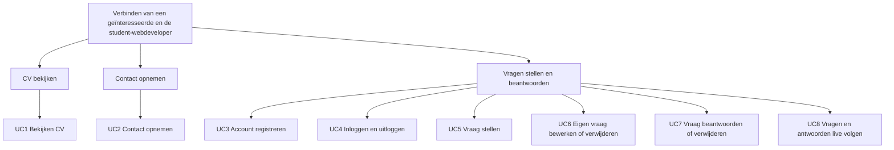
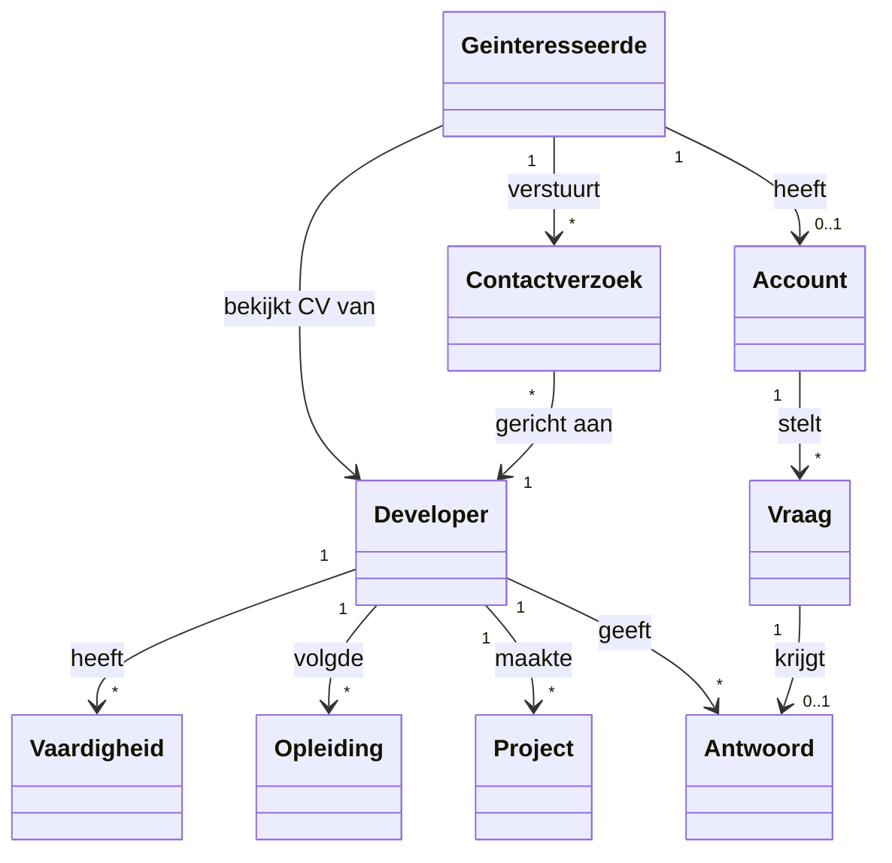
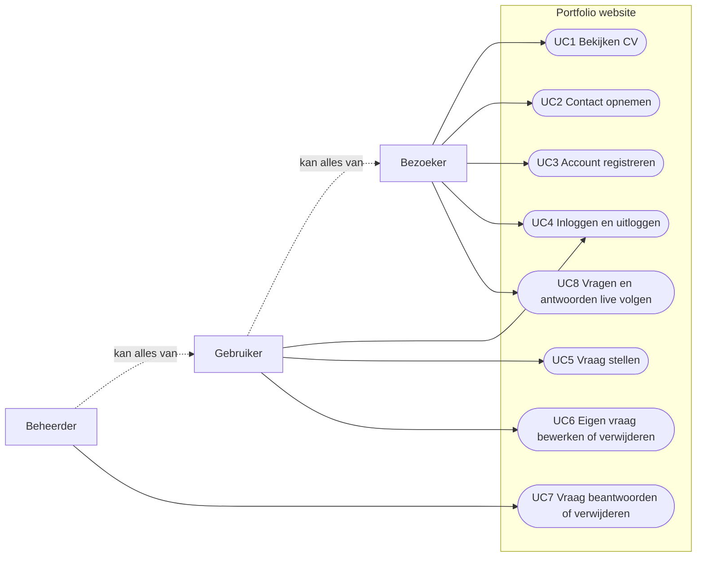

# Functioneel ontwerp portfoliowebsite

**Student:** Sebastiaan Kolmschate
**Opleiding:** HBO-ICT, Windesheim
**Module:** Client- en Server Technology
**Datum:** 19-10-2026

## 1. Distributie

| Versie | Datum      | Wijzigingen             | Ontvangers |
| ------ | ---------- | ----------------------- | ---------- |
| 1.0    | 19-10-2026 | Eerste volledige versie | Docent     |

## 2. Inleiding

Dit document beschrijft het functionele ontwerp van mijn portfolio website. Het bouwt voort op de
requirementsanalyse. Alle ID's (UC, FR, NFR, AS, SM) komen uit die analyse.

Het productdoel is het verbinden van een geïnteresseerde en de student-webdeveloper. UC1
(profielpagina) en UC2 (contactpagina) zijn door school gegeven. UC3 tot en met UC8 vormen mijn
eigen showcase: accounts met tweestapsverificatie en een "Ask me anything"-pagina met live
vragen en antwoorden.

Het productdoel valt uiteen in drie subdoelen, elk gerealiseerd door één of meer use cases.



_Figuur 1: Decompositie van het productdoel in subdoelen_

NFR8 tot en met NFR10 (testen en deployment) hebben geen schermen of scenario's. Ze staan in de
requirementsanalyse en het technisch ontwerp.

## 3. Domeinanalyse

### 3.1 Huidige situatie

In de tweede periode van het semester Web Development doet de student een opdracht voor een bedrijf.
Dat bedrijf, de geïnteresseerde, wil vooraf zien wat de student kan. Ik heb nu geen eigen online CV.
Een geïnteresseerde kan mijn vaardigheden, opleidingen en projecten dus nergens op één plek
bekijken. Er is ook geen vaste manier om contact op te nemen of een vraag te stellen over mijn werk.

### 3.2 Gewenste situatie

In de gewenste situatie heb ik een eigen website. Een geïnteresseerde ziet daar mijn naam, foto,
introductie, skills, opleidingen en projecten. Elk project heeft een eigen pagina. De gegevens
veranderen weinig. Ze worden daarom niet via de website beheerd (NFR1). De pagina laadt binnen één
seconde (NFR2).

Via een contactformulier stuurt een geïnteresseerde mij een bericht. Het bericht komt als e-mail
binnen. De website bewaart de gegevens niet (NFR6).

Op de "Ask me anything"-pagina kan iedereen vragen en antwoorden lezen. Wie een vraag wil stellen,
maakt een account aan en bevestigt zijn e-mailadres. Inloggen gaat met wachtwoord plus een
eenmalige code per e-mail. Zo komt elke vraag van een bevestigd adres en blijft spam beperkt. Als
beheerder beantwoord en verwijder ik vragen. Een gebruiker past zijn eigen vraag aan zolang die
onbeantwoord is. Wijzigingen verschijnen zonder herladen.

De site is minimalistisch, in een klassieke stijl en in het Engels, voor internationale
zichtbaarheid.

### 3.3 Domeinmodel



_Figuur 2: Domeinmodel van de gewenste situatie_

- **Geïnteresseerde**: iemand die wil weten wat de developer kan, bijvoorbeeld een bedrijf.
- **Developer**: de student-webdeveloper. Op de website is hij de beheerder.
- **Vaardigheid, Opleiding, Project**: de onderdelen van het CV.
- **Contactverzoek**: een bericht aan de developer. Het wordt gemaild en niet bewaard.
- **Account**: nodig om vragen te stellen. Rol gebruiker of beheerder; het beheerdersaccount is van
  de developer.
- **Vraag**: een openbare vraag van een accounthouder.
- **Antwoord**: de openbare reactie van de developer op één vraag.

### 3.4 Use case diagram



_Figuur 3: Use case diagram van de gewenste situatie_

Een gebruiker kan alles wat een bezoeker kan. Een beheerder kan alles wat een gebruiker kan. De
stippellijnen geven die generalisatie aan. E-mail (contactberichten en codes) gaat via een externe
maildienst. In de huidige omgevingen is dat de testinbox van Mailtrap.

## 4. Use cases

De schermontwerpen hieronder zijn tekstschetsen van de echte pagina's, van boven naar beneden. Elke
pagina heeft dezelfde kop: mijn naam (link naar de profielpagina), de links "Contact" en "Ask me
anything", en rechts daarvan "Log in" en "Register", of de naam van de ingelogde gebruiker met "Log
out".

### 4.1 UC1 Bekijken CV

| Use case naam           | Bekijken CV                                                                                                                                                                                                                                                                                                                       |
| ----------------------- | --------------------------------------------------------------------------------------------------------------------------------------------------------------------------------------------------------------------------------------------------------------------------------------------------------------------------------- |
| Actoren                 | Bezoeker                                                                                                                                                                                                                                                                                                                          |
| Samenvatting            | De bezoeker bekijkt het CV van de developer en de details van een project.                                                                                                                                                                                                                                                        |
| Precondities            | Er zijn geen precondities.                                                                                                                                                                                                                                                                                                        |
| Hoofdscenario           | 1. De bezoeker opent de profielpagina.<br>2. Het systeem toont naam, foto, introductie, projecten, skills en opleidingen.<br>3. De bezoeker kiest een project.<br>4. Het systeem toont de projectpagina met titel, samenvatting, links, afbeeldingen en beschrijving.                                                             |
| Alternatieve scenario's | 1a. De bezoeker heeft nog geen privacykeuze gemaakt.<br>1a1. Het systeem toont onderaan de privacymelding.<br>1a2. De bezoeker kiest "Accept" of "Decline".<br>1a3. Het systeem bewaart de keuze en verbergt de melding.<br>3a. De bezoeker opent een project dat niet bestaat.<br>3a1. Het systeem toont "404 - Page not found." |
| Postcondities           | Er zijn geen postcondities.                                                                                                                                                                                                                                                                                                       |

**Betrokken requirements**

| #    | Beschrijving                                                                                                   | MoSCoW |
| ---- | -------------------------------------------------------------------------------------------------------------- | ------ |
| FR1  | Profielpagina toont naam, foto en introductie                                                                  | Must   |
| FR2  | Profielpagina toont skills                                                                                     | Must   |
| FR3  | Profielpagina toont opleidingen                                                                                | Must   |
| FR4  | Profielpagina toont projecten, elk met een detailpagina                                                        | Should |
| NFR1 | Profielgegevens zijn niet via de website te beheren                                                            | Must   |
| NFR2 | Pagina's laden binnen 1 seconde                                                                                | Must   |
| NFR3 | Semantische HTML, mobile first en responsive                                                                   | Must   |
| NFR4 | GDPR-melding; keuze opgeslagen in localStorage; alleen getoond zolang er geen keuze is; stijl past bij de site | Must   |

**Schermontwerp**

```text
Profielpagina (/)
+--------------------------------------------------+
| Sebastiaan Henri Kolmschate                       |
| Contact  Ask me anything        Log in  Register  |
+--------------------------------------------------+
| [foto]  Introductietekst                          |
|                                                   |
| Projects                                          |
|   Projecttitel (link)                             |
|   Samenvatting                                    |
|   ... nieuwste project eerst                      |
|                                                   |
| Skills                                            |
|   (Typescript) (React) (Next.js) ...              |
|                                                   |
| Education                                         |
|   Opleiding                                       |
|   Instelling, plaats · beginjaar tot eindjaar         |
+--------------------------------------------------+
| Privacymelding (alleen zonder eerdere keuze)      |
| [ Accept ]  [ Decline ]                           |
+--------------------------------------------------+

Projectpagina (/projects/<slug>)
  Titel
  Samenvatting
  Links (openen in nieuw tabblad)
  Afbeeldingen
  Beschrijving in alinea's
```

Afwijking van de wireframe van school: die toont een blok "Personalia" met e-mailadres,
telefoonnummer, adres en LinkedIn. Ik toon alleen mijn naam. Reden: dataminimalisatie. Een adres en
telefoonnummer op een openbare pagina zijn niet nodig om het productdoel te halen. Contact loopt via
het formulier van UC2.

**Acceptatiecriteria**

- De profielpagina toont naam, foto, introductie, projecten, skills en opleidingen.
- Projecten en opleidingen staan in volgorde van nieuw naar oud.
- Elk project linkt naar een eigen pagina. Een onbekend project geeft de 404-pagina.
- Er is geen formulier om profielgegevens te wijzigen.
- De profielpagina laadt binnen 1 seconde.
- De pagina is bruikbaar op een telefoonscherm (375 px breed) en op desktop.
- Na "Accept" of "Decline" verschijnt de privacymelding niet meer, ook niet na herladen.

**Evil user stories**

Geen evil user stories. De pagina heeft geen invoer en toont alleen vaste gegevens. Dit volgt het
ontwerp van school.

### 4.2 UC2 Contact opnemen

| Use case naam           | Contact opnemen                                                                                                                                                                                                                                                                                                                                                                                                                                                                                                                                                                                                                                                                                                                                                                                                 |
| ----------------------- | --------------------------------------------------------------------------------------------------------------------------------------------------------------------------------------------------------------------------------------------------------------------------------------------------------------------------------------------------------------------------------------------------------------------------------------------------------------------------------------------------------------------------------------------------------------------------------------------------------------------------------------------------------------------------------------------------------------------------------------------------------------------------------------------------------------- |
| Actoren                 | Bezoeker                                                                                                                                                                                                                                                                                                                                                                                                                                                                                                                                                                                                                                                                                                                                                                                                        |
| Samenvatting            | De bezoeker vult het contactformulier in en verstuurt het. De developer ontvangt het bericht per e-mail.                                                                                                                                                                                                                                                                                                                                                                                                                                                                                                                                                                                                                                                                                                        |
| Precondities            | Er zijn geen precondities.                                                                                                                                                                                                                                                                                                                                                                                                                                                                                                                                                                                                                                                                                                                                                                                      |
| Hoofdscenario           | 1. De bezoeker opent de contactpagina.<br>2. Het systeem toont het formulier en een rekensom.<br>3. De bezoeker vult de velden in en beantwoordt de som.<br>4. Het systeem controleert de velden tijdens het typen en maakt de knop "Send" actief zodra alles geldig is.<br>5. De bezoeker klikt op "Send".<br>6. Het systeem toont een spinner en de tekst "Sending...".<br>7. Het systeem controleert de invoer en de som opnieuw en mailt het bericht naar de developer.<br>8. Het systeem toont "Thanks! Your message has been sent.", maakt het formulier leeg en toont een nieuwe som.                                                                                                                                                                                                                    |
| Alternatieve scenario's | 4a. Eén of meer velden zijn ongeldig.<br>4a1. Het systeem toont onder elk ongeldig veld wat er mis is, bijvoorbeeld "Invalid email address" of "Links are not allowed". De knop blijft uit.<br>4a2. De bezoeker past de velden aan. Verder bij stap 4.<br>7a. Het antwoord op de som is fout.<br>7a1. Het systeem toont onder de som "Wrong answer, try again" en "Your message was not sent. Please try again.". Het antwoordveld wordt leeggemaakt en er komt een nieuwe som. De overige velden blijven staan. Verder bij stap 3.<br>7b. De som is verlopen of al gebruikt.<br>7b1. Het systeem toont "This sum has expired, try the new one". Verder als 7a1.<br>7c. Het versturen van de e-mail mislukt.<br>7c1. Het systeem toont "Your message was not sent. Please try again.". De velden blijven staan. |
| Postcondities           | De developer heeft een e-mail met onderwerp "Contact form: " plus het onderwerp. Een antwoord op die e-mail gaat naar het adres van de bezoeker. Het systeem heeft niets opgeslagen. Het formulier is leeg.                                                                                                                                                                                                                                                                                                                                                                                                                                                                                                                                                                                                     |

**Betrokken requirements**

| #    | Beschrijving                                                                                                                                    | MoSCoW |
| ---- | ----------------------------------------------------------------------------------------------------------------------------------------------- | ------ |
| FR5  | Contactformulier met voornaam, achternaam, e-mail, telefoon, onderwerp en bericht                                                               | Must   |
| FR6  | Een verstuurd bericht komt als e-mail in de Mailtrap-inbox van de developer                                                                     | Must   |
| FR7  | Het contactformulier heeft een captcha (som)                                                                                                    | Must   |
| FR8  | De bezoeker krijgt feedback over het versturen: spinner, daarna flashmelding                                                                    | Must   |
| NFR5 | Na succesvol versturen is het contactformulier leeg                                                                                             | Must   |
| NFR6 | Contactgegevens worden niet opgeslagen                                                                                                          | Must   |
| NFR7 | Invoerlimieten client- én serverside: voornaam 60, achternaam 60, e-mail 80 (contact) of 254 (account), telefoon 20, onderwerp 200, bericht 600 | Must   |

**Schermontwerp**

```text
Contactpagina (/contact)
  Contact
  Send me a message and I will reply by email. Your details
  are only used to answer you.

  First name     [______________]
  Last name      [______________]
  Email          [______________]
  Phone number   [______________]
  Subject        [______________]
  Message        [______________]
                 [______________]
  What is 3 + 4? [____]
                 foutmelding in rood onder het veld

                                   [ (spinner) Send ]
                                   uit tot alles geldig is
  Thanks! Your message has been sent.   (verdwijnt na 6 s)
```

Regels per veld: alle velden zijn verplicht. Het telefoonnummer bevat alleen cijfers, spaties, +, -
en haakjes, minimaal 6 tekens. Het bericht mag geen HTML en geen links bevatten ("HTML is not
allowed", "Links are not allowed"). Het antwoord op de som is een getal van één of twee cijfers.

**Acceptatiecriteria**

- Het formulier bevat de zes velden van FR5 en een rekensom.
- Een ongeldig veld krijgt een rode melding eronder. De knop "Send" is uit tot alle velden geldig
  zijn.
- Invoer boven de limiet van NFR7 wordt client- én serverside geweigerd.
- Tijdens het versturen toont de knop een spinner en "Sending...".
- Na succes staat de e-mail in de Mailtrap-inbox en is het formulier leeg.
- De statusmelding verdwijnt na 6 seconden.
- Een fout antwoord op de som geeft een melding en een nieuwe som. Er wordt geen e-mail verstuurd.
- Een som kan maar één keer gebruikt worden en is 10 minuten geldig.

**Evil user stories**

| #    | Evil user story                                                                                                        | Mitigatie |
| ---- | ---------------------------------------------------------------------------------------------------------------------- | --------- |
| EUS1 | Als aanvaller wil ik scripts in de invoervelden zetten, zodat ze uitgevoerd worden bij wie het leest.                  | SM3, SM2  |
| EUS2 | Als aanvaller wil ik zeer lange invoer sturen, zodat het systeem overbelast raakt of crasht.                           | SM1       |
| EUS3 | Als aanvaller wil ik ongeldige data sturen, bijvoorbeeld door het formulier te omzeilen, om het systeem te ontregelen. | SM2       |
| EUS4 | Als aanvaller wil ik met een script automatisch veel berichten versturen, zodat de inbox volloopt met spam.            | SM5       |

### 4.3 UC3 Account registreren

| Use case naam           | Account registreren                                                                                                                                                                                                                                                                                                                                                                                                                                                                                                                                                                                                                                                                                                                                                                                                                                                                                |
| ----------------------- | -------------------------------------------------------------------------------------------------------------------------------------------------------------------------------------------------------------------------------------------------------------------------------------------------------------------------------------------------------------------------------------------------------------------------------------------------------------------------------------------------------------------------------------------------------------------------------------------------------------------------------------------------------------------------------------------------------------------------------------------------------------------------------------------------------------------------------------------------------------------------------------------------- |
| Actoren                 | Bezoeker                                                                                                                                                                                                                                                                                                                                                                                                                                                                                                                                                                                                                                                                                                                                                                                                                                                                                           |
| Samenvatting            | De bezoeker maakt een account aan en bevestigt zijn e-mailadres met een eenmalige code. Daarna is hij ingelogd als gebruiker.                                                                                                                                                                                                                                                                                                                                                                                                                                                                                                                                                                                                                                                                                                                                                                      |
| Precondities            | Er zijn geen precondities.                                                                                                                                                                                                                                                                                                                                                                                                                                                                                                                                                                                                                                                                                                                                                                                                                                                                         |
| Hoofdscenario           | 1. De bezoeker opent de registratiepagina.<br>2. De bezoeker vult e-mailadres, naam en wachtwoord in en klikt op "Create account".<br>3. Het systeem maakt een nog niet bevestigd account aan en mailt een code van zes cijfers.<br>4. Het systeem toont "We sent a 6-digit code to [e-mailadres]. It is valid for 5 minutes." en een veld voor de code.<br>5. De bezoeker vult de code in en klikt op "Continue".<br>6. Het systeem bevestigt het e-mailadres, logt de bezoeker in als gebruiker en opent de Ask me anything-pagina.                                                                                                                                                                                                                                                                                                                                                              |
| Alternatieve scenario's | 2a. Eén of meer velden zijn ongeldig.<br>2a1. Het systeem toont de melding onder het veld, bijvoorbeeld "Password must be at least 12 characters". Verder bij stap 2.<br>3a. Het e-mailadres hoort al bij een bevestigd account.<br>3a1. Het systeem verstuurt geen code, maar toont hetzelfde scherm als bij stap 4. Een code invoeren lukt dan niet.<br>3b. Het e-mailadres hoort bij een account dat nog niet bevestigd is.<br>3b1. Het systeem vervangt naam en wachtwoord en mailt een nieuwe code. Een eerdere code werkt niet meer. Verder bij stap 4.<br>3c. Het versturen van de e-mail mislukt.<br>3c1. Het systeem toont "Something went wrong. Please try again.".<br>5a. De code is fout, verlopen of al vijf keer fout geprobeerd.<br>5a1. Het systeem toont "This code is invalid or has expired.". Verder bij stap 5.<br>5b. De bezoeker klikt op "Start over". Verder bij stap 2. |
| Postcondities           | Er is een bevestigd account met de rol gebruiker. De bezoeker is ingelogd als gebruiker.                                                                                                                                                                                                                                                                                                                                                                                                                                                                                                                                                                                                                                                                                                                                                                                                           |

**Betrokken requirements**

| #     | Beschrijving                                                                                                   | MoSCoW |
| ----- | -------------------------------------------------------------------------------------------------------------- | ------ |
| FR9   | Account registreren met e-mailadres, weergavenaam en wachtwoord; e-mailadres bevestigen met een eenmalige code | Must   |
| FR16  | Twee rollen met verschillende rechten: gebruiker en beheerder                                                  | Must   |
| NFR7  | Invoerlimieten client- én serverside: wachtwoord 12 tot 128, weergavenaam 50                                   | Must   |
| NFR11 | Communicatie via HTTPS; sessiecookie httpOnly, Secure en SameSite=Strict                                       | Must   |

**Schermontwerp**

```text
Registratiepagina (/register), stap 1
  Register
  Create an account to ask me a question.
  Email      [______________]
  Name       [______________]
  Password   [______________]
                          [ Create account ]  -> "Creating account..."
  melding bij fout
  Already have an account? Log in

Stap 2 (zelfde pagina)
  We sent a 6-digit code to naam@voorbeeld.nl.
  It is valid for 5 minutes.
  Code       [______]
                          [ Continue ]  -> "Checking..."
  This code is invalid or has expired.
  Start over
```

De e-mail heeft als onderwerp "Verify your email address". In de huidige omgevingen komt hij in de
Mailtrap-testinbox terecht.

**Acceptatiecriteria**

- Registreren met een geldig adres, een naam en een wachtwoord van minstens 12 tekens geeft het
  codescherm.
- Een nieuw adres en een bestaand bevestigd adres geven dezelfde melding.
- Een juiste code binnen 5 minuten logt de bezoeker in en opent /ask. In de kop staat zijn naam.
- Een code werkt één keer. Na vijf foute pogingen werkt ook de juiste code niet meer.
- Een nieuw account heeft altijd de rol gebruiker.

**Evil user stories**

| #    | Evil user story                                                                                         | Mitigatie |
| ---- | ------------------------------------------------------------------------------------------------------- | --------- |
| EUS5 | Als aanvaller wil ik via het registratieformulier ontdekken welke e-mailadressen al een account hebben. | SM7       |
| EUS6 | Als aanvaller wil ik de bevestigingscode raden, zodat ik een account op andermans adres kan bevestigen. | SM6       |
| EUS7 | Als aanvaller wil ik bij registratie zelf de rol beheerder meesturen.                                   | SM2, SM8  |

### 4.4 UC4 Inloggen en uitloggen

| Use case naam           | Inloggen en uitloggen                                                                                                                                                                                                                                                                                                                                                                                                                                                                                                                                                                                                                                                                                                                                                                                                      |
| ----------------------- | -------------------------------------------------------------------------------------------------------------------------------------------------------------------------------------------------------------------------------------------------------------------------------------------------------------------------------------------------------------------------------------------------------------------------------------------------------------------------------------------------------------------------------------------------------------------------------------------------------------------------------------------------------------------------------------------------------------------------------------------------------------------------------------------------------------------------- |
| Actoren                 | Bezoeker (inloggen), Gebruiker en Beheerder (uitloggen)                                                                                                                                                                                                                                                                                                                                                                                                                                                                                                                                                                                                                                                                                                                                                                    |
| Samenvatting            | De bezoeker logt in met wachtwoord en een eenmalige code per e-mail. Een ingelogde gebruiker of beheerder logt weer uit.                                                                                                                                                                                                                                                                                                                                                                                                                                                                                                                                                                                                                                                                                                   |
| Precondities            | Voor inloggen: de bezoeker heeft een bevestigd account. Voor uitloggen: de gebruiker is ingelogd.                                                                                                                                                                                                                                                                                                                                                                                                                                                                                                                                                                                                                                                                                                                          |
| Hoofdscenario           | 1. De bezoeker opent de inlogpagina.<br>2. De bezoeker vult e-mailadres en wachtwoord in en klikt op "Log in".<br>3. Het systeem controleert de gegevens en mailt een code van zes cijfers.<br>4. Het systeem toont het codescherm.<br>5. De bezoeker vult de code in en klikt op "Continue".<br>6. Het systeem logt de bezoeker in voor één dag en opent de Ask me anything-pagina. De kop toont zijn naam, bij de beheerder met "(admin)", en "Log out".<br>7. De gebruiker klikt op "Log out".<br>8. Het systeem beëindigt de sessie en opent de profielpagina. De kop toont weer "Log in" en "Register".                                                                                                                                                                                                               |
| Alternatieve scenario's | 2a. Een veld is leeg of ongeldig.<br>2a1. Het systeem toont de melding onder het veld, bijvoorbeeld "Password is required".<br>3a. Het e-mailadres is onbekend, het wachtwoord is fout of het account is niet bevestigd.<br>3a1. Het systeem toont in alle gevallen "Invalid email or password.". Verder bij stap 2.<br>3b. Het versturen van de e-mail mislukt.<br>3b1. Het systeem toont "Something went wrong. Please try again.".<br>5a. De code is fout, verlopen of al vijf keer fout geprobeerd.<br>5a1. Het systeem toont "This code is invalid or has expired.".<br>5b. De gebruiker klikt op "Start over". Verder bij stap 2.<br>6a. De sessie is na één dag verlopen.<br>6a1. Een actie waarvoor inloggen nodig is, wordt geweigerd. Het vraagformulier toont "Your session has expired. Please log in again.". |
| Postcondities           | Na inloggen: de gebruiker heeft een sessie met zijn rol. Na uitloggen: er is geen sessie meer.                                                                                                                                                                                                                                                                                                                                                                                                                                                                                                                                                                                                                                                                                                                             |

**Betrokken requirements**

| #     | Beschrijving                                                             | MoSCoW |
| ----- | ------------------------------------------------------------------------ | ------ |
| FR10  | Inloggen met wachtwoord plus een eenmalige e-mailcode (2FA)              | Must   |
| FR11  | Uitloggen                                                                | Must   |
| FR16  | Twee rollen met verschillende rechten: gebruiker en beheerder            | Must   |
| NFR7  | Invoerlimieten client- én serverside: wachtwoord maximaal 128            | Must   |
| NFR11 | Communicatie via HTTPS; sessiecookie httpOnly, Secure en SameSite=Strict | Must   |

**Schermontwerp**

```text
Inlogpagina (/login), stap 1
  Log in
  Email      [______________]
  Password   [______________]
                          [ Log in ]  -> "Checking..."
  Invalid email or password.
  No account yet? Register

Stap 2: hetzelfde codescherm als bij UC3

Kop na inloggen
  Sebastiaan Henri Kolmschate
  Contact  Ask me anything        Naam (admin)  Log out
```

De e-mail heeft als onderwerp "Your login code". Een nieuwe code maakt een eerdere code ongeldig.

**Acceptatiecriteria**

- Een juist wachtwoord geeft het codescherm. Er is dan nog geen sessie.
- Een fout wachtwoord en een onbekend adres geven dezelfde melding.
- Een juiste code binnen 5 minuten logt in en opent /ask.
- De sessie is één dag geldig. Het sessiecookie is niet leesbaar voor JavaScript.
- Na "Log out" is de sessie weg en toont de kop "Log in" en "Register".

**Evil user stories**

| #     | Evil user story                                                                                                                | Mitigatie |
| ----- | ------------------------------------------------------------------------------------------------------------------------------ | --------- |
| EUS8  | Als aanvaller wil ik via het inlogformulier ontdekken welke e-mailadressen een account hebben, aan de melding of de wachttijd. | SM7       |
| EUS9  | Als aanvaller wil ik veel wachtwoorden achter elkaar proberen tot er één klopt.                                                | SM6       |
| EUS10 | Als aanvaller wil ik de inlogcode raden, nadat ik een wachtwoord heb buitgemaakt.                                              | SM6       |
| EUS11 | Als aanvaller wil ik het sessiecookie stelen of een verzoek laten versturen vanaf een andere site.                             | SM9       |

Bij EUS9: er is geen limiet op het aantal wachtwoordpogingen. bcrypt maakt elke poging traag. Een
geraden wachtwoord alleen geeft ook geen toegang, want daarna is nog de code uit de e-mail nodig.

### 4.5 UC5 Vraag stellen

| Use case naam           | Vraag stellen                                                                                                                                                                                                                                                                                                                                                                                                            |
| ----------------------- | ------------------------------------------------------------------------------------------------------------------------------------------------------------------------------------------------------------------------------------------------------------------------------------------------------------------------------------------------------------------------------------------------------------------------ |
| Actoren                 | Gebruiker                                                                                                                                                                                                                                                                                                                                                                                                                |
| Samenvatting            | Een ingelogde gebruiker stelt een openbare vraag aan de developer.                                                                                                                                                                                                                                                                                                                                                       |
| Precondities            | De gebruiker is ingelogd.                                                                                                                                                                                                                                                                                                                                                                                                |
| Hoofdscenario           | 1. De gebruiker opent de Ask me anything-pagina.<br>2. Het systeem toont het vraagformulier en de lijst met vragen.<br>3. De gebruiker typt een vraag en klikt op "Ask".<br>4. Het systeem bewaart de vraag met de gebruiker als auteur.<br>5. Het systeem maakt het formulier leeg en toont de vraag bovenaan de lijst, met naam en datum.                                                                              |
| Alternatieve scenario's | 1a. De bezoeker is niet ingelogd.<br>1a1. Het systeem toont geen formulier, maar "Log in or create an account to ask a question." met links naar inloggen en registreren.<br>3a. De vraag is leeg of te lang.<br>3a1. Het systeem toont "Question is required" of "Question must be less than 500 characters".<br>4a. De sessie is verlopen.<br>4a1. Het systeem toont "Your session has expired. Please log in again.". |
| Postcondities           | De vraag staat in de lijst en is voor iedereen zichtbaar, ook zonder herladen (UC8).                                                                                                                                                                                                                                                                                                                                     |

**Betrokken requirements**

| #    | Beschrijving                                                  | MoSCoW |
| ---- | ------------------------------------------------------------- | ------ |
| FR12 | Een ingelogde gebruiker stelt een vraag                       | Must   |
| FR16 | Twee rollen met verschillende rechten: gebruiker en beheerder | Must   |
| NFR7 | Invoerlimieten client- én serverside: vraag 500               | Must   |

**Schermontwerp**

```text
Ask me anything (/ask), ingelogd als gebruiker
  Ask me anything
  Curious about a project, how I work or what I am up to? Ask away.
  Your question
  [Ask me anything about my work...      ]
  [                                      ]
                                  [ Ask ]  -> "Sending..."
  Questions
  - zie UC8 voor de lijst

Niet ingelogd: in plaats van het formulier
  Log in or create an account to ask a question.
```

**Acceptatiecriteria**

- Alleen een ingelogde gebruiker ziet het vraagformulier.
- Een vraag van 1 tot 500 tekens wordt opgeslagen en verschijnt bovenaan.
- De auteur van een vraag is altijd de ingelogde gebruiker.
- Een verzoek zonder geldige sessie wordt geweigerd met status 401.

**Evil user stories**

| #     | Evil user story                                                                                            | Mitigatie |
| ----- | ---------------------------------------------------------------------------------------------------------- | --------- |
| EUS12 | Als aanvaller wil ik een vraag plaatsen namens een ander door zelf een auteur-id in het verzoek te zetten. | SM8       |
| EUS13 | Als aanvaller wil ik zonder account een vraag plaatsen door de server rechtstreeks aan te roepen.          | SM8, SM9  |
| EUS14 | Als aanvaller wil ik een script in mijn vraag zetten, zodat het bij andere bezoekers wordt uitgevoerd.     | SM3       |

### 4.6 UC6 Eigen vraag bewerken of verwijderen

| Use case naam           | Eigen vraag bewerken of verwijderen                                                                                                                                                                                                                                                                                                                                                                                                                                                                                                                              |
| ----------------------- | ---------------------------------------------------------------------------------------------------------------------------------------------------------------------------------------------------------------------------------------------------------------------------------------------------------------------------------------------------------------------------------------------------------------------------------------------------------------------------------------------------------------------------------------------------------------- |
| Actoren                 | Gebruiker                                                                                                                                                                                                                                                                                                                                                                                                                                                                                                                                                        |
| Samenvatting            | De gebruiker past zijn eigen vraag aan zolang die onbeantwoord is, of verwijdert zijn eigen vraag.                                                                                                                                                                                                                                                                                                                                                                                                                                                               |
| Precondities            | De gebruiker is ingelogd en heeft een vraag gesteld.                                                                                                                                                                                                                                                                                                                                                                                                                                                                                                             |
| Hoofdscenario           | Bewerken:<br>1. De gebruiker klikt bij zijn eigen, onbeantwoorde vraag op "Edit".<br>2. Het systeem toont een tekstveld "Edit your question" met de huidige tekst.<br>3. De gebruiker past de tekst aan en klikt op "Save".<br>4. Het systeem bewaart de nieuwe tekst en toont de vraag weer.<br>Verwijderen:<br>5. De gebruiker klikt bij zijn eigen vraag op "Delete".<br>6. Het systeem verwijdert de vraag, met een eventueel antwoord, direct uit de lijst.                                                                                                 |
| Alternatieve scenario's | 1a. De vraag is al beantwoord.<br>1a1. Het systeem toont geen knop "Edit". Alleen "Delete" is beschikbaar.<br>3a. De gebruiker klikt op "Cancel".<br>3a1. Het systeem sluit het tekstveld zonder wijziging.<br>4a. De vraag is intussen beantwoord.<br>4a1. Het systeem toont "This question has already been answered".<br>4b. De vraag is intussen verwijderd.<br>4b1. Het systeem toont "Question not found".<br>4c. De tekst is leeg of langer dan 500 tekens.<br>4c1. Het systeem verstuurt niets en toont de melding, bijvoorbeeld "Question is required". |
| Postcondities           | De vraag is gewijzigd of verwijderd. Andere bezoekers zien dit zonder herladen (UC8).                                                                                                                                                                                                                                                                                                                                                                                                                                                                            |

**Betrokken requirements**

| #    | Beschrijving                                                                                      | MoSCoW |
| ---- | ------------------------------------------------------------------------------------------------- | ------ |
| FR13 | Een gebruiker bewerkt zijn eigen vraag zolang die onbeantwoord is, en verwijdert zijn eigen vraag | Should |
| FR16 | Twee rollen met verschillende rechten: gebruiker en beheerder                                     | Must   |
| NFR7 | Invoerlimieten client- én serverside: vraag 500                                                   | Must   |

**Schermontwerp**

```text
Eigen vraag in de lijst (onbeantwoord)
  Tekst van de vraag
  Naam, 19 October 2026
  Edit  Delete

Na "Edit"
  Edit your question
  [huidige tekst                          ]
                         Cancel  [ Save ]  -> "Saving..."
  This question has already been answered
```

**Acceptatiecriteria**

- "Edit" staat alleen bij een eigen, onbeantwoorde vraag. "Delete" staat bij elke eigen vraag.
- Bij andermans vraag staan geen knoppen.
- Bewerken van een beantwoorde vraag geeft status 409.
- Bewerken of verwijderen van andermans vraag via een eigen verzoek geeft status 403.

**Evil user stories**

| #     | Evil user story                                                                                                                     | Mitigatie |
| ----- | ----------------------------------------------------------------------------------------------------------------------------------- | --------- |
| EUS15 | Als aanvaller wil ik het id in het verzoek vervangen door dat van andermans vraag, zodat ik die kan wijzigen of verwijderen (IDOR). | SM8       |
| EUS16 | Als aanvaller wil ik mijn vraag na het antwoord nog aanpassen, zodat het antwoord ergens anders over lijkt te gaan.                 | SM8       |

### 4.7 UC7 Vraag beantwoorden of verwijderen (beheerder)

| Use case naam           | Vraag beantwoorden of verwijderen                                                                                                                                                                                                                                                                                                                                                                                                                                                                                                  |
| ----------------------- | ---------------------------------------------------------------------------------------------------------------------------------------------------------------------------------------------------------------------------------------------------------------------------------------------------------------------------------------------------------------------------------------------------------------------------------------------------------------------------------------------------------------------------------- |
| Actoren                 | Beheerder                                                                                                                                                                                                                                                                                                                                                                                                                                                                                                                          |
| Samenvatting            | De beheerder beantwoordt een vraag, wijzigt een bestaand antwoord of verwijdert een vraag.                                                                                                                                                                                                                                                                                                                                                                                                                                         |
| Precondities            | De beheerder is ingelogd. Het beheerdersaccount bestaat alleen via het seed-script.                                                                                                                                                                                                                                                                                                                                                                                                                                                |
| Hoofdscenario           | 1. De beheerder opent de Ask me anything-pagina.<br>2. Het systeem toont bij elke vraag "Answer" (of "Edit answer") en "Delete".<br>3. De beheerder klikt op "Answer".<br>4. Het systeem toont een tekstveld "Your answer".<br>5. De beheerder typt het antwoord en klikt op "Save".<br>6. Het systeem bewaart het antwoord en toont het onder de vraag, met "Answered on" en de datum.                                                                                                                                            |
| Alternatieve scenario's | 3a. De vraag heeft al een antwoord.<br>3a1. De knop heet "Edit answer". Het tekstveld bevat het huidige antwoord. Verder bij stap 5.<br>3b. De beheerder klikt op "Delete".<br>3b1. Het systeem verwijdert de vraag direct.<br>5a. De beheerder klikt op "Cancel". Het tekstveld sluit.<br>6a. De vraag is intussen verwijderd.<br>6a1. Het systeem toont "Question not found".<br>6b. Het antwoord is leeg of langer dan 2000 tekens.<br>6b1. Het systeem verstuurt niets en toont de melding, bijvoorbeeld "Answer is required". |
| Postcondities           | De vraag heeft een antwoord of is verwijderd. De auteur kan een beantwoorde vraag niet meer bewerken.                                                                                                                                                                                                                                                                                                                                                                                                                              |

**Betrokken requirements**

| #    | Beschrijving                                                                        | MoSCoW |
| ---- | ----------------------------------------------------------------------------------- | ------ |
| FR14 | De beheerder beantwoordt een vraag (ook antwoord wijzigen) en verwijdert elke vraag | Must   |
| FR16 | Twee rollen met verschillende rechten: gebruiker en beheerder                       | Must   |
| NFR7 | Invoerlimieten client- én serverside: antwoord 2000                                 | Must   |

**Schermontwerp**

```text
Vraag in de lijst, ingelogd als beheerder
  Tekst van de vraag
  Naam, 19 October 2026
  | Tekst van het antwoord
  | Answered on 19 October 2026
  Edit answer  Delete            ("Answer" als er nog geen antwoord is)

Na "Answer"
  Your answer
  [                                       ]
                         Cancel  [ Save ]  -> "Saving..."
```

**Acceptatiecriteria**

- Alleen de beheerder ziet "Answer", "Edit answer" en "Delete" bij andermans vragen.
- Een antwoord van 1 tot 2000 tekens verschijnt onder de vraag met de datum.
- Een antwoordverzoek van een gewone gebruiker geeft status 403.
- De beheerder kan de tekst van andermans vraag niet wijzigen (status 403).

**Evil user stories**

| #     | Evil user story                                                                                                       | Mitigatie |
| ----- | --------------------------------------------------------------------------------------------------------------------- | --------- |
| EUS17 | Als gebruiker wil ik zelf een antwoord plaatsen alsof ik de beheerder ben, door de server rechtstreeks aan te roepen. | SM8       |
| EUS18 | Als gebruiker wil ik mijn sessie aanpassen, zodat er de rol beheerder in staat.                                       | SM9       |

### 4.8 UC8 Vragen en antwoorden live volgen

| Use case naam           | Vragen en antwoorden live volgen                                                                                                                                                                                                                                                                                                                                                                                                                |
| ----------------------- | ----------------------------------------------------------------------------------------------------------------------------------------------------------------------------------------------------------------------------------------------------------------------------------------------------------------------------------------------------------------------------------------------------------------------------------------------- |
| Actoren                 | Bezoeker, Gebruiker, Beheerder                                                                                                                                                                                                                                                                                                                                                                                                                  |
| Samenvatting            | Iedereen leest de vragen en antwoorden. Wijzigingen van anderen verschijnen zonder herladen.                                                                                                                                                                                                                                                                                                                                                    |
| Precondities            | Er zijn geen precondities.                                                                                                                                                                                                                                                                                                                                                                                                                      |
| Hoofdscenario           | 1. De bezoeker opent de Ask me anything-pagina.<br>2. Het systeem toont alle vragen, nieuwste eerst, met naam van de auteur, datum en eventueel antwoord.<br>3. De pagina opent een live-verbinding met de server.<br>4. Iemand stelt, wijzigt, beantwoordt of verwijdert een vraag.<br>5. De server meldt alleen dát er iets veranderd is.<br>6. De pagina haalt de lijst opnieuw op, met de rechten van deze bezoeker, en toont de wijziging. |
| Alternatieve scenario's | 2a. Er zijn nog geen vragen.<br>2a1. Het systeem toont "No questions yet. Be the first to ask one.".<br>3a. De verbinding valt weg.<br>3a1. De browser maakt na 3 seconden opnieuw verbinding. Een schermlezer hoort "Connecting to live updates" en daarna "Live updates on".                                                                                                                                                                  |
| Postcondities           | Er zijn geen postcondities.                                                                                                                                                                                                                                                                                                                                                                                                                     |

**Betrokken requirements**

| #    | Beschrijving                                                                                | MoSCoW |
| ---- | ------------------------------------------------------------------------------------------- | ------ |
| FR15 | Iedereen ziet vragen en antwoorden; nieuwe en gewijzigde vragen verschijnen zonder herladen | Must   |

**Schermontwerp**

```text
Ask me anything (/ask), lijst
  Questions
  (onzichtbaar, voor schermlezers: "Live updates on")

  Tekst van de nieuwste vraag
  Naam, 19 October 2026
  | Antwoord
  | Answered on 19 October 2026

  Tekst van een oudere vraag
  Naam, 18 October 2026
```

Een bezoeker ziet alleen de knoppen waar hij recht op heeft (zie hoofdstuk 5). E-mailadressen van
auteurs staan nergens op de pagina.

**Acceptatiecriteria**

- Een niet-ingelogde bezoeker ziet alle vragen en antwoorden.
- Een vraag die in een ander venster wordt gesteld, beantwoord of verwijderd, is binnen enkele
  seconden zichtbaar zonder herladen.
- De live-verbinding bevat alleen het soort wijziging en het id van de vraag, geen tekst en geen
  namen.
- Na het wegvallen van de verbinding herstelt die zichzelf.

**Evil user stories**

| #     | Evil user story                                                                                                           | Mitigatie |
| ----- | ------------------------------------------------------------------------------------------------------------------------- | --------- |
| EUS19 | Als aanvaller wil ik de live-verbinding afluisteren om e-mailadressen of andere privégegevens van vraagstellers te lezen. | SM10      |

## 5. Rollen en rechten

De tabel toont wat elke rol mag. Een ✓ betekent toegestaan. Een statuscode is het antwoord van de
server als iemand het toch probeert, bijvoorbeeld door het verzoek zelf te sturen. De interface
toont knoppen alleen als de actie is toegestaan. De server controleert het altijd opnieuw, met de
rol en het id uit de sessie.

| Actie                                         | Bezoeker | Gebruiker | Beheerder |
| --------------------------------------------- | -------- | --------- | --------- |
| CV en projecten bekijken (UC1)                | ✓        | ✓         | ✓         |
| Contactformulier versturen (UC2)              | ✓        | ✓         | ✓         |
| Account registreren (UC3)                     | ✓        | n.v.t.    | n.v.t.    |
| Inloggen (UC4)                                | ✓        | n.v.t.    | n.v.t.    |
| Uitloggen (UC4)                               | n.v.t.   | ✓         | ✓         |
| Vragen en antwoorden lezen, live (UC8)        | ✓        | ✓         | ✓         |
| Vraag stellen (UC5)                           | 401      | ✓         | ✓         |
| Eigen vraag bewerken, onbeantwoord (UC6)      | 401      | ✓         | ✓         |
| Eigen vraag bewerken, beantwoord (UC6)        | 401      | 409       | 409       |
| Andermans vraag bewerken                      | 401      | 403       | 403       |
| Eigen vraag verwijderen (UC6)                 | 401      | ✓         | ✓         |
| Andermans vraag verwijderen (UC7)             | 401      | 403       | ✓         |
| Vraag beantwoorden of antwoord wijzigen (UC7) | 401      | 403       | ✓         |

Een vraag die niet bestaat geeft 404. Ongeldige invoer geeft 400 met een melding per veld. Het
beheerdersaccount wordt alleen aangemaakt met het seed-script; via registratie krijgt een account
altijd de rol gebruiker.

## 6. Principes

Deze regels gelden voor alle formulieren en pagina's.

- **Taal.** De hele interface is in het Engels. Datums staan als "19 October 2026".
- **Labels.** Elk veld heeft een zichtbaar label boven het veld.
- **Validatie op twee plekken.** De browser en de server gebruiken hetzelfde schema met dezelfde
  limieten (NFR7). De server controleert altijd opnieuw. Ongeldige invoer geeft status 400 met
  meldingen per veld.
- **Foutmelding onder het veld.** Een ongeldig veld krijgt een rode melding direct eronder. Het
  veld krijgt `aria-invalid` en verwijst met `aria-describedby` naar de melding, zodat een
  schermlezer die voorleest.
- **Knop tijdens versturen.** De verzendknop staat uit zolang een verzoek loopt en toont wat er
  gebeurt: "Sending...", "Checking...", "Creating account..." of "Saving...". Het contactformulier
  toont daarbij een spinner en houdt de knop uit tot alle velden geldig zijn.
- **Statusmelding.** Een fout staat onder het formulier met `role="alert"`. Een succesmelding heeft
  `role="status"`. De melding van het contactformulier is een flashmelding die na 6 seconden
  verdwijnt.
- **Geen gevoelige details in meldingen.** Meldingen verraden niet of een e-mailadres bestaat. Bij
  een serverfout toont de pagina "Something went wrong. Please try again.".
- **Leegmaken alleen na succes.** Bij een fout blijft de invoer staan.
- **Volledige herlading na in- en uitloggen.** Zo toont de kop direct de juiste status.

**Bekende afwijking.** Verwijderen gebeurt zonder bevestigingsvraag.
