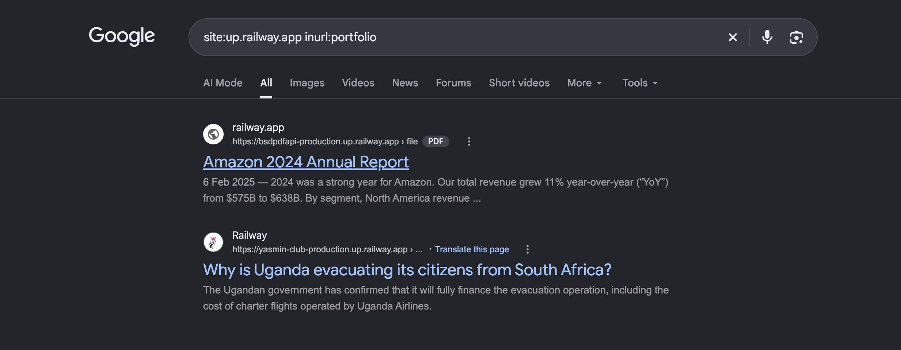
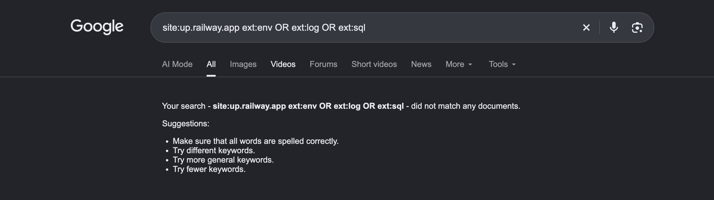
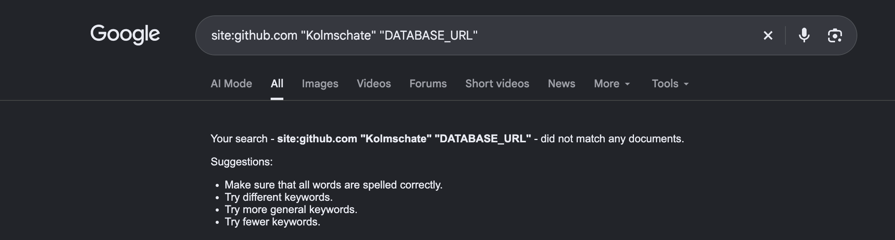
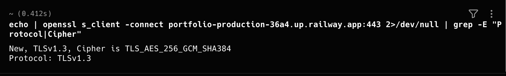
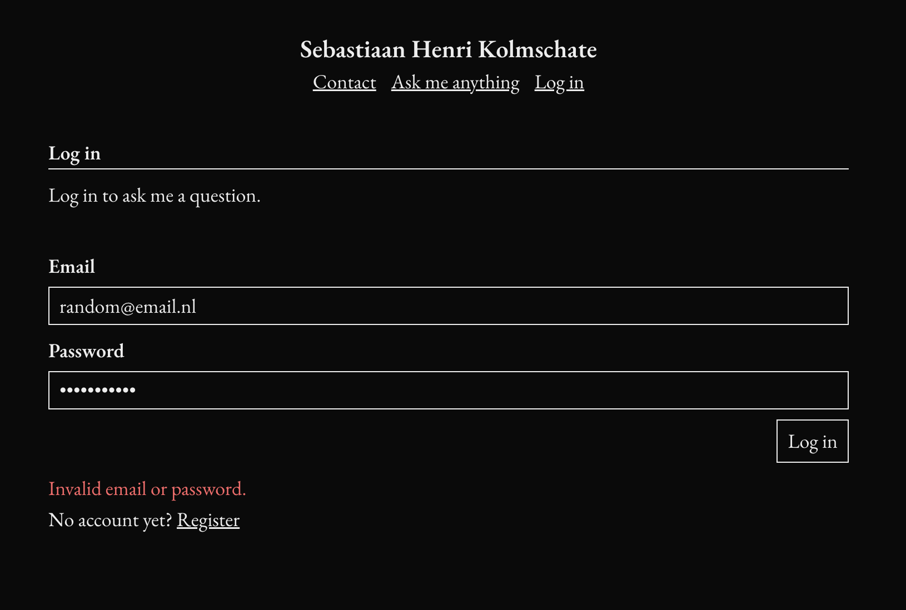
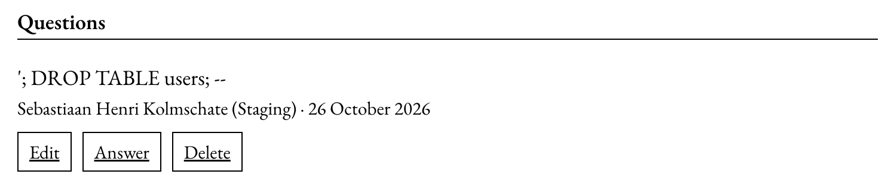

# Ask me anything

# Securityportfolio

Security for Web Applications

Sebastiaan Kolmschate (S1148925)
HBO-ICT, Windesheim
Versie 1.1, 26-10-2026
Voor dit portfolio geldt AIAS niveau 3: AI-samenwerking. Tijdens de ontwikkeling van dit werk heb ik AI-toepassingen gebruikt; de verantwoording staat in bijlage A.

## Revisietabel

| Versie | Datum      | Wijzigingen                                                                                                                                     | Auteur                |
| ------ | ---------- | ----------------------------------------------------------------------------------------------------------------------------------------------- | --------------------- |
| 1.0    | 20-10-2026 | Eerste volledige versie                                                                                                                         | Sebastiaan Kolmschate |
| 1.1    | 26-10-2026 | Actualiteit (H1), TLS-test (4.11), securityreview en advies (H5), ethiek (H6), ASVS-lijst, AI-verantwoording; claims gecorrigeerd na codereview | Sebastiaan Kolmschate |

## Inleiding

Dit portfolio laat zien hoe ik de website "Ask me anything" veilig heb gebouwd. De website heeft een profielpagina (UC1), een contactpagina (UC2) en een showcase waarin bezoekers met een account vragen stellen die de beheerder live beantwoordt (UC3 tot en met UC8).

Dit portfolio volgt de indeling van het portfoliotemplate: elk hoofdstuk hoort bij één criterium uit de rubric. Hoofdstuk 1 gaat over de actualiteit, hoofdstuk 2 over de risico's en het threat modeling, hoofdstuk 3 over de DTAP-straat en hoofdstuk 4 over de securitymaatregelen in de code en de tests daarvan. Hoofdstuk 5 bevat mijn securityreview met oordeel en advies, en paragraaf 5.3 de ethische afwegingen. Bijlage A verantwoordt mijn gebruik van AI.

Bij het bouwen heb ik de Secure Software Development Life Cycle van Snyk uit de studentenhandleiding gevolgd (Hogeschool Windesheim, 2024), met OWASP ASVS 4.0.3 als kader (OWASP Foundation, 2021).

De nummers komen overeen met de andere documenten: assets (AS), risico's (RSK) en maatregelen (SM) uit de requirementsanalyse, en de use cases (UC) uit het functioneel ontwerp.

## 1. Bijhouden van actualiteit (Analyseren, Adviseren)

Mijn site draait op Next.js en React. Zit er een lek in dat framework, dan zit het ook in mijn site, hoe netjes mijn eigen code ook is. Daarom houd ik de security-advisories van Next.js op GitHub bij en lees ik wat securitybedrijven erover schrijven. Twee hacks en de advisories van deze maand heb ik naast mijn eigen site gelegd.

### 1.1 Recente hack 1: React2Shell (december 2025)

**Tabel 1.** _React2Shell langs de vragen van de risicoanalyse_

| Vraag                    | Antwoord                                                                                                                                                                                                                                                                                        |
| ------------------------ | ----------------------------------------------------------------------------------------------------------------------------------------------------------------------------------------------------------------------------------------------------------------------------------------------- |
| Wat gebeurde er?         | Een fout in React Server Components (CVE-2025-55182, CVSS 10) liet een aanvaller zonder inloggen code uitvoeren op de server, met één verzoek. Binnen enkele uren na publicatie werd hij massaal misbruikt; CISA zette hem op 5 december 2025 op de lijst van actief misbruikte kwetsbaarheden. |
| Kwetsbaarheid            | Onveilige deserialisatie: de server vertrouwde de structuur van binnenkomende data.                                                                                                                                                                                                             |
| Asset en schade          | De server zelf. Aanvallers installeerden cryptominers en backdoors en zochten naar cloudsleutels.                                                                                                                                                                                               |
| CIA                      | Vertrouwelijkheid (geheimen en data uitlezen), integriteit (code en data wijzigen) en beschikbaarheid (server misbruikt voor mining).                                                                                                                                                           |
| Relevant voor mijn site? | Ja. Mijn site gebruikt de App Router van Next.js 16, precies de getroffen combinatie. Een standaard Next.js-app was zonder aanpassingen kwetsbaar.                                                                                                                                              |
| Maatregel voor mijn site | Next.js up-to-date houden (de versie die ik gebruik bevat de fix), Dependabot-meldingen aan, en geheimen alleen in omgevingsvariabelen van Railway, zodat een aanvaller op de server niet ook bij mijn repository of andere omgevingen kan.                                                     |

Bronnen: Tikochinski et al. (2025), Tafani-Dereeper et al. (2025) en Pham et al. (2025).

### 1.2 Recente hack 2: autorisatie omzeilen via de middleware van Next.js (maart 2025)

**Tabel 2.** _Middleware-bypass van Next.js langs de vragen van de risicoanalyse_

| Vraag                    | Antwoord                                                                                                                                                                                                                         |
| ------------------------ | -------------------------------------------------------------------------------------------------------------------------------------------------------------------------------------------------------------------------------- |
| Wat gebeurde er?         | Met één extra, speciaal gekozen header in het verzoek kon een aanvaller de middleware van Next.js overslaan (CVE-2025-29927, CVSS 9.1). Sites die daar hun inlogcontrole deden, lieten beschermde pagina's zonder inloggen zien. |
| Kwetsbaarheid            | Toegangscontrole op één plek aan de rand van de applicatie, die met een door de client gestuurde header uit te zetten was.                                                                                                       |
| Asset en schade          | Beheerpagina's en gegevens achter een login.                                                                                                                                                                                     |
| CIA                      | Vertrouwelijkheid en integriteit.                                                                                                                                                                                                |
| Relevant voor mijn site? | Het type fout wel, deze versie niet meer. Het laat zien waarom ik rechten niet alleen in middleware of in de pagina controleer.                                                                                                  |
| Maatregel voor mijn site | Mijn site heeft geen middleware. Elke API-route en de datalaag controleren zelf de sessie en de rol (SM8, 4.3). Valt één laag weg, dan staat de controle in de volgende laag nog steeds (defense in depth).                      |

Bronnen: Chaddha (2025) en Baguelin et al. (2025).

### 1.3 Mijn eigen situatie: Next.js-advisories van oktober 2026

Op 14 oktober 2026 bracht Next.js een extra security-release uit; de advisories staan sinds 22 oktober in de GitHub Advisory Database. Mijn versie (16.3.8) valt in het getroffen bereik (16.0.0 tot en met 16.4.0):

**Tabel 3.** _Next.js-advisories van oktober 2026 en wat ze voor mijn site betekenen_

| Advisory            | Ernst   | Wat                                                              | Raakt het mij?                                                                                                                               |
| ------------------- | ------- | ---------------------------------------------------------------- | -------------------------------------------------------------------------------------------------------------------------------------------- |
| GHSA-2464-fhr4-w9xw | Kritiek | Code uitvoeren op de server via een SVG in de beeldoptimalisatie | Klein: ik optimaliseer alleen eigen JPG- en PNG-bestanden en sta geen SVG of externe afbeeldingen toe. Maar de functie draait wel, op Linux. |
| GHSA-673q-mjm6-r5xr | Kritiek | Code uitvoeren via de cachefunctie van Next.js                   | Nee: ik gebruik die cachefunctie niet.                                                                                                       |

Ook als ik de fout niet direct kan misbruiken, update ik: de volgende variant is misschien wel bereikbaar, en aanvallers scannen juist op bekende kwetsbare versies. Dit is hetzelfde patroon als in 3.3, waar de dependency-audit een kritieke fout in de beeldoptimalisatie vond.

Op 26 oktober 2026 heb ik Next.js en eslint-config-next op een aparte branch bijgewerkt naar 16.4.1. De dependency-audit liet daarna nog twee packages zien die in productie draaien en die ik binnen hun versiebereik kon repareren. Zod (onder 4.6.6) kon bij het valideren het geheugen laten vollopen, en Zod controleert al mijn invoer. Nodemailer (onder 10.1.4) las e-mailadressen soms verkeerd uit, terwijl bij mij het adres van de bezoeker als reply-to meegaat. Die twee staan nu op 4.6.7 en 10.2.1.

**Tabel 4.** _Controles vóór en na de update naar Next.js 16.4.1_

| Controle               | Vóór (16.3.8)                                             | Na (16.4.1)                                       |
| ---------------------- | --------------------------------------------------------- | ------------------------------------------------- |
| Dependency-audit       | 13 meldingen: 2 kritiek, 6 hoog                           | 7 meldingen: 0 kritiek, 5 hoog, 2 middel          |
| Lint, opmaak           | groen                                                     | groen (dezelfde 2 bestaande waarschuwingen)       |
| Back-endtests (Vitest) | Alle 65 geslaagd (in CI)                                  | Alle 65 geslaagd                                  |
| Cypress-tests          | Alle 17 end-to-end- en 10 componenttests geslaagd (in CI) | Alle 17 end-to-end- en 10 componenttests geslaagd |
| Productiebuild         | slaagt (CI)                                               | slaagt                                            |

De overgebleven meldingen zitten in bouw- en ontwikkeltools (PostCSS, source-map-js, nanoid), in de database-CLI van Prisma (mysql2, deepmerge-ts) en in een eigen kopie van Zod binnen de ESLint-plugin. Geen daarvan verwerkt invoer van bezoekers. De update staat sinds 26 oktober 2026 in develop (pull request #42, gemerged nadat alle verplichte CI-checks groen waren). De automatische deploy naar staging liep die avond vast door een storing bij Railway; staging en productie draaiden op het moment van inleveren nog op 16.3.8. Bevinding B1 is daarom in de code opgelost, maar pas helemaal afgerond als de nieuwe versie live staat.

Bronnen: GitHub (2026a, 2026b).

### 1.4 Google Dorks

Met Google Dorks zoek je met speciale zoekoperators, zoals site, inurl en filetype, naar informatie die per ongeluk openbaar staat. Ik heb dit alleen gebruikt om te kijken wat er over mijn eigen site te vinden is; gevonden gegevens van anderen open of bewaar ik niet (zie hoofdstuk 6).

Op 26 oktober 2026 heb ik de zoekopdrachten uitgevoerd, en ook rechtstreeks op mijn sites gekeken of de bestanden die een dork zou vinden, op te vragen zijn. De resultaten staan in Tabel 5 en Figuur 1 tot en met 3.

**Tabel 5.** _Google Dorks: zoekopdrachten en resultaten_

| #   | Zoekopdracht                                      | Waarom                                                                | Resultaat                                                                                                                                                                                                                 |
| --- | ------------------------------------------------- | --------------------------------------------------------------------- | ------------------------------------------------------------------------------------------------------------------------------------------------------------------------------------------------------------------------- |
| D1  | site:up.railway.app inurl:portfolio               | Welke van mijn omgevingen zijn geïndexeerd, ook staging?              | Geen van mijn omgevingen staat in de zoekresultaten.                                                                                                                                                                      |
| D2  | site:up.railway.app ext:env OR ext:log OR ext:sql | Staan er configuratie-, log-, database- of source-map-bestanden open? | Geen treffers. Ook rechtstreeks gecontroleerd op staging en productie: de bestanden met geheimen, de git-gegevens, de projectinstellingen, het databaseschema en de source maps van de JavaScript zijn niet op te vragen. |
| D3  | site:github.com "Kolmschate" "DATABASE_URL"       | Staan er geheimen of verbindingsgegevens van mij in openbare code?    | De repository is openbaar. Ik heb de hele git-geschiedenis doorzocht op de namen van mijn geheimen: alleen een voorbeeldbestand met de namen van de instellingen is ooit gecommit, nooit een echte sleutel.               |

**Figuur 1.** _Zoekopdracht D1: Google toont wel apps van anderen op up.railway.app, maar geen van mijn omgevingen_

**Figuur 2.** _Zoekopdracht D2: geen configuratie-, log- of databasebestanden geïndexeerd_

**Figuur 3.** _Zoekopdracht D3: geen verbindingsgegevens van mij op GitHub_

Veel bewijzen de dorks niet. Google laat alleen zien wat het al heeft opgepikt, dus "geen resultaten" betekent niet dat er niets openstaat. Dat de techniek wel werkt, zie je bij D1: daar vindt Google gewoon bestanden in apps van anderen op hetzelfde platform. Het echte bewijs voor mijn site is de directe controle, samen met de scan van de git-geschiedenis. De dorks voegen daar alleen aan toe dat er ook niets bij de zoekmachine terecht is gekomen.

Staat er toch iets openbaar, dan ligt de verantwoordelijkheid bij de eigenaar van de site of de data, niet bij Google. Een zoekmachine indexeert alleen wat al publiek bereikbaar is.

Daaruit volgt een nieuwe requirement (NFR): gegevens die mijn site verwerkt, zijn niet via een zoekmachine te vinden. Grotendeels voldoet de site daar al aan.

Contactgegevens worden niet opgeslagen en staan op geen enkele pagina (AS1). E-mailadressen van gebruikers verlaten de server nooit; de vragenlijst toont alleen een weergavenaam (SM10). Geheimen staan alleen in omgevingsvariabelen, en de bestanden met die geheimen staan niet in git (SM12). Wat ik nog niet heb gedaan, is zoekmachines vragen om de API en de stagingomgeving over te slaan, zodat staging niet in zoekresultaten komt. Dat staat als advies in hoofdstuk 5.

## 2. Risico's en Threat modeling (Ontwerpen)

### 2.1 Wat er te beschermen valt

**Tabel 6.** _Assets en waarom ze waardevol zijn_

| #   | Asset                                          | Waarom het waardevol is                                                                                                                                |
| --- | ---------------------------------------------- | ------------------------------------------------------------------------------------------------------------------------------------------------------ |
| AS1 | Contactgegevens (naam, e-mail, telefoon)       | Persoonsgegevens van bezoekers                                                                                                                         |
| AS2 | Accountgegevens (e-mailadres, wachtwoord, rol) | Wie een account overneemt, kan namens iemand vragen stellen. Een gelekt wachtwoord kan bovendien elders werken, omdat mensen wachtwoorden hergebruiken |
| AS3 | Sessie                                         | Een gestolen sessie is een overgenomen account                                                                                                         |
| AS4 | Vragen en antwoorden                           | De inhoud van de site; alleen de auteur en de beheerder mogen die wijzigen                                                                             |
| AS5 | Eenmalige codes                                | De tweede factor bij registreren en inloggen                                                                                                           |

Contactgegevens worden niet opgeslagen. Ze gaan alleen mee in de e-mail aan mij, en kunnen dus ook niet uit de database lekken.

### 2.2 Risico's

Ik heb de risico's geschat als kans maal impact. Voor elk middelmatig of hoog risico is er een maatregel. De volledige tabel staat in de requirementsanalyse, hoofdstuk 4.

**Tabel 7.** _Risico's met ASVS-hoofdstuk en maatregel_

| #     | Risico                                                 | Risico | ASVS    | Maatregel |
| ----- | ------------------------------------------------------ | ------ | ------- | --------- |
| RSK1  | Extreem lange invoer laat de server vastlopen          | Hoog   | V5      | SM1       |
| RSK2  | Invoer in een onverwacht formaat                       | Hoog   | V5      | SM2       |
| RSK3  | Script in een bericht, vraag of antwoord (XSS)         | Hoog   | V5      | SM3       |
| RSK4  | SQL-injectie                                           | Hoog   | V5      | SM4       |
| RSK5  | Spam via het contactformulier                          | Hoog   | V2      | SM5       |
| RSK6  | Wachtwoord of code raden, of wachtwoorden lekken       | Hoog   | V2      | SM6       |
| RSK7  | Uitzoeken welke e-mailadressen een account hebben      | Middel | V2      | SM7       |
| RSK8  | Andermans vraag wijzigen of je voordoen als beheerder  | Hoog   | V4      | SM8       |
| RSK9  | Sessie stelen of misbruiken vanaf een andere site      | Hoog   | V3      | SM9       |
| RSK10 | Privégegevens via de live-verbinding of de vragenlijst | Middel | V8, V13 | SM10      |
| RSK11 | Onversleuteld verkeer of clickjacking                  | Middel | V9, V14 | SM11      |
| RSK12 | Gelekte of gedeelde geheimen                           | Hoog   | V14     | SM12      |

### 2.3 Evil user stories

In het functioneel ontwerp staan per use case evil user stories: wat zou een aanvaller hier willen? Een paar voorbeelden:

**Tabel 8.** _Evil user stories per use case met maatregel_

| Use case | Als aanvaller wil ik…                                          | Maatregel |
| -------- | -------------------------------------------------------------- | --------- |
| UC2      | …het formulier gebruiken om spam of een phishinglink te sturen | SM3, SM5  |
| UC3      | …ontdekken welke e-mailadressen al een account hebben          | SM7       |
| UC4      | …de inlogcode raden                                            | SM6       |
| UC6      | …andermans vraag bewerken door een ander id te sturen          | SM8       |
| UC7      | …als gewone gebruiker een antwoord plaatsen                    | SM8       |
| UC8      | …via de live-verbinding gegevens zien die niet voor mij zijn   | SM10      |

### 2.4 STRIDE per verbinding

In het technisch ontwerp heb ik het systeem opgedeeld in drie containers: de browser, de Next.js-server en de database. Per container en per verbinding heb ik met STRIDE gekeken wat er mis kan gaan.

**Tabel 9.** _STRIDE-dreigingen per verbinding_

| Plek                 | Dreiging                                        | STRIDE                 | Maatregel   |
| -------------------- | ----------------------------------------------- | ---------------------- | ----------- |
| Browser naar server  | Verkeer of cookie afluisteren                   | Information disclosure | SM9, SM11   |
| Browser naar server  | Verzoek vanaf een andere site met de cookie     | Spoofing (CSRF)        | SM9         |
| Browser naar server  | Te lange of verkeerde invoer, of een script     | Tampering              | SM1 t/m SM3 |
| Browser naar server  | Wachtwoord of code raden                        | Spoofing               | SM6         |
| Server               | Andermans vraag wijzigen, of beheerdersactie    | Elevation of privilege | SM8         |
| Server               | Vervalst of aangepast sessietoken               | Spoofing, Tampering    | SM9         |
| Server (live)        | Inhoud of e-mailadressen via de live-verbinding | Information disclosure | SM10        |
| Server naar database | SQL-injectie                                    | Tampering              | SM4         |
| Database             | Lek van wachtwoorden of codes                   | Information disclosure | SM6         |
| Server naar Mailtrap | Gelekte sleutels                                | Information disclosure | SM12        |

### 2.5 Ontwerpkeuzes voor security

Front-end en back-end draaien samen in één applicatie op één domein. Daardoor kan de sessiecookie strikt op de eigen site blijven (SameSite=Strict) en zijn er geen CORS-instellingen nodig. Alle regels over wie wat mag, staan op één plek, in de datalaag. De pagina's en de API gebruiken dezelfde regels; de browser verbergt alleen knoppen en beslist niets.

De live-verbinding stuurt geen inhoud. Wat iemand mag zien, verschilt per bezoeker, dus stuurt de server alleen een seintje en haalt elke browser de pagina zelf op met zijn eigen rechten. Voor het inloggen heb ik gekozen voor een wachtwoord plus een code uit de mail. Een inloglink per mail zou maar één factor zijn; wachtwoord plus code zijn er twee. Tot slot heb ik een eigen captcha gebouwd, zonder externe partij en zonder tracking, zodat er ook geen cookie-toestemming nodig is.

## 3. Secure release management via DTAP (Manage & Control, Realiseren)

Dit hoofdstuk beschrijft hoe een wijziging van mijn laptop naar de acceptatieomgeving gaat, en welke controles onderweg voorkomen dat er een onveilige versie live komt.

### 3.1 De DTAP-straat

**Tabel 10.** _De DTAP-straat_

| Fase       | Omgeving          | Wat er gecontroleerd wordt                                           |
| ---------- | ----------------- | -------------------------------------------------------------------- |
| Ontwikkel  | Lokaal            | Alle controles vóór elke push; database in Docker                    |
| Test       | GitHub Actions    | Lint, opmaak, back-endtests en Cypress bij elke push en pull request |
| Acceptatie | Railway staging   | Automatische deploy na merge naar develop; hier draait de ZAP-scan   |
| Productie  | Railway productie | Automatische deploy na een release van develop naar main             |

Ik heb niet de Skylab-omgeving van school gebruikt maar Railway; de FAQ staat een eigen platform toe (Hogeschool Windesheim, z.d.-a). De stagingomgeving op Railway is mijn acceptatieomgeving (A in DTAP): live bereikbaar via HTTPS, met een eigen database en eigen geheimen. Railway regelt de firewall, de reverse proxy en de TLS-terminatie die in de Skylab-opdrachten met pfSense en nginx worden ingericht; de TLS-instellingen heb ik gecontroleerd in 4.11.

Er wordt nooit direct naar main gepusht: elke wijziging gaat eerst door CI en staging. Staging en productie hebben elk een eigen database en eigen geheimen, zodat testdata van staging nooit in productie komt. Vóór elke deploy draait Railway de databasemigraties en maakt het beheerdersaccount aan; die stap staat in de instellingen van Railway en niet in de repository. Mislukt die stap, dan blijft de oude versie draaien. Het beheerderswachtwoord staat alleen als omgevingsvariabele in Railway.

De acceptatieomgeving is te bekijken op https://portfolio-staging-9685.up.railway.app. In bijlage I staat een screencast van twee minuten waarin ik door de acceptatieomgeving klik.

### 3.2 Statische analyse

De code wordt op drie manieren statisch gecontroleerd. TypeScript draait in strict mode, zodat typefouten de build breken. ESLint controleert de code met de regels van Next.js en TypeScript, lokaal en in CI bij elke push en pull request. Met een dependency-audit heb ik de gebruikte packages gecontroleerd op bekende kwetsbaarheden; de bevindingen staan in 3.3.

Na die audit heb ik ook Dependabot-meldingen en -beveiligingsupdates aangezet in GitHub. Wordt er een kwetsbaarheid bekend in een package dat ik gebruik, dan waarschuwt GitHub en opent het zelf een pull request met de fix. Die pull request gaat door dezelfde CI als elke andere wijziging.

### 3.3 Dependency-audit

De dependency-audit vond 34 bekende kwetsbaarheden in packages, waarvan 20 in packages die in productie meedraaien.

De ernstigste zaten in Next.js. Versie 16.2.11 had onder meer een kwetsbaarheid waarmee een aanvaller via de beeldoptimalisatie code op de server kon uitvoeren, en een SSRF in diezelfde functie. Die functie gebruik ik voor de foto's op de profiel- en projectpagina's, dus dit was echt bereikbaar. Na de update naar 16.3.8 waren er geen kritieke kwetsbaarheden in productie meer, en slaagden alle tests en de build nog steeds.

Zes meldingen heb ik laten staan. Ze zitten in packages die alleen tijdens het bouwen of door de database-CLI worden gebruikt, zoals PostCSS en een MySQL-driver die Prisma meelevert terwijl ik PostgreSQL gebruik. Die code komt niet in aanraking met invoer van bezoekers.

## 4. Secure componenten en interfaces (Realiseren)

Per ASVS-hoofdstuk staat hier wat ik in de code heb gedaan. De showcase-requirements noemen V2 tot en met V5, V9, V13 en V14 expliciet, dus die komen allemaal langs.

### 4.1 V2 Authenticatie (2FA)

Inloggen gaat in twee stappen. Eerst vult de gebruiker zijn e-mail en wachtwoord in. Klopt dat, dan mailt de server een code van zes cijfers, en pas met de juiste code krijgt de browser een sessie (SM6). Een code is 5 minuten geldig, werkt één keer en is na 5 foute pogingen ongeldig. Vraagt iemand een nieuwe code aan, dan wordt de vorige ongeldig.

Wachtwoorden worden opgeslagen met bcrypt, cost 12. bcrypt voegt per wachtwoord een eigen salt toe en is bewust traag, zodat raden veel tijd kost. Lekt de database toch, dan zijn de wachtwoorden niet direct te lezen. Dat is belangrijk, omdat veel mensen hetzelfde wachtwoord ook op andere sites gebruiken.

Van de codes staat in de database alleen een HMAC met een geheime sleutel. Een gewone hash zou hier niet genoeg zijn: er zijn maar een miljoen mogelijke codes, en die reken je zo terug. Bij het controleren worden codes vergeleken met een vergelijking die altijd even lang duurt, zodat de tijd niets verraadt.

Bij een fout wachtwoord en bij een onbekend adres geeft de server dezelfde melding, en het antwoord duurt even lang. Daarvoor vergelijkt bcrypt bij een onbekend adres met een nep-hash (SM7). Ook registreren geeft altijd hetzelfde antwoord, of het adres nu al bestaat of niet (SM7).

### 4.2 V3 Sessies

De sessie is een JWT met alleen het gebruikers-id en de rol, ondertekend met HS256 en een geheime sleutel. De server accepteert alleen dat algoritme (SM9). Het token staat in een cookie die httpOnly is, zodat JavaScript hem niet kan lezen. De cookie is ook Secure, zodat hij alleen via HTTPS meegaat; die vlag staat aan zodra de app in productiemodus draait, zoals op staging en productie. Met SameSite=Strict gaat hij niet mee bij verzoeken vanaf een andere site. De cookie is 1 dag geldig, en uitloggen wist hem.

### 4.3 V4 Toegangscontrole (RBAC)

Er zijn twee ingelogde rollen: gebruiker en beheerder (SM8).

**Tabel 11.** _Rechten per rol (RBAC)_

| Actie                                     | Bezoeker | Gebruiker | Beheerder |
| ----------------------------------------- | -------- | --------- | --------- |
| Vragen en antwoorden lezen                | ja       | ja        | ja        |
| Vraag stellen                             | nee      | ja        | ja        |
| Eigen vraag bewerken, zolang onbeantwoord | nee      | ja        | ja        |
| Eigen vraag verwijderen                   | nee      | ja        | ja        |
| Andermans vraag verwijderen               | nee      | nee       | ja        |
| Vraag beantwoorden                        | nee      | nee       | ja        |

De server haalt de gebruiker en zijn rol altijd uit de ondertekende sessie en nooit uit het verzoek; een auteur die iemand zelf meestuurt, wordt genegeerd. Een ander id in de URL invullen (IDOR) helpt ook niet, omdat de datalaag de auteur van de vraag vergelijkt met de gebruiker in de sessie en anders 403 geeft. Het beheerdersaccount kan niet via de website worden aangemaakt: registreren geeft altijd de rol gebruiker.

### 4.4 V5 Validatie, XSS en injectie

Alle invoer wordt gecontroleerd met dezelfde regels in de browser en op de server. De browser geeft direct feedback, maar omdat de browser te omzeilen is, controleert de server alles opnieuw. Ongeldige invoer geeft een 400 met een melding per veld (SM1, SM2). Elk veld heeft een maximale lengte, ook in de database, zodat de database de laatste grens is.

Tegen XSS beschermt vooral React: het toont invoer altijd als tekst en nooit als HTML, en nergens in de code wordt HTML uit invoer ingevoegd. Het contactbericht weigert daarnaast HTML en links, wat strenger is dan het ontwerp van school (SM3). Tegen SQL-injectie loopt alle databasetoegang via Prisma met parameters; invoer gaat als waarde mee en nooit als stuk van de query (SM4).

### 4.5 V8 en V13: API en de live-verbinding

Elke API-route volgt dezelfde stappen: eerst de sessie controleren (401), dan de invoer (400), en pas daarna de logica. De uitkomst wordt vertaald naar een vaste statuscode, zoals 403, 404 of 409. De vragenlijst geeft van een auteur alleen de weergavenaam terug, zodat een e-mailadres de server nooit verlaat.

De live-verbinding is alleen-lezen. Hij stuurt alleen het type wijziging en het id van de vraag, geen inhoud. De browser haalt daarna zelf de pagina opnieuw op, met de rechten van die bezoeker (SM10). Sluit een bezoeker het tabblad, dan ruimt de server de verbinding op, zodat er geen luisteraars blijven hangen.

### 4.6 V9 Communicatie

Railway levert de site alleen via HTTPS, en de header Strict-Transport-Security vertelt de browser een jaar lang alleen HTTPS te gebruiken (SM11). De sessiecookie gaat daardoor ook alleen via HTTPS mee. De verbinding met Mailtrap loopt via hun HTTPS-API, met een time-out van 10 seconden.

### 4.7 V14 Configuratie

Alle geheimen staan in omgevingsvariabelen en nooit in de code: de sleutels voor de sessie, de codes en de captcha, de databaseverbinding en de Mailtrap-sleutel. Staging en productie hebben elk hun eigen geheimen (SM12). Ontbreekt een geheim, dan geeft de app een fout zodra dat geheim nodig is, in plaats van onveilig door te draaien met een lege sleutel. Die controle gebeurt bij het eerste gebruik en niet al bij het opstarten (zie hoofdstuk 5). Ontbreekt de mailinstelling in productie, dan geeft de server een fout in plaats van stil niets te versturen.

Op elke pagina stuurt de server de security headers uit tabel 11 mee (SM11).

**Tabel 12.** _Security headers op elke pagina_

| Header                    | Waarde (kort)                                | Doel                                           |
| ------------------------- | -------------------------------------------- | ---------------------------------------------- |
| Content-Security-Policy   | alleen de eigen site; frame-ancestors 'none' | Beperkt wat de pagina laadt; geen clickjacking |
| Strict-Transport-Security | een jaar, inclusief subdomeinen              | Alleen HTTPS                                   |
| X-Content-Type-Options    | nosniff                                      | De browser raadt geen ander bestandstype       |
| Referrer-Policy           | strict-origin-when-cross-origin              | Geen volledige URL naar andere sites           |
| Permissions-Policy        | camera, microfoon en locatie uit             | Minder rechten voor de pagina                  |

De server vertelt niet meer in een header welk framework hij gebruikt. Een paar andere headers die Next.js zelf meestuurt, verraden het framework nog wel; zie hoofdstuk 5.

### 4.8 Geautomatiseerde tests per maatregel

De back-end heeft 65 tests (Vitest) tegen een echte testdatabase. De mail wordt nagebootst. De front-end heeft 17 end-to-end-tests en 10 componenttests (Cypress). Alles draait in CI bij elke push en pull request. Main is beschermd: wijzigingen kunnen er alleen via een pull request in. Sinds 26 oktober 2026 zijn de CI-controles (lint, opmaak, back-endtests en Cypress) op main en develop verplicht: een pull request kan pas gemerged worden als alles groen is (bevinding B3, opgelost).

**Tabel 13.** _Wat de geautomatiseerde tests per maatregel aantonen_

| Maatregel | Wat de tests aantonen                                                                                                                      |
| --------- | ------------------------------------------------------------------------------------------------------------------------------------------ |
| SM1, SM2  | Ongeldige of te lange invoer en kapotte JSON geven 400; de limieten uit het ontwerp worden afgedwongen                                     |
| SM3       | HTML en links in een contactbericht worden geweigerd                                                                                       |
| SM5       | Een som werkt alleen met het goede antwoord, één keer, 10 minuten; een aangepast token wordt geweigerd                                     |
| SM6       | Een code wordt alleen als hash opgeslagen, werkt precies één keer, is na 5 fouten of 5 minuten ongeldig, en werkt niet voor een ander doel |
| SM6       | Na het juiste wachtwoord komt er een code, maar nog geen sessie; pas na de juiste code wel                                                 |
| SM7       | Een onbekend adres en een fout wachtwoord geven hetzelfde antwoord; registreren met een bestaand adres ook                                 |
| SM8       | Andermans vraag bewerken of verwijderen geeft 403 (IDOR); een gebruiker kan niet antwoorden; een meegestuurde auteur wordt genegeerd       |
| SM9       | Een aangepast token, een token met een andere sleutel en een verlopen token worden geweigerd                                               |
| SM10      | De vragenlijst bevat nooit e-mailadressen; een geweigerde wijziging stuurt geen seintje                                                    |
| SM12      | Zonder mailinstelling faalt productie in plaats van stil niets te doen                                                                     |

### 4.9 Vulnerability scan met OWASP ZAP

Ik heb een ZAP baseline-scan (ZAP Dev Team, z.d.) gedraaid op de stagingomgeving. Die scan zoekt alle pagina's op en controleert passief de antwoorden van de server. Resultaat: 60 controles geslaagd, 0 fouten en 7 waarschuwingen.

**Tabel 14.** _Waarschuwingen uit de ZAP-baseline-scan en mijn beoordeling_

| Waarschuwing                                           | Risico ZAP | Beoordeling                                                                                                                                                              |
| ------------------------------------------------------ | ---------- | ------------------------------------------------------------------------------------------------------------------------------------------------------------------------ |
| Gevoelige informatie in de URL                         | Info       | **Echte bevinding, opgelost.** Zie hieronder.                                                                                                                            |
| CSP staat inline scripts en styles toe                 | Middel     | Geaccepteerd. Next.js heeft inline scripts nodig. React toont invoer als tekst, dus het XSS-risico blijft klein.                                                         |
| Cross-Origin-Embedder/Opener/Resource-Policy ontbreken | Laag       | Geaccepteerd. Deze headers beschermen vooral sites die gevoelige data in andere vensters of iframes delen; de site laat zich al niet insluiten (frame-ancestors 'none'). |
| Authenticatieverzoek gevonden                          | Info       | Geen probleem: ZAP meldt alleen dat er een inlogformulier is.                                                                                                            |
| Cache-control nakijken, niet op te slaan inhoud        | Info       | Geen probleem: statische pagina's mogen gecachet worden, de pagina's met persoonlijke inhoud niet.                                                                       |
| Moderne webapplicatie                                  | Info       | Geen probleem: ZAP meldt dat de site JavaScript gebruikt.                                                                                                                |

Eén waarschuwing bleek een echte fout: het wachtwoord kwam in de URL terecht. ZAP voert geen JavaScript uit en verstuurde mijn formulieren daarom als gewoon HTML-formulier. Er stond geen methode op, dus ging dat met GET, en zo kwamen e-mail en wachtwoord in de URL. Een echte bezoeker kan hetzelfde overkomen als hij op de knop drukt voordat de pagina helemaal geladen is. Zo'n URL belandt in de browsergeschiedenis en in serverlogs.

Alle formulieren versturen nu met POST. Met JavaScript merk je daar niets van; zonder JavaScript komt er geen invoer meer in de URL. Daarna heb ik de scan opnieuw gedraaid (zie 4.10). Om te voorkomen dat een nieuw formulier dezelfde fout krijgt, controleert een test (PR #44) dat elk formulier in de app met POST verstuurt. Die test heb ik zelf laten falen door POST uit het inlogformulier te halen.

Na de fix kwam er een nieuwe waarschuwing bij: de formulieren hebben geen anti-CSRF-token. Dat heb ik bewust zo gelaten. Alle acties gaan als JSON-verzoek naar de API van de eigen site, en omdat de sessiecookie SameSite=Strict heeft, kan een andere site hem niet laten meesturen. Een HTML-formulier zonder JavaScript komt bij de pagina zelf uit en doet niets.

### 4.10 Hertest

**Tabel 15.** _Hertest vóór en na de fixes_

| Test                  | Voor                        | Na                                                |
| --------------------- | --------------------------- | ------------------------------------------------- |
| ZAP: invoer in de URL | e-mail en wachtwoord in URL | weg; ZAP verstuurt het inlogformulier nu met POST |
| bun audit (productie) | 3 kritiek, 10 hoog          | 0 kritiek, 4 hoog (alleen bouwtools)              |
| bun audit, 26-10-2026 | 2 kritiek (Next.js 16.3.8)  | 0 kritiek na 16.4.1 (zie 1.3)                     |
| Back-endtests         | 65 geslaagd                 | 65 geslaagd                                       |
| Formuliertest         | -                           | elk formulier gebruikt POST (PR #44)              |

### 4.11 Versleutelde verbinding (V9)

Op 26 oktober 2026 heb ik de verbinding met de stagingomgeving gecontroleerd met de commandoregeltools openssl en curl (Tabel 16).

**Tabel 16.** _TLS- en HTTPS-controles op staging_

| Controle            | Wat ik deed                                      | Uitkomst                                                                          |
| ------------------- | ------------------------------------------------ | --------------------------------------------------------------------------------- |
| TLS 1.3             | Verbinding gemaakt en TLS 1.3 afgedwongen        | Werkt, met TLS_AES_256_GCM_SHA384                                                 |
| TLS 1.2             | Verbinding gemaakt en TLS 1.2 afgedwongen        | Werkt, met ECDHE-ECDSA-AES256-GCM-SHA384 (forward secrecy)                        |
| TLS 1.1 (verouderd) | Verbinding geprobeerd met het verouderde TLS 1.1 | Geweigerd door de server                                                          |
| Certificaat         | Certificaat van de server uitgelezen             | Uitgegeven door Let's Encrypt voor de domeinen van Railway, geldig tot 26-12-2026 |
| HTTP                | Site opgevraagd via gewoon HTTP                  | Doorgestuurd naar de HTTPS-versie                                                 |
| Security headers    | Headers van staging en productie opgevraagd      | CSP, HSTS, nosniff, Referrer-Policy en Permissions-Policy aanwezig                |

De TLS-instellingen beheert Railway, niet ik. Daarom heb ik ze zelf getest in plaats van erop te vertrouwen.

Ik heb de controle zelf herhaald op productie (Figuur 4):

**Figuur 4.** _De TLS-test op productie: de verbinding gebruikt TLS 1.3_

### 4.12 SQL-injectie: aantonen dat de query's veilig zijn

SM4 zegt dat alle databasetoegang via Prisma met parameters loopt. Dat heb ik op twee manieren gecontroleerd.

Eerst met een codereview. Prisma heeft een paar functies waarmee je zelf SQL-tekst kunt samenstellen, en alleen daarmee schrijf je met Prisma een onveilige query. Die functies komen nergens in de applicatie voor. Alle lees- en schrijfacties lopen via de gewone functies, waarbij invoer als losse parameter meegaat en nooit als tekst in de query. Alleen de testopzet van Cypress bevat handgeschreven SQL, en ook die werkt met parameters.

Daarna heb ik het met de hand geprobeerd. Bij het inloggen vulde ik ' OR '1'='1 in als wachtwoord, en als vraag stelde ik '; DROP TABLE users; --. De server behandelt beide als gewone tekst: het inloggen mislukt zoals altijd (401), en de vraag staat er letterlijk tussen (Figuur 5 en 6). De tabellen zijn intact gebleven.

**Figuur 5.** _Inloggen met het wachtwoord ' OR '1'='1 geeft gewoon "Invalid email or password" (de API antwoordt 401)_

**Figuur 6.** _De vraag '; DROP TABLE users; -- staat letterlijk als tekst op staging; de tabellen zijn intact_

## 5. Acceptatie van de webapplicatie (Analyseren, Adviseren)

Voordat een versie van acceptatie naar productie gaat, wil ik weten of hij veilig genoeg is. Daarom heb ik mijn eigen applicatie gestructureerd gereviewd; volgens de FAQ mag dat, als de review onderbouwd is (Hogeschool Windesheim, z.d.-a). 5.1 tot en met 5.4 zijn geschreven voor een ontwikkelaar, 5.5 voor iemand zonder technische achtergrond.

### 5.1 Aanpak

Ik heb de broncode op de branch develop bekeken (commit 3406237, Next.js 16.3.8), en de live staging- en productieomgeving. Per ASVS-hoofdstuk (V1 tot en met V14) heb ik voor elke bewering in dit rapport in de code opgezocht waar het gebeurt. Daarna heb ik gekeken naar wat er níét is: eisen uit de ASVS die ik niet heb gebouwd.

Als bronnen heb ik OWASP ASVS 4.0.3 gebruikt (OWASP Foundation, 2021), op niveau 1 en op niveau 2 waar het om accounts en sessies gaat. Verder heb ik de ZAP-rapporten (bijlage G en H), de dependency-audit, de GitHub Advisory Database, de headers die de live sites terugsturen en de instellingen van de GitHub-repository gebruikt.

Elke bevinding heeft een ernst. Hoog betekent dat een aanvaller zonder veel moeite bij accounts, gegevens of de server kan. Middel betekent dat misbruik mogelijk maar beperkt is, of dat er een beschermlaag ontbreekt. Laag is een verbetering op een plek waar al een andere maatregel staat.

### 5.2 Bevindingen

**Tabel 17.** _Bevindingen van de securityreview_

| #   | ASVS             | Bevinding                                                                                                                                                                                                       | Ernst  | Advies                                                                                                                                |
| --- | ---------------- | --------------------------------------------------------------------------------------------------------------------------------------------------------------------------------------------------------------- | ------ | ------------------------------------------------------------------------------------------------------------------------------------- |
| B1  | V14.2.1          | Next.js 16.3.8 valt onder twee kritieke advisories van oktober 2026 (1.3). Via mijn configuratie nauwelijks bereikbaar, maar wel een bekende kwetsbare versie.                                                  | Hoog   | **In code opgelost 26-10-2026** (16.4.1, PR #42); live zodra de Railway-deploy lukt.                                                  |
| B2  | V2.2.1, V11.1.4  | Geen limiet op verzoeken. Wachtwoorden raden kan onbeperkt. Wie een wachtwoord kent, kan steeds een nieuwe code aanvragen, elk met 5 pogingen. Registreren kan gebruikt worden om iemand te bestoken met mails. | Middel | Teller per IP-adres en per account (bv. 5 pogingen per 15 minuten), daarna 429. Maximaal aantal codes per uur.                        |
| B3  | V14.1.1, V1.1.1  | Main is alleen via een pull request te wijzigen, maar een groene CI is geen verplichte voorwaarde. Develop, dat automatisch naar staging gaat, is niet beschermd.                                               | Middel | **Opgelost 26-10-2026:** de CI-controles zijn verplicht op main en develop; develop is ook beschermd tegen verwijderen en force-push. |
| B4  | V7.1, V7.2       | Geen logging van security-gebeurtenissen: mislukte logins, geweigerde acties (403) en beheerdersacties worden niet vastgelegd. Een aanval valt daardoor niet op.                                                | Middel | Gestructureerd loggen (wie, wat, wanneer, uitkomst), zonder wachtwoorden, codes of contactgegevens.                                   |
| B5  | V6.4.1, V14.1.1  | Secret scanning en push protection staan uit, terwijl de repository openbaar is. Een per ongeluk gecommit geheim wordt niet tegengehouden.                                                                      | Middel | Secret scanning en push protection aanzetten in de GitHub-instellingen (gratis voor openbare repositories).                           |
| B6  | V3.3.1           | Uitloggen wist de cookie, maar het token zelf blijft tot 24 uur geldig. De rol staat in het token: een beheerder die zijn rechten verliest, houdt ze tot het token verloopt.                                    | Middel | Bij elke actie de gebruiker en rol in de database controleren, of een sessietabel die je kunt intrekken.                              |
| B7  | V11.1.4, V12.1.1 | Er is geen maximum op de grootte van een verzoek. De lengtecontrole van Zod gebeurt pas nadat het hele bericht is ingelezen. RSK1 is daardoor maar deels afgedekt.                                              | Laag   | Content-Length controleren en verzoeken boven bijvoorbeeld 16 kB weigeren met 413.                                                    |
| B8  | V2.2.1           | De teller van foute codes wordt eerst gelezen en daarna verhoogd. Gelijktijdige verzoeken kunnen daardoor iets meer dan 5 pogingen krijgen.                                                                     | Laag   | De teller in één databasebewerking verhogen en controleren.                                                                           |
| B9  | V13.2.5, V4.2.2  | De server controleert niet of een verzoek echt JSON is of van de eigen site komt. De CSRF-bescherming leunt helemaal op SameSite=Strict.                                                                        | Laag   | Alleen JSON-verzoeken accepteren en controleren of een verzoek van de eigen site komt, bij acties die iets wijzigen.                  |
| B10 | V14.3.3          | Een paar headers die Next.js zelf meestuurt, laten zien dat de site Next.js gebruikt.                                                                                                                           | Laag   | Accepteren: het framework is ook aan de HTML te herkennen. Echte bescherming is up-to-date blijven (B1).                              |
| B11 | V6.4.1           | Geheimen worden pas gecontroleerd als ze nodig zijn, niet bij het opstarten. Ontbreekt de sessiesleutel, dan lijkt iedereen uitgelogd. De sterkte van een sleutel wordt niet gecontroleerd.                     | Laag   | Bij het opstarten alle geheimen controleren op aanwezigheid en minimale lengte (32 tekens).                                           |
| B12 | V2.1.7           | Geen controle op gelekte wachtwoorden. bcrypt gebruikt alleen de eerste 72 bytes van een wachtwoord; het formulier staat er 128 toe.                                                                            | Laag   | Controle tegen de Pwned Passwords-lijst (Hunt, z.d.) met k-anonimiteit; maximum op 72 bytes zetten.                                   |
| B13 | V11.1            | De captcha is een eenvoudige som die een bot kan uitrekenen. Hij remt spam, maar houdt een gericht script niet tegen.                                                                                           | Laag   | Samen met B2: een limiet per IP-adres op het contactformulier.                                                                        |
| B14 | V2.1             | Opnieuw registreren met een nog niet bevestigd adres overschrijft naam en wachtwoord. De code in de mailbox van de echte eigenaar voorkomt overname.                                                            | Laag   | Een onbevestigd account na een tijd verwijderen in plaats van overschrijven.                                                          |
| B15 | V7.4.1           | Geen eigen foutpagina voor serverfouten. Next.js toont in productie een algemene pagina zonder details, dus er lekt niets.                                                                                      | Info   | Een eigen foutpagina met een nette melding.                                                                                           |
| B16 | -                | De mail loopt ook in productie via de sandbox-API van Mailtrap. Berichten komen in een testinbox, niet bij echte ontvangers.                                                                                    | Info   | Voor deze opdracht bewust (school vraagt Mailtrap). Bij echte livegang een echte mailprovider.                                        |

Veel punten heb ik niet als bevinding opgenomen, omdat de code daar doet wat dit rapport beschrijft. Dat geldt voor het inloggen met wachtwoord en eenmalige code, het opslaan van wachtwoorden met bcrypt, de rechten in de datalaag en de validatie op de server. Ook vond ik geen ruwe SQL, geen HTML uit invoer, geen e-mailadressen in antwoorden, geen bestandsuploads en geen externe afbeeldingen. De security headers staan live op staging en productie, en er worden in productie geen source maps meegestuurd.

### 5.3 Restrisico's

Deze risico's ken ik en heb ik bewust geaccepteerd voor een portfolio van deze omvang:

**Tabel 18.** _Bewust geaccepteerde restrisico's_

| Restrisico                                             | Waarom geaccepteerd                                                   | Hoe ik het zou oplossen                                                 |
| ------------------------------------------------------ | --------------------------------------------------------------------- | ----------------------------------------------------------------------- |
| Geen limiet op verzoeken per IP-adres                  | Codes en sommen hebben al een pogingslimiet; bcrypt maakt raden traag | Een teller per IP in de database of Redis, met 429 bij te veel pogingen |
| Een sessie is niet in te trekken                       | Maximaal 1 dag geldig, en er is maar één beheerder                    | Een sessietabel, of kortere tokens met verversen                        |
| De CSP staat inline scripts toe                        | Nodig voor Next.js; React toont invoer als tekst                      | Een nonce per verzoek in de CSP                                         |
| Gebruikte captcha-tokens staan in het geheugen         | Na een herstart werkt een oud token hooguit 10 minuten                | De gebruikte tokens in de database bewaren                              |
| Registreren kan iets langer duren als er een mail gaat | Het antwoord zelf is altijd gelijk                                    | De mail in de achtergrond versturen                                     |
| Veel open live-verbindingen kosten geheugen            | Voor deze schaal geen probleem                                        | Een maximum aantal verbindingen per gebruiker                           |

### 5.4 Oordeel

Voor acceptatie is mijn oordeel ja. De maatregelen uit de risicoanalyse (SM1 tot en met SM12) zijn gebouwd, getest en werken live, en ik heb geen fout gevonden waarmee een aanvaller zonder veel moeite een account, de gegevens van een ander of de beheerdersrechten kan overnemen.

Voor productie is het ook ja, maar onder twee voorwaarden. Ten eerste moet B1 opgelost zijn. In de code is dat al gebeurd, want Next.js staat op 16.4.1 (PR #42), maar de deploy naar staging en productie wacht nog op een storing bij Railway. Ten tweede moeten B3 en B5 ingesteld zijn. CI is sinds 26-10-2026 verplicht vóór een merge (B3); secret scanning (B5) moet nog aan. Het zijn instellingen en geen code, maar ze houden een onveilige versie of een gelekt geheim tegen voordat die live gaat.

B2, B4 en B6 zijn de volgende stap als de site echt gebruikers krijgt. Voor een portfolio met één beheerder en weinig bezoekers accepteer ik ze nu, om de redenen uit paragraaf 5.3.

### 5.5 Managementsamenvatting

De website "Ask me anything" laat bezoekers met een account vragen stellen die ik beantwoord. Ik heb de beveiliging gecontroleerd volgens de OWASP-standaard voor webapplicaties.

Mijn conclusie is dat de site veilig genoeg is om te testen en te laten zien. Inloggen kan alleen met een wachtwoord én een code per mail, en gebruikers kunnen alleen hun eigen vragen wijzigen. Contactgegevens worden niet bewaard, en andere bezoekers zien nooit iemands e-mailadres. Een automatische scan vond één echt probleem, en dat is opgelost.

Vóór een echte livegang moeten er nog twee dingen gebeuren. Het onderliggende framework moet worden bijgewerkt, omdat daar deze maand een ernstig lek in is gevonden. Op mijn site is het nauwelijks te misbruiken, maar ik wil er niet op wachten: de update is klaar en getest en moet alleen nog live. Daarnaast moeten er twee instellingen in GitHub aan, zodat een versie met fouten of een uitgelekt wachtwoord niet vanzelf live kan gaan. De eerste staat sinds 26 oktober aan, de tweede is een paar minuten werk.

Later, als er echt gebruikers komen, wil ik een limiet op het aantal inlogpogingen en een logboek waarin verdachte activiteit opvalt.

## 6. Ethical hacking (Professionele vaardigheden / Toekomstgericht organiseren)

Bij bijna elke securitykeuze speelde nog een andere vraag mee: wie heeft er last van als ik dit wel doe, of juist niet?

### 6.1 Testen en hacken: alleen wat van mij is

De ZAP-scan en de andere tests heb ik alleen uitgevoerd op mijn eigen stagingomgeving of lokaal, nooit op productie met echte gebruikers en nooit op sites van anderen. Scannen zonder toestemming is in Nederland computervredebreuk (Wetboek van Strafrecht, z.d., art. 138ab), ook als het om een eenvoudige scan gaat. Daarbij is het platform zelf ook van een ander: mijn site draait bij Railway, en een actieve scan belast hun infrastructuur en andere klanten. Op Railway heb ik daarom alleen de passieve baseline-scan gedraaid; zwaardere tests doe ik lokaal.

Bij de Google Dorks speelt iets vergelijkbaars. Een dork kan gegevens van anderen laten zien die per ongeluk openbaar staan. Ik heb de zoekopdrachten daarom op mijn eigen site gericht. Kom je toch gegevens van een ander tegen, dan open en bewaar je ze niet en meld je het bij de eigenaar (responsible disclosure).

Een peer-pentest heb ik niet uitgevoerd. Mijn securityreview in hoofdstuk 5 gaat over mijn eigen applicatie, wat volgens de FAQ is toegestaan (Hogeschool Windesheim, z.d.-a). Als ik de site van een medestudent zou testen, zou ik eerst afspraken maken met de eigenaar over de host, de periode, de tools en wat er met de bevindingen gebeurt.

### 6.2 Ontwerp: wat ik bewust niet verzamel

De AVG vraagt om niet meer persoonsgegevens te verwerken dan nodig (Verordening (EU) 2016/679, 2016, art. 5 lid 1c). Daarom sla ik contactgegevens niet op: ze gaan alleen in een mail aan mij. Gegevens die ik niet bewaar, kunnen niet uitlekken, en ik hoef ze ook niet te beveiligen of later te verwijderen.

Om dezelfde reden heb ik een eigen captcha gebouwd en geen externe dienst gebruikt. Een externe captcha stuurt het gedrag van bezoekers naar een derde partij en vraagt om cookie-toestemming. Dan zouden bezoekers hun privacy inleveren om mijn spamprobleem op te lossen, en dat vind ik geen goede ruil.

Andere bezoekers zien van een gebruiker alleen de weergavenaam, nooit het e-mailadres. Een e-mailadres is een persoonsgegeven en kan gebruikt worden voor phishing. Ook verraadt de site niet wie een account heeft (SM7): wie een e-mailadres invult, kan niet afleiden of die persoon bij mijn site zit. Dat kost wat gebruiksgemak, omdat de foutmelding minder specifiek is, maar het beschermt de gebruikers.

### 6.3 Nalaten: wat het kost als ik iets niet doe

Voor elk restrisico (Tabel 18) heb ik gekeken wie de gevolgen draagt (Tabel 19):

**Tabel 19.** _Wie de gevolgen draagt als ik iets nalaat_

| Als ik dit nalaat                        | Wie draagt de gevolgen                                                              |
| ---------------------------------------- | ----------------------------------------------------------------------------------- |
| Next.js niet bijwerken na een advisory   | Alle bezoekers: een overgenomen server kan hun gegevens en sessies lekken           |
| Wachtwoorden niet goed hashen            | Gebruikers, ook op andere sites, omdat mensen wachtwoorden hergebruiken             |
| Geen limiet op verzoeken per IP-adres    | Ikzelf (kosten, beschikbaarheid) en gebruikers van wie een wachtwoord wordt geraden |
| Staging vindbaar laten voor zoekmachines | Gebruikers van staging, als testgegevens in zoekresultaten komen                    |

Een restrisico accepteer ik alleen als de schade klein is of vooral mijzelf raakt. Risico's voor de gegevens van anderen (AS1, AS2) heb ik altijd met een maatregel afgedekt.

### 6.4 AI

Ik heb AI gebruikt bij het maken van dit portfolio. School staat dat toe onder voorwaarden: AIAS niveau 3 (Hogeschool Windesheim, z.d.-b; Perkins et al., 2024). Hoe en waarvoor, en wat ik zelf heb gecontroleerd, staat in bijlage A.

## Bronnen

Baguelin, F., Salem, E., Spir, E.-H., Muir, M., & Korn, A. (2025, 28 maart). _Understanding CVE-2025-29927: The Next.js middleware authorization bypass vulnerability_. Datadog Security Labs. https://securitylabs.datadoghq.com/articles/nextjs-middleware-auth-bypass/

Chaddha, P. (2025, 23 maart). _CVE-2025-29927: Next.js middleware authorization bypass – Technical analysis_. ProjectDiscovery. https://projectdiscovery.io/blog/nextjs-middleware-authorization-bypass

GitHub. (2026a, 22 oktober). _Next.js: Unauthenticated remote code execution in Image Optimization API when SVG files are used (GHSA-2464-fhr4-w9xw)_. GitHub Advisory Database. https://github.com/advisories/GHSA-2464-fhr4-w9xw

GitHub. (2026b, 22 oktober). _Next.js: Unauthenticated remote code execution in use cache functions returning typed arrays (GHSA-673q-mjm6-r5xr)_. GitHub Advisory Database. https://github.com/advisories/GHSA-673q-mjm6-r5xr

Hogeschool Windesheim. (2024). _Studentenhandleiding showcase: Modules Client- en Server Technology, Security for Web Applications_ (versie 1.4) [Cursusmateriaal]. Team SE.

Hogeschool Windesheim. (z.d.-a). _FAQ, veelgestelde vragen_ [Cursusmateriaal Security for Web Applications]. Brightspace.

Hogeschool Windesheim. (z.d.-b). _Gebruik van AI binnen het vak Security for Web Applications_ [Cursusmateriaal]. Brightspace.

Hunt, T. (z.d.). _Pwned Passwords_. Have I Been Pwned. https://haveibeenpwned.com/Passwords

OWASP Foundation. (2021). _OWASP Application Security Verification Standard 4.0.3_. https://owasp.org/www-project-application-security-verification-standard/

Perkins, M., Furze, L., Roe, J., & MacVaugh, J. (2024). The Artificial Intelligence Assessment Scale (AIAS): A framework for ethical integration of generative AI in educational assessment. _Journal of University Teaching and Learning Practice, 21_(6). https://doi.org/10.53761/q3azde36

Pham, A., Sweeney, C., & Tigges, M. (2025, 9 december). _PeerBlight Linux backdoor exploits React2Shell CVE-2025-55182_. Huntress. https://www.huntress.com/blog/peerblight-linux-backdoor-exploits-react2shell

Tafani-Dereeper, C., Spir, E.-H., & Salem, E. (2025, 4 december). _CVE-2025-55182 (React2Shell): Remote code execution in React Server Components and Next.js_. Datadog Security Labs. https://securitylabs.datadoghq.com/articles/cve-2025-55182-react2shell-remote-code-execution-react-server-components/

Tikochinski, G., Bar, M., & Aminov, D. (2025, 3 december). _React2Shell (CVE-2025-55182): Everything you need to know about the critical React vulnerability_. Wiz. https://www.wiz.io/blog/critical-vulnerability-in-react-cve-2025-55182

Verordening (EU) 2016/679 van het Europees Parlement en de Raad van 27 april 2016 (Algemene verordening gegevensbescherming). (2016). https://eur-lex.europa.eu/eli/reg/2016/679/oj

Wetboek van Strafrecht. (z.d.). Overheid.nl. https://wetten.overheid.nl/BWBR0001854/

ZAP Dev Team. (z.d.). _ZAP – Baseline scan_. https://www.zaproxy.org/docs/docker/baseline-scan/

## Bijlagen

Losse bijlagen bij dit portfolio. Elk document waarnaar ik verwijs, zit erbij.

In de ASVS-lijst (bijlage B) staat per eis wat ik heb gedaan en een status. Van de 286 eisen zijn er 143 geïmplementeerd, 38 deels, 32 niet en 73 niet van toepassing (bijvoorbeeld eisen over bestandsuploads of XML, die mijn site niet heeft). Zo is direct te zien welke eisen nog openstaan; de belangrijkste staan als bevinding in 5.2.

**Tabel 20.** _Overzicht van de bijlagen_

| Bijlage | Document                                      | Vorm                 |
| ------- | --------------------------------------------- | -------------------- |
| A       | Verantwoording AI-gebruik (interne bijlage)   | In dit document      |
| B       | OWASP ASVS-lijst met genomen maatregelen      | Excel                |
| C       | Requirementsanalyse (assets, risico's, SM)    | PDF                  |
| D       | Functioneel ontwerp (use cases, evil stories) | PDF                  |
| E       | Technisch ontwerp (C4, STRIDE, tests)         | PDF                  |
| F       | Plan van aanpak                               | PDF                  |
| G       | ZAP-rapport vóór de fix                       | HTML-rapport van ZAP |
| H       | ZAP-rapport na de fix                         | HTML-rapport van ZAP |
| I       | Screencast van de acceptatieomgeving          | Video                |

Broncode: https://github.com/sebastiaankolmschateq42/portfolio. Staging: https://portfolio-staging-9685.up.railway.app, productie: https://portfolio-production-36a4.up.railway.app.

## Bijlage A: Verantwoording AI-gebruik (intern)

Voor dit portfolio geldt AIAS niveau 3, AI-samenwerking (Hogeschool Windesheim, z.d.-b; Perkins et al., 2024). Hieronder staat hoe ik AI heb ingezet, wat ik heb aangepast en hoe ik kritisch heb gekeken naar wat AI voorstelde.

### A.1 Hoe ik AI heb ingezet

De applicatie heb ik van juli tot oktober 2026 zelf gebouwd. De securitykeuzes daarin komen uit mijn eigen ontwerp: inloggen in twee stappen, contactgegevens niet bewaren en een eigen captcha zonder tracking. Bij het bouwen gebruikte ik Claude Code voor uitleg, advies, debughulp, code review en commitberichten; GitHub Copilot doet een automatische review op elke pull request naar main. Twaalf van de 43 commits op develop hebben een Co-Authored-By-regel van Claude.

Bij dit portfolio heb ik AI in de laatste week veel meer laten doen. AI zocht bronnen op, analyseerde mijn code per ASVS-hoofdstuk, schreef grote delen van de tekst (vooral hoofdstuk 1, 5 en 6), vulde de ASVS-lijst in en voerde op mijn verzoek de dependency-update en een aanpassing van CI uit. Tabel 21 laat per onderdeel zien wat AI deed en wat ik deed.

**Tabel 21.** _Bijdragen van AI per onderdeel en mijn eigen rol_

| Onderdeel               | Wat AI deed                                                                      | Wat ik deed                                                          |
| ----------------------- | -------------------------------------------------------------------------------- | -------------------------------------------------------------------- |
| Hoofdstuk 1 Actualiteit | Advisories en twee recente hacks opgezocht, tekst en tabellen opgesteld          | Gelezen; gekozen voor een bronnenlijst in APA                        |
| 1.3 Dependency-update   | Packages bijgewerkt, alle tests en de build gedraaid, audit voor en na           | De volledige diff bekeken en pas daarna akkoord gegeven op de commit |
| 1.4 Google Dorks        | Zoekopdrachten voorgesteld, de sites en de git-geschiedenis direct gecontroleerd | De zoekopdrachten zelf in Google uitgevoerd, met screenshots         |
| 4.11 TLS-test           | De test uitgevoerd en beschreven                                                 | De test zelf herhaald op productie, met screenshot                   |
| 4.12 SQL-injectie       | De code doorzocht op onveilige SQL                                               | De injectiepogingen zelf uitgevoerd via de site, met screenshots     |
| Hoofdstuk 5             | Securityreview, oordeel en advies opgesteld                                      | Gelezen; op basis van het advies CI verplicht laten maken (B3)       |
| Hoofdstuk 6             | Tekst opgesteld over de ethische keuzes in mijn ontwerp                          | De keuzes zelf komen uit mijn ontwerp                                |
| ASVS-lijst (bijlage B)  | Maatregel en status per eis ingevuld                                             | Niet regel voor regel nagelopen; de lijst volgt hoofdstuk 5          |
| Rest van het rapport    | Beweringen tegen de code gecontroleerd, opmaak en stijl aangepast                | Akkoord gegeven op de wijzigingen                                    |

### A.2 Welke aanpassingen ik heb gedaan

Ik heb de tekst van AI niet zelf herschreven, maar wel gestuurd waar hij anders moest. Ik vroeg om lopende tekst in plaats van opsommingen, en om gewone taal zonder bestandsnamen, paden en code-opmaak, zoals ik dat ook in mijn andere documenten doe. Ik vroeg om een minder gepolijste stijl, omdat de tekst niet als mijn eigen stem klonk. Verder liet ik de bronnen in APA vermelden, de tabellen en figuren nummeren en een onduidelijke rij in Tabel 4 uitschrijven. De screenshots in hoofdstuk 1 en 4 zijn van mijn eigen tests.

### A.3 Hoe ik kritisch heb beoordeeld wat AI voorstelde

- Ik liet AI de beweringen in mijn eigen rapport tegen de code controleren. Vijf bleken te sterk, zoals "mergen kan pas als alles groen is", en zijn aangepast.
- Bij de Google Dorks vroeg ik me af of dit wel een goede testmethode is. Dat bleek terecht: een dork laat alleen zien wat een zoekmachine al heeft opgepikt. Daarom staat er nu bij hoe sterk dit bewijs is, en is de directe controle het echte bewijs.
- De dependency-update liet ik eerst op een aparte branch zetten. Ik heb de diff bekeken voordat er iets werd gecommit.
- Toen de deploy naar staging bleef hangen, heb ik zelf in Railway gekeken en besloten niet door te drukken naar productie.

Wat ik hiervan heb geleerd: AI schrijft snel een overtuigend rapport, maar alleen controle tegen de echte code laat zien of het ook klopt.

### A.4 Voorbeelden van prompts

Het template vraagt om voorbeelden van prompts met mijn eigen evaluatie. Hieronder staan zes van mijn berichten aan Claude Code uit de laatste week, letterlijk overgenomen.

**Tabel 22.** _Voorbeelden van prompts en wat ik ermee deed_

| Prompt                                                                                                          | Wat ik ermee deed                                                                                                                                                   |
| --------------------------------------------------------------------------------------------------------------- | ------------------------------------------------------------------------------------------------------------------------------------------------------------------- |
| "Never invent test results, scan output or personal reflections." (uit mijn openingsopdracht)                   | Vanaf het begin vastgelegd dat AI geen testresultaten of ervaringen mocht verzinnen. Testresultaten staan daarom alleen in het rapport als ze echt zijn uitgevoerd. |
| "Ja, zet Next.js 16.4.1 op een feature-branch, draai lint, test en build, en laat me de diff zien vóór commit." | De diff zelf bekeken voordat er iets werd gecommit.                                                                                                                 |
| "is dit een proper manier om dit te testen? Voelt een beetje wonky?" (over de Google Dorks)                     | Mijn twijfel bleek terecht. In 1.4 staat nu hoe sterk dit bewijs is, en de directe controle op mijn sites is het echte bewijs.                                      |
| "Is dit geschreven zoals een HBO-ict student het zou schrijven qua schrijfstijl?"                               | Het antwoord was nee. Daarna heb ik om een minder gepolijste stijl gevraagd.                                                                                        |
| "we willen geen exacte paths en die styling is lelijk, dat deden we in eerdere documenten ook niet."            | Bestandsnamen, paden en code-opmaak zijn vervangen door gewone taal, zoals in mijn andere documenten.                                                               |
| "jij moet gewoon alles voor me maken"                                                                           | Dit laat zien hoeveel ik in de laatste week aan AI heb overgelaten. De tests, de screenshots en de keuzes over wat ik inlever, heb ik daarna wel zelf gedaan.       |
