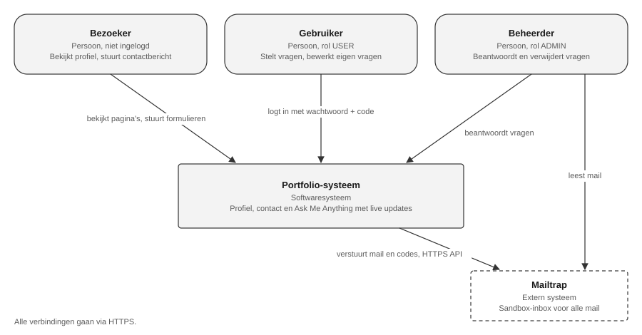
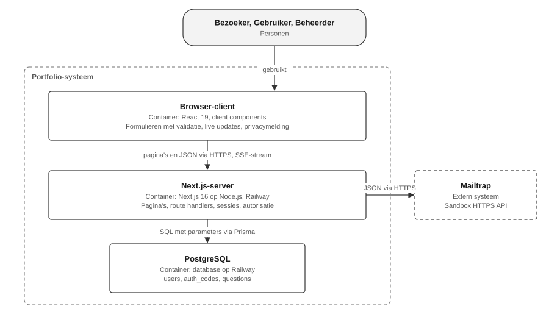
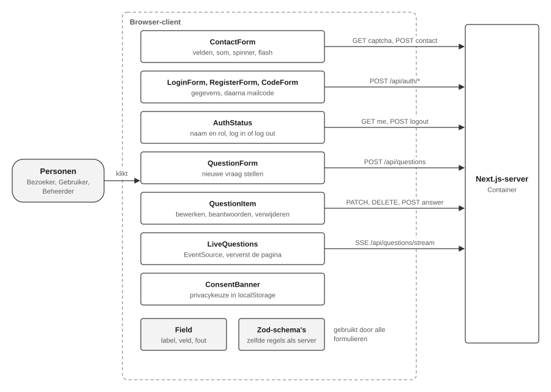
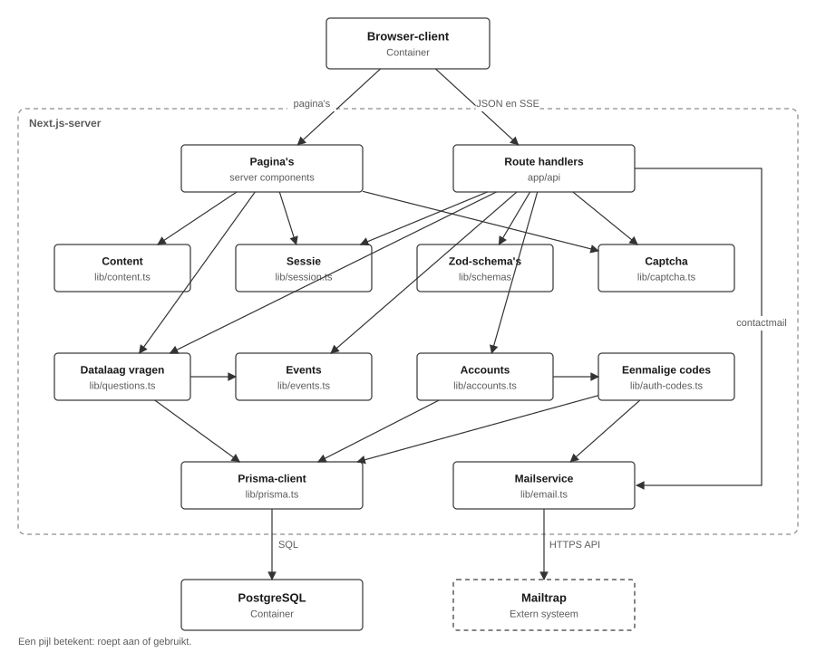
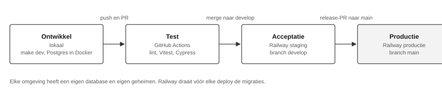

# Ask me anything

# Technisch ontwerp

Portfolio website met profielpagina, contactpagina en showcase "Ask Me Anything"

Sebastiaan Kolmschate (S1148925)
HBO-ICT, Windesheim
Client- en Server Technology
20-10-2026

## Distributie

| Versie | Datum      | Ontvangers | Wijzigingen                                                      |
| ------ | ---------- | ---------- | ---------------------------------------------------------------- |
| 1.0    | 20-10-2026 | Docenten   | Eerste volledige versie: database, accounts, AMA, realtime, OTAP |

## Inleiding

Dit project is de website van Sebastiaan Kolmschate, gebouwd voor het semester Web Development van de opleiding HBO-ICT aan Hogeschool Windesheim. De website heeft een profielpagina met projecten (UC1), een contactpagina (UC2) en een Ask Me Anything-pagina. Op die pagina stellen bezoekers met een account vragen, en de beheerder beantwoordt ze. Nieuwe vragen en antwoorden verschijnen zonder herladen (UC3 tot en met UC8).

Dit technisch ontwerp beschrijft hoe de applicatie is opgebouwd. Het volgt het C4-model tot en met niveau drie: de context, de containers en de componenten. Niveau vier, de code zelf, staat in de repository.

De use cases (UC), functionele requirements (FR), niet-functionele requirements (NFR) en security-maatregelen (SM) hebben dezelfde nummers als in de requirementsanalyse en het functioneel ontwerp. Paragraaf 6.4 laat per requirement zien in welk component het gerealiseerd is.

## 1. Setup

### 1.1 Repository

Alle code en documentatie staan in één GitHub-repository: github.com/sebastiaankolmschateq42/portfolio.

### 1.2 Project draaien

Nodig zijn Bun, Node.js 20 of hoger en Docker. Docker draait de lokale PostgreSQL-database.

| Commando       | Wat het doet                                                                         |
| -------------- | ------------------------------------------------------------------------------------ |
| make setup     | Installeert alles, maakt een lokaal configuratiebestand aan en zet de database klaar |
| make dev       | Start de database en de website op localhost:3000                                    |
| make db-seed   | Maakt het beheerdersaccount aan of werkt het bij                                     |
| make check     | Lint, opmaakcontrole en back-endtests, precies zoals de CI                           |
| make e2e       | Cypress end-to-end-tests; de website moet draaien                                    |
| make component | Cypress-componenttests                                                               |

Welke instellingen nodig zijn, staat in een voorbeeldbestand in de repository. Dat bevat alleen namen en voorbeeldwaarden, geen echte geheimen. De README beschrijft de overige commando's.

## 2. Technieken

### 2.1 De basis

De website is één Next.js-applicatie, geschreven in TypeScript met React. Front-end en back-end zitten daardoor in één codebase en gaan in één keer live. TypeScript vangt fouten al bij het bouwen, in plaats van bij de bezoeker. De opmaak is gemaakt met Tailwind CSS, mobile first. Het lettertype, EB Garamond, wordt met de website meegeleverd, zodat er geen verzoek naar een externe server gaat.

De gegevens staan in een PostgreSQL-database. Accounts, codes en vragen moeten blijvend zijn en door meerdere bezoekers tegelijk te wijzigen. De website praat met de database via Prisma. Prisma geeft invoer altijd als losse waarde mee, nooit als deel van de query, en legt elke wijziging aan de database vast in een migratie die met de code meegaat.

### 2.2 Content

De teksten van de website, zoals het profiel, de skills, de opleidingen en de projecten, staan in de code. Ze worden bij het bouwen gecontroleerd. Een fout in de content laat daardoor de build falen in plaats van een kapotte pagina op te leveren.

### 2.3 Validatie en beveiliging

Alle invoer wordt gecontroleerd met Zod. Dezelfde regels draaien in de browser en op de server. In de browser gebruikt React Hook Form ze om een fout direct bij het juiste veld te tonen. De server controleert elk verzoek daarna opnieuw, want de browser is te omzeilen. Omdat het dezelfde regels zijn, zijn de meldingen overal gelijk.

Wachtwoorden worden opgeslagen met bcrypt: een bewust langzame hash met een eigen salt per wachtwoord. Het sessietoken wordt ondertekend met jose.

### 2.4 Testen en kwaliteit

Vitest test de back-end, Cypress test de front-end in een echte browser. ESLint en Prettier bewaken de codekwaliteit en een vaste opmaak. Alle commando's staan in een Makefile. Dezelfde commando's draaien in GitHub Actions bij elke push en elke pull request, dus wat lokaal faalt, faalt ook in CI.

### 2.5 Hosting en diensten

De code staat op GitHub; tickets zijn GitHub-issues. Railway host de website en de database, met een aparte staging- en productieomgeving. Lokaal draait de database in Docker. Mail gaat via de API van Mailtrap, een sandbox die alle mail opvangt. Bun is de package manager.

### 2.6 Standaarden

De architectuur in dit document volgt het C4-model. De security-maatregelen zijn gekoppeld aan OWASP ASVS 4.0. Commitberichten volgen Conventional Commits. Voor toegankelijkheid gebruikt de website semantische HTML, en elk invoerveld is gekoppeld aan zijn label en foutmelding.

## 3. Definition of Done

Een feature is af wanneer:

- de acceptatiecriteria uit het functioneel ontwerp aantoonbaar gehaald zijn;
- nieuwe server-logica een back-endtest heeft, en nieuw gedrag in de browser een Cypress-test;
- alle controles slagen, lokaal én in CI;
- het functioneel en technisch ontwerp de gerealiseerde functionaliteit beschrijven;
- de feature via een pull request naar develop is gemerged;
- de deploy naar staging slaagt;
- alle geheimen als omgevingsvariabele zijn ingesteld en niet in de repository staan.

## 4. Systeemcontext

Dit hoofdstuk beschrijft het systeem op het hoogste niveau: welke personen en externe systemen erbij betrokken zijn, en hoe ze zich tot elkaar verhouden.

| Van               | Naar              | Interactie                                                                                | Use cases          |
| ----------------- | ----------------- | ----------------------------------------------------------------------------------------- | ------------------ |
| Bezoeker          | Portfolio-systeem | Bekijkt profiel en projecten, stuurt contactbericht, maakt account aan, leest vragen live | UC1, UC2, UC3, UC8 |
| Gebruiker         | Portfolio-systeem | Logt in en uit, stelt vragen, bewerkt of verwijdert eigen vragen                          | UC4, UC5, UC6      |
| Beheerder         | Portfolio-systeem | Logt in, beantwoordt vragen, verwijdert elke vraag                                        | UC4, UC7           |
| Portfolio-systeem | Mailtrap          | Verstuurt contactberichten, verificatiecodes en inlogcodes                                | UC2, UC3, UC4      |
| Beheerder         | Mailtrap          | Leest contactberichten in de sandbox-inbox                                                | UC2                |

Mailtrap is de enige externe dienst. Het is een sandbox: mail komt nooit bij een echte ontvanger aan, maar in een testinbox van de ontwikkelaar. Dat geldt ook voor de verificatie- en inlogcodes. Voor deze showcase is dat genoeg: het formulier en de 2FA zijn veilig te testen en te demonstreren zonder eigen maildomein. Voor echte gebruikers is een maildienst nodig die wel aflevert; dat is alleen een andere instelling van de mailservice.

Het beheerdersaccount wordt niet via de website aangemaakt, maar automatisch bij elke deploy (zie 9.1).

## 5. Containers

### 5.1 Applicaties

Het systeem is één Next.js-applicatie met een eigen database. Er is bewust geen losse backend-service; voor deze schaal zou dat alleen een extra netwerkgrens en extra beheer opleveren (zie 6.5).

Binnen het systeem zijn er drie containers:

- **Browser-client:** de React-code die bij de bezoeker draait. Pagina's komen als kant-en-klare HTML binnen. Alleen interactieve onderdelen, zoals formulieren en de live-koppeling, draaien in de browser.
- **Next.js-server:** één proces op Railway. Bouwt de pagina's, verwerkt API-verzoeken, controleert sessies en rechten, en praat met de database en Mailtrap.
- **PostgreSQL:** database op Railway. Bewaart accounts, eenmalige codes en vragen. Contactberichten worden niet opgeslagen (NFR6).

| Verbinding                     | Hoe                                                                                        |
| ------------------------------ | ------------------------------------------------------------------------------------------ |
| Browser naar Next.js-server    | HTTPS. Pagina's als HTML, formulieren en acties als JSON.                                  |
| Next.js-server naar browser    | Server-Sent Events: één open verbinding waarover de server meldt dat er iets veranderd is. |
| Sessie                         | Een cookie met een ondertekend token; gaat mee met elk verzoek naar de eigen website.      |
| Next.js-server naar PostgreSQL | Via Prisma, altijd met parameters.                                                         |
| Next.js-server naar Mailtrap   | HTTPS-verzoek naar de Mailtrap-API, met een time-out van 10 seconden.                      |

### 5.2 Threat modelling op containerniveau

Per container en per verbinding zijn de dreigingen benoemd met STRIDE. De tabel noemt de maatregel die de dreiging afvangt. Hoofdstuk 8 beschrijft elke maatregel.

| Plek                           | Dreiging (STRIDE)                                                                   | Maatregel                |
| ------------------------------ | ----------------------------------------------------------------------------------- | ------------------------ |
| Browser naar server            | Afluisteren van verkeer of sessiecookie (Information disclosure)                    | SM9, SM11, NFR11         |
| Browser naar server            | Zeer lange of verkeerd getypte invoer (Tampering, DoS)                              | SM1, SM2                 |
| Browser naar server            | Script in een bericht of vraag (Tampering, XSS)                                     | SM3, SM11                |
| Browser naar server            | Verzoek vanaf een andere site met de cookie (CSRF, Spoofing)                        | SM9                      |
| Browser naar server            | Site in een frame laden voor clickjacking (Tampering)                               | SM11                     |
| Browser naar server            | Bots die het contactformulier misbruiken (DoS, spam)                                | SM5                      |
| Browser naar server            | Wachtwoord of code raden (Spoofing)                                                 | SM6                      |
| Browser naar server            | Uitzoeken welke e-mailadressen een account hebben (Information disclosure)          | SM7                      |
| Next.js-server                 | Andermans vraag wijzigen, of beheerdersactie als gebruiker (Elevation of privilege) | SM8                      |
| Next.js-server                 | Eigen auteur of rol meesturen in het verzoek (Tampering)                            | SM8                      |
| Next.js-server                 | Vraaginhoud of e-mailadressen via de live-verbinding (Information disclosure)       | SM10                     |
| Next.js-server                 | Vervalst of verlopen sessietoken (Spoofing)                                         | SM9                      |
| Next.js-server naar PostgreSQL | SQL-injectie (Tampering)                                                            | SM4                      |
| PostgreSQL                     | Datalek van wachtwoorden of codes (Information disclosure)                          | SM6                      |
| Next.js-server naar Mailtrap   | Gelekte toegangssleutel of databasewachtwoord (Information disclosure)              | SM12                     |
| Next.js-server naar Mailtrap   | Formulier gebruiken om mail naar willekeurige adressen te sturen (Spoofing)         | Vaste ontvanger, zie 6.2 |

Restrisico's die bewust niet zijn afgevangen:

- Er is geen limiet op het aantal verzoeken per IP-adres. Een inlogcode is wel na vijf pogingen ongeldig, en een captcha na één poging.
- Veel open live-verbindingen kosten geheugen op de server. Voor deze schaal is dat geaccepteerd.
- De Content Security Policy staat inline scripts toe, omdat Next.js die nodig heeft. React toont alle invoer als tekst, dus de kans op XSS blijft klein.

## 6. Componenten

Per container worden hieronder de componenten beschreven. De validatieregels (Zod-schema's) draaien in beide containers: dezelfde regels gelden in de browser én op de server. Daarom staan ze in beide diagrammen.

### 6.1 Browser-client

- **Contactformulier:** controleert alle velden tijdens het typen. De verzendknop werkt pas als alles klopt. Tijdens het versturen draait een spinner, daarna verschijnt zes seconden een melding. Lukt het versturen, dan wordt het formulier leeggemaakt (NFR5). Lukt het niet, dan blijft de invoer staan en staat de fout bij het juiste veld. Na elke poging komt er een nieuwe som, omdat elke som maar één keer bruikbaar is.
- **Registratie-, inlog- en codeformulier:** eerst e-mail en wachtwoord, daarna de zescijferige code uit de mail. Na het inloggen laadt de pagina opnieuw, zodat de navigatie de nieuwe sessie toont. Een fout wachtwoord en een onbekend adres geven dezelfde melding.
- **Accountstatus:** staat in de navigatie. Toont zonder sessie "Log in", met sessie de naam van de gebruiker en "Log out". Bij de beheerder staat er "(admin)" achter.
- **Vraagformulier:** controleert de vraag met dezelfde regels als de server en ververst de lijst na het stellen.
- **Vraag-item:** toont een vraag met het antwoord. Welke knoppen er staan (bewerken, beantwoorden, verwijderen), bepaalt de server. De browser beslist zelf niets over rechten.
- **Live-koppeling:** houdt een verbinding open met de server. Komt er een seintje dat er iets veranderd is, dan haalt de browser de pagina opnieuw op, met de rechten van deze bezoeker. Valt de verbinding weg, dan maakt de browser zelf opnieuw verbinding.
- **Privacymelding:** staat onderaan zolang de bezoeker geen keuze heeft gemaakt. De keuze wordt in de browser bewaard, zodat de melding daarna wegblijft (NFR4).
- **Invoerveld:** koppelt label, veld en foutmelding, zodat een schermlezer de fout bij het juiste veld voorleest.

### 6.2 Next.js-server

- **Pagina's:** de profielpagina en de projectpagina's worden bij het bouwen al gemaakt. Dat maakt ze snel (NFR2). De Ask me anything-pagina en de contactpagina worden per bezoek opgebouwd: de eerste toont de vragen met de rechten van de bezoeker, de tweede geeft elke bezoeker een eigen som.
- **Content:** profiel, skills, opleidingen, projecten en menu. Staan in de code en worden bij het bouwen gecontroleerd. Er is geen beheerscherm voor (NFR1).
- **Route handlers:** de API. Elk verzoek gaat door dezelfde stappen: sessie controleren (anders 401), invoer controleren met de validatieregels (anders 400), en pas dan de logica. De uitkomst wordt omgezet naar een vaste statuscode.
- **Sessie:** maakt en controleert het ondertekende sessietoken met de gebruiker en zijn rol, één dag geldig. Het token staat in een cookie dat scripts niet kunnen lezen en dat niet vanaf andere sites wordt meegestuurd.
- **Accounts:** registreren, e-mailadres bevestigen en inloggen in twee stappen. Wachtwoorden worden opgeslagen met bcrypt. Bij een onbekend e-mailadres duurt het antwoord even lang als bij een bekend adres (SM7).
- **Eenmalige codes:** maakt de zescijferige codes voor bevestigen en inloggen. In de database staat alleen een ondertekende versie van de code. Een code is 5 minuten geldig, werkt één keer en is na 5 foute pogingen ongeldig. Een nieuwe code maakt de vorige ongeldig.
- **Datalaag vragen:** alle databasewerk voor vragen én alle rechtencontroles. Alleen de auteur bewerkt zijn vraag, en alleen zolang er geen antwoord is. De auteur of de beheerder verwijdert. Alleen de beheerder beantwoordt. Wie de auteur is, komt altijd uit de sessie, nooit uit het verzoek. Naar buiten gaat alleen de naam van de auteur, nooit zijn e-mailadres. Na elke wijziging meldt de datalaag een event.
- **Captcha:** maakt een som van twee getallen. De server ondertekent het antwoord samen met een vervaltijd; het antwoord zelf gaat nooit naar de browser. Elke som kan één keer gecontroleerd worden, ook bij een fout antwoord.
- **Mailservice:** verstuurt mail via de Mailtrap-API. Het contactformulier mailt altijd naar één vast adres; het adres van de bezoeker gaat alleen mee als antwoordadres. Zo kan niemand het formulier gebruiken om mail naar willekeurige adressen te sturen.
- **Events:** geeft een melding van de datalaag door aan alle open live-verbindingen. De melding bevat alleen wat er veranderde en welke vraag, geen inhoud. Dit werkt omdat de website als één proces draait (zie 6.5).
- **Prisma-client:** de verbinding met de database.

### 6.3 Datamodel

De database heeft drie tabellen: gebruikers, eenmalige codes en vragen. Een gebruiker heeft nul of meer codes en stelt nul of meer vragen. Wordt een gebruiker verwijderd, dan gaan zijn codes en vragen mee. De maximale lengtes in de database zijn gelijk aan de validatieregels, zodat de database de laatste grens is (SM1).

### 6.4 Herleidbaarheid naar het functioneel ontwerp

Elke use case uit het functioneel ontwerp komt terug in een of meer componenten. De tabel laat per use case zien waar de requirements zitten.

| Use case                                | Requirements                  | Gerealiseerd in                                                                                                                          |
| --------------------------------------- | ----------------------------- | ---------------------------------------------------------------------------------------------------------------------------------------- |
| UC1 Bekijken CV                         | FR1 t/m FR4, NFR1, NFR2, NFR4 | Pagina's met gegevens uit Content. De pagina's worden vooraf gebouwd en er is geen beheerscherm. De privacymelding staat op elke pagina. |
| UC2 Contact opnemen                     | FR5 t/m FR8, NFR5, NFR6       | Contactformulier in de browser; route handler, Captcha en Mailservice op de server. Het bericht wordt niet opgeslagen.                   |
| UC3 Account registreren                 | FR9                           | Registratie- en codeformulier; Accounts, Eenmalige codes en Mailservice.                                                                 |
| UC4 Inloggen en uitloggen               | FR10, FR11                    | Inlog- en codeformulier en Accountstatus; Accounts, Eenmalige codes en Sessie.                                                           |
| UC5 Vraag stellen                       | FR12                          | Vraagformulier; Datalaag vragen.                                                                                                         |
| UC6 Eigen vraag bewerken of verwijderen | FR13                          | Vraag-item; Datalaag vragen controleert of de gebruiker de auteur is.                                                                    |
| UC7 Vraag beantwoorden of verwijderen   | FR14                          | Vraag-item; Datalaag vragen controleert of de gebruiker beheerder is.                                                                    |
| UC8 Vragen en antwoorden live volgen    | FR15                          | Live-koppeling in de browser; Events en de live-verbinding op de server.                                                                 |
| UC5 t/m UC7                             | FR16                          | Sessie bewaart de rol; Datalaag vragen controleert die bij elke actie.                                                                   |

Twee requirements gelden voor alle componenten: semantische HTML en mobile first (NFR3), en de maximale lengtes in de browser, op de server en in de database (NFR7). De overige requirements gaan over de werkwijze: de tests (NFR8, NFR9) staan in hoofdstuk 7, HTTPS en de cookie (NFR11) in hoofdstuk 8 en de OTAP-straat (NFR10) in hoofdstuk 9.

### 6.5 Ontwerpkeuzes

**Eén Next.js-applicatie in plaats van een losse front-end en back-end.** Een aparte API betekent twee deployments en een sessie over twee domeinen, zonder dat de gebruiker er iets aan heeft. In één applicatie blijft de sessiecookie strikt op de eigen site.

**Route handlers in plaats van server actions.** De formulieren controleren elk veld al in de browser, en dat past beter bij een gewone API. De live-verbinding moet sowieso een API-route zijn. Zo is er één patroon, dat los van de voorkant te testen is.

**PostgreSQL in plaats van een JSON-bestand.** Accounts, codes en vragen moeten blijvend zijn en door meerdere bezoekers tegelijk te wijzigen. Een bestand overleeft een nieuwe deploy niet.

**Wachtwoord plus mailcode in plaats van alleen een inloglink.** Met een inloglink is de mailbox de enige sleutel. Wachtwoord plus code zijn twee factoren.

**Rechten in de datalaag in plaats van in elke route handler.** De regels over wie wat mag, staan op één plek. Pagina's en API gebruiken dezelfde regels, en ze zijn los te testen.

**Server-Sent Events in plaats van WebSockets.** Alleen de server hoeft iets te sturen. SSE is gewoon HTTP, werkt met de bestaande cookie, en de browser maakt zelf opnieuw verbinding als die wegvalt.

**Alleen een seintje in plaats van de hele vraag.** Wat iemand mag zien, verschilt per bezoeker. Daarom meldt de server alleen dat er iets veranderd is, en haalt elke browser de pagina zelf opnieuw op met zijn eigen rechten. Zo kan er via de live-verbinding niets uitlekken.

**Railway in plaats van Vercel.** Op Vercel is elk verzoek een losse functie met een maximale looptijd. De live-verbinding blijft open, en de seintjes werken alleen binnen één proces dat blijft draaien. Railway draait de website als één proces en levert ook de database.

**Mailtrap via HTTPS in plaats van SMTP.** Railway blokkeert uitgaande SMTP; de HTTPS-API werkt wel.

**Een som als captcha in plaats van reCAPTCHA.** Geen externe partij, geen tracking en geen cookie van derden. Een som houdt een gerichte bot minder goed tegen, maar voor een portfolio is dat genoeg.

## 7. Testen

### 7.1 Teststrategie en waarom deze tests belangrijk zijn

De tests zijn verdeeld over twee lagen. Vitest test de back-end: de API, de datalaag en de hulpmodules. Cypress test de front-end: wat de bezoeker ziet en doet. Beide draaien bij elke pull request in CI. Een merge kan pas als ze groen zijn.

Waarom deze tests belangrijk zijn:

- **De veiligheid zit in de back-end.** Wie wat mag, hoe lang een code geldig is en of een captcha maar één keer werkt: dat zijn regels op de server. Een fout daarin is in de interface niet te zien. Een gebruiker die andermans vraag kan bewerken, valt niet op door te klikken, want de knop staat er niet. Alleen een test die het verzoek direct stuurt, laat zien dat de server het weigert.
- **Elke security-maatregel is aantoonbaar.** Elke maatregel uit hoofdstuk 8 heeft een test. Een maatregel zonder test is een bewering; met een test wordt hij bij elke wijziging opnieuw gecontroleerd.
- **Regressie.** De code is meerdere keren omgebouwd, bijvoorbeeld van gastenboek naar Ask Me Anything en van SMTP naar de Mailtrap API. Na zo'n ombouw laten de tests direct zien of het bestaande gedrag nog klopt.
- **Foutpaden zijn anders niet te testen.** Een mailserver die faalt of een trage server komen bij handmatig testen bijna nooit voor. Met nagebootste diensten worden ze in de test afgedwongen.
- **De front-endtests bewaken de afspraken uit het functioneel ontwerp:** de knop blijft dicht tot alles geldig is, het formulier is leeg na verzenden, de fout staat bij het juiste veld, en het antwoord verschijnt zonder herladen.

### 7.2 Wat er getest wordt

**Back-end (Vitest, 65 tests)**

De back-endtests controleren de regels die de server bewaakt:

- Een gebruiker kan alleen zijn eigen vraag bewerken. Alleen de beheerder kan een vraag beantwoorden.
- Inloggen werkt alleen met het juiste wachtwoord én de juiste code uit de mail. Een code verloopt na 5 minuten en werkt na 5 foute pogingen niet meer.
- Een aangepaste of verlopen sessie wordt geweigerd.
- Het contactformulier weigert te lange tekst, HTML en links, en werkt alleen met de juiste som.

De tests praten met een echte database, een aparte testdatabase. De regels over wie wat mag, zitten namelijk in de eigen code en in de databasequeries. Die wil ik echt laten draaien.

Het versturen van mail wordt nagebootst (gemockt). Mail is een externe dienst: echt versturen is traag, vraagt een account en vult een inbox. Met een nagebootste mail kan ik ook testen wat er gebeurt als het versturen mislukt.

**Front-end (Cypress, 17 end-to-end-tests en 10 componenttests)**

| Techniek                                       | Wat ik ermee test                                                                                  |
| ---------------------------------------------- | -------------------------------------------------------------------------------------------------- |
| End-to-end tegen de echte app                  | De profielpagina, een contactbericht dat echt verstuurd wordt, en een antwoord dat live verschijnt |
| Nagebootste server (cy.intercept met fixtures) | Wat de bezoeker ziet als versturen mislukt, als de server traag is, of als de som fout is          |
| Componenttests                                 | Losse onderdelen: het invoerveld, de privacymelding en het contactformulier                        |
| Eigen commando's                               | Snel inloggen zonder mailcode, en testdata opruimen                                                |

Alle tests draaien automatisch bij elke pull request op GitHub. Pas als alles groen is, kan er gemerged worden.

## 8. Security-maatregelen

De maatregelen komen uit de threat modelling in 5.2. Elke maatregel zit in een vaste laag van de architectuur: de browser, de route handlers (waar een verzoek binnenkomt), de datalaag (waar de regels over wie wat mag staan), de database of de serverconfiguratie. Alle maatregelen zijn getest; hoofdstuk 7 beschrijft hoe.

| #    | Dreiging                                              | Maatregel                                                                                                                                                                             | Laag                             | ASVS   |
| ---- | ----------------------------------------------------- | ------------------------------------------------------------------------------------------------------------------------------------------------------------------------------------- | -------------------------------- | ------ |
| SM1  | Extreem lange invoer                                  | Elk veld heeft een maximale lengte, in het formulier én op de server                                                                                                                  | Browser, route handler, database | V5     |
| SM2  | Invoer in een onverwacht formaat                      | Elk verzoek wordt gecontroleerd tegen vaste regels. Wijkt het af, dan volgt een foutmelding (400)                                                                                     | Route handler                    | V5     |
| SM3  | Script of link in een bericht (XSS)                   | Berichten zijn alleen platte tekst. De website toont invoer altijd als tekst, nooit als code                                                                                          | Browser, route handler           | V5     |
| SM4  | SQL-injectie                                          | De database krijgt invoer alleen als losse waarde mee, nooit als onderdeel van de query                                                                                               | Datalaag                         | V5     |
| SM5  | Bots die het contactformulier spammen                 | Een rekensom die de server ondertekent, 10 minuten geldig is en één keer gebruikt kan worden                                                                                          | Route handler                    | V11    |
| SM6  | Gestolen of geraden inloggegevens                     | Wachtwoorden worden versleuteld opgeslagen (bcrypt). Inlogcodes zijn 5 minuten geldig, werken één keer, en zijn na 5 foute pogingen ongeldig                                          | Datalaag, database               | V2     |
| SM7  | Achterhalen of een e-mailadres een account heeft      | De server geeft bij een bekend en een onbekend adres hetzelfde antwoord, even snel                                                                                                    | Route handler, datalaag          | V2     |
| SM8  | Andermans vraag bewerken, of als gebruiker antwoorden | De datalaag haalt de gebruiker en zijn rol uit de sessie en controleert bij elke actie of die mag. Wat de browser meestuurt over de auteur, wordt genegeerd                           | Datalaag                         | V4     |
| SM9  | Sessie stelen of namaken                              | De sessie is een ondertekend token in een cookie dat scripts niet kunnen lezen, dat alleen via HTTPS gaat en niet mee wordt gestuurd vanaf andere sites. Het verloopt na 1 dag        | Route handler, browser           | V3     |
| SM10 | Privégegevens via de live-verbinding                  | De live-verbinding stuurt alleen een seintje (wat er veranderde en welke vraag). De pagina wordt daarna opnieuw opgehaald, met de rechten van de bezoeker zelf                        | Route handler, browser           | V4, V8 |
| SM11 | Clickjacking, informatie over de server               | Security headers verbieden insluiten in een andere site en dwingen HTTPS af. De server vertelt niet welk framework hij gebruikt                                                       | Serverconfiguratie               | V14    |
| SM12 | Gelekte geheimen                                      | Geheimen staan alleen in omgevingsvariabelen, per omgeving verschillend. Ontbreekt de mailinstelling op productie, dan geeft de server een fout in plaats van stil niets te versturen | Serverconfiguratie               | V14    |

De security headers uit SM11 gelden voor elke pagina:

| Header                    | Doel                                                                               |
| ------------------------- | ---------------------------------------------------------------------------------- |
| Content-Security-Policy   | Alleen inhoud van de eigen website laden, en de site niet in een frame laten tonen |
| Strict-Transport-Security | De browser gebruikt een jaar lang alleen HTTPS                                     |
| X-Content-Type-Options    | De browser raadt geen ander bestandstype                                           |
| Referrer-Policy           | Geen volledige URL meesturen naar andere sites                                     |
| Permissions-Policy        | Camera, microfoon en locatie staan uit                                             |

## 9. Deployment

### 9.1 OTAP

| Fase       | Omgeving          | Branch                    | Database             | Wat gebeurt er                                          |
| ---------- | ----------------- | ------------------------- | -------------------- | ------------------------------------------------------- |
| Ontwikkel  | Lokaal            | Feature-branch            | PostgreSQL in Docker | Ontwikkelen; alle controles vóór elke push              |
| Test       | GitHub Actions    | Elke push en pull request | Eigen testdatabase   | Lint, opmaak, back-endtests en Cypress                  |
| Acceptatie | Railway staging   | develop                   | Eigen database       | Automatische deploy na een merge naar develop           |
| Productie  | Railway productie | main                      | Eigen database       | Automatische deploy na de release van develop naar main |

Vóór elke deploy past Railway de databasemigraties toe en maakt het het beheerdersaccount aan of werkt het bij. Mislukt dat, bijvoorbeeld door een kapotte migratie, dan zet Railway de nieuwe versie niet live en blijft de oude draaien.

Staging en productie zijn gescheiden omgevingen met elk een eigen database en eigen geheimen. Een fout op staging raakt productie niet, en testdata van staging komt nooit in productie.

- Staging: https://portfolio-staging-9685.up.railway.app
- Productie: https://portfolio-production-36a4.up.railway.app

### 9.2 Branchflow

- Elk ticket is een GitHub-issue met acceptatiecriteria.
- Per ticket een feature-branch vanaf develop.
- Pull request naar develop. CI draait, en pas als alles groen is volgt de merge.
- Na de merge zet Railway develop op staging.
- Bij een mijlpaal gaat develop via een release naar main. Railway zet die op productie.

Er wordt nooit direct naar main gepusht. Zo is elke wijziging in productie eerst door CI en staging gegaan.
