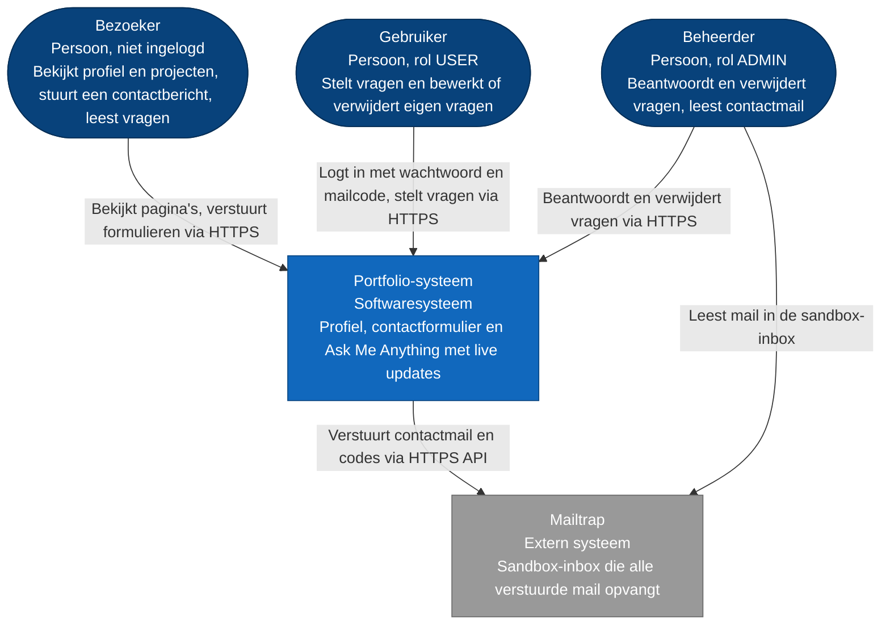
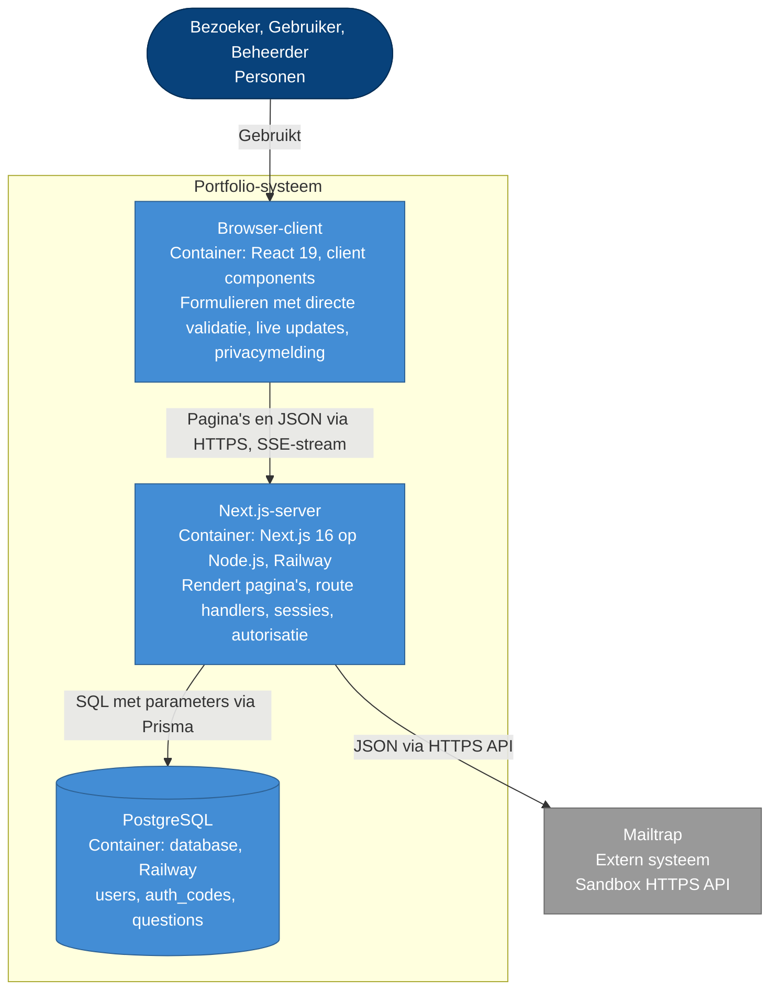
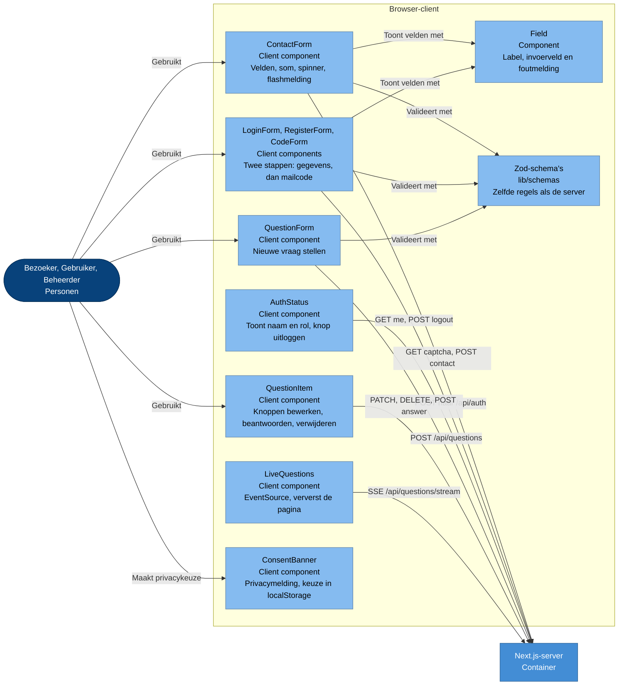
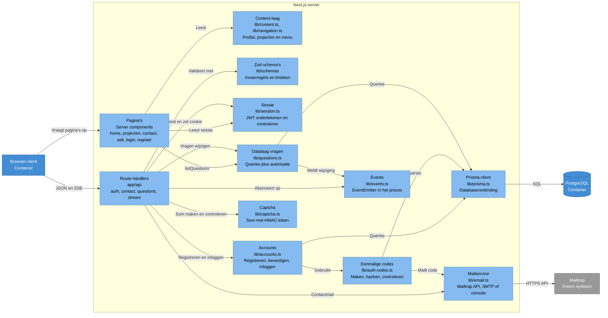
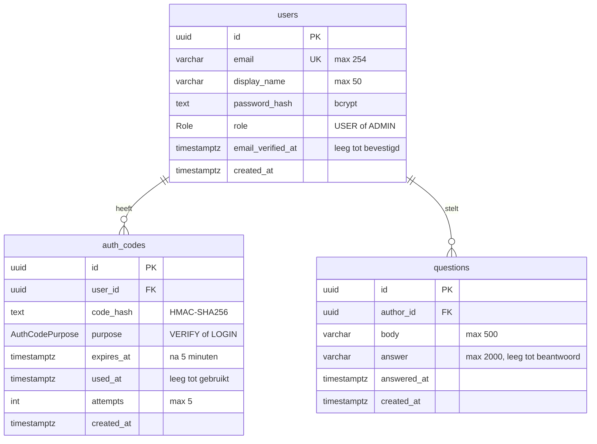
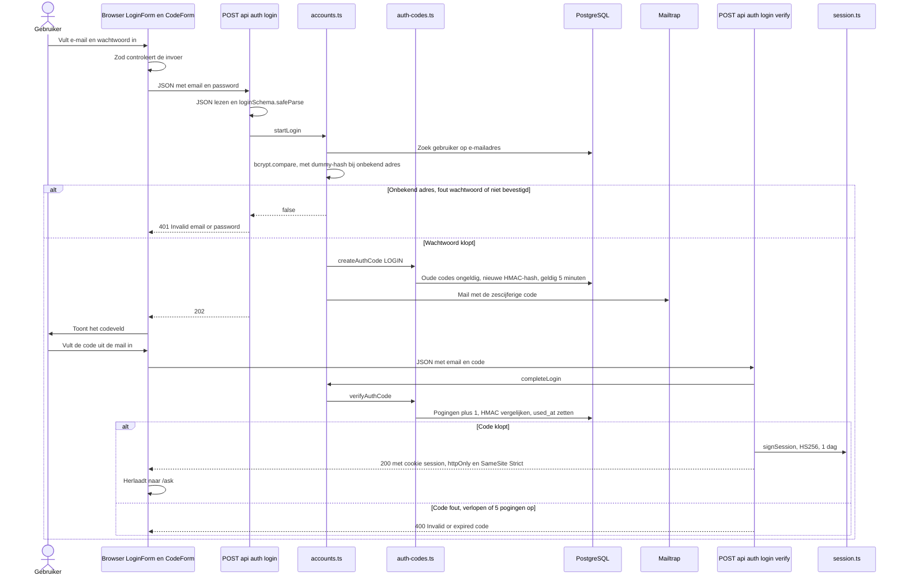
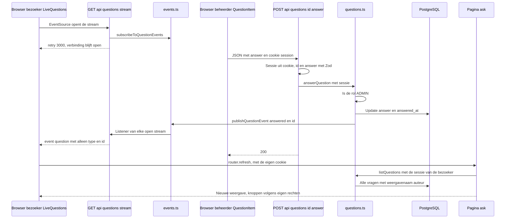
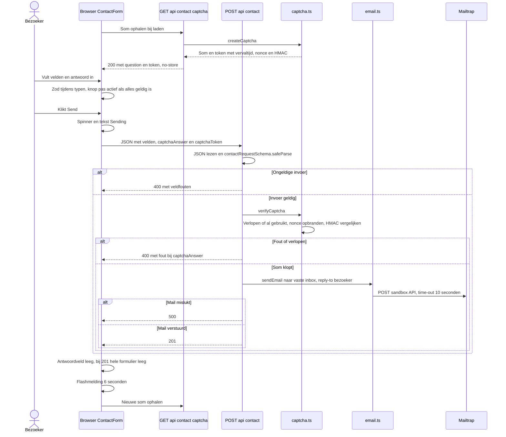
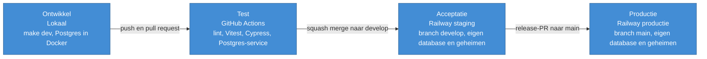

# Technisch ontwerp

**Project:** Portfolio met contactformulier en Ask Me Anything
**Modules:** Client Technology, Server Technology, Security for Web Applications
**Auteur:** Sebastiaan Kolmschate

## Distributie

| Versie | Datum      | Ontvangers | Wijzigingen                                                      |
| ------ | ---------- | ---------- | ---------------------------------------------------------------- |
| 1.0    | 19-10-2026 | Docenten   | Eerste volledige versie: database, accounts, AMA, realtime, OTAP |

## Inleiding

Dit project is de website van Sebastiaan Kolmschate, gebouwd voor het semester Web Development van de opleiding HBO-ICT aan Hogeschool Windesheim. De website heeft een profielpagina met projecten (UC1), een contactpagina (UC2) en een Ask Me Anything-pagina. Op die pagina stellen bezoekers met een account vragen, en de beheerder beantwoordt ze. Nieuwe vragen en antwoorden verschijnen zonder herladen (UC3 tot en met UC8).

Dit technisch ontwerp beschrijft hoe de applicatie is opgebouwd. Het volgt het C4-model tot en met niveau drie. Niveau vier, de code, staat in de repository. Waar een stuk code een ontwerpkeuze uitlegt, verwijst dit document naar het bestand.

De use cases (UC), functionele requirements (FR), niet-functionele requirements (NFR) en security-maatregelen (SM) hebben dezelfde nummers als in de requirementsanalyse en het functioneel ontwerp. Paragraaf 6.6 laat per requirement zien in welk component het gerealiseerd is.

De diagrammen zijn getekend als Mermaid-flowchart in C4-stijl. Ze renderen daardoor in elke Markdown-viewer.

## 1. Setup

### 1.1 Repository

Alle code en documentatie staan in één repository: `github.com/sebastiaankolmschateq42/portfolio`.

### 1.2 Project draaien

Nodig zijn Bun, Node.js 20 of hoger en Docker. Docker draait de lokale PostgreSQL-database.

| Commando         | Wat het doet                                                                                         |
| ---------------- | ---------------------------------------------------------------------------------------------------- |
| `make setup`     | Installeert dependencies, maakt `.env.local` uit `.env.example`, start de database, draait migraties |
| `make dev`       | Start de database, past openstaande migraties toe en start de dev-server op `localhost:3000`         |
| `make db-seed`   | Maakt of werkt het beheerdersaccount bij met de gegevens uit `.env.local`                            |
| `make check`     | Lint, opmaakcontrole en Vitest, precies zoals de CI                                                  |
| `make e2e`       | Cypress end-to-end-tests; de app moet draaien                                                        |
| `make component` | Cypress-componenttests; start een eigen Vite-server                                                  |

Welke omgevingsvariabelen nodig zijn, staat in `.env.example`. Dat bestand bevat alleen namen en voorbeeldwaarden, geen echte geheimen. De README beschrijft de overige commando's. Die staat naast de code en verandert mee, zodat dit document niet bij elke kleine wijziging verouderd raakt.

## 2. Technieken

### 2.1 Tools

- **Bun**: package manager en scriptrunner.
- **Make**: vaste commando's voor installeren, ontwikkelen, testen en controleren. Dezelfde commando's draaien in CI.
- **Docker Compose**: lokale PostgreSQL 17 op poort 5433.
- **ESLint en Prettier**: codekwaliteit en consistente opmaak.
- **Vitest**: back-endtests.
- **Cypress**: front-endtests, end-to-end en per component.
- **GitHub**: repository, issues als tickets, pull requests.
- **GitHub Actions**: CI bij elke push naar `main` en `develop` en bij elke pull request.
- **Railway**: hosting van de app en de database, met een staging- en een productieomgeving.
- **Mailtrap**: sandbox-inbox die alle verstuurde mail opvangt.

### 2.2 Programmeertalen

- **TypeScript** voor alle code, zowel in de browser als op de server.
- **CSS** via Tailwind, met basisstijlen voor formulierelementen in `app/globals.css`.
- **SQL** alleen in de migraties die Prisma genereert (`prisma/migrations/`).

### 2.3 Frameworks en libraries

| Keuze                     | Rol                                | Waarom                                                                                     |
| ------------------------- | ---------------------------------- | ------------------------------------------------------------------------------------------ |
| Next.js 16 (App Router)   | Rendering, routing, route handlers | Front- en back-end in één type-veilige codebase en één deploy                              |
| React 19                  | UI                                 | Componenten in de browser en op de server                                                  |
| TypeScript                | Taal                               | Fouten bij compileren in plaats van bij de bezoeker                                        |
| Tailwind CSS 4            | Styling                            | Snel itereren; mobile first met breakpoints als `sm:`                                      |
| Zod 4                     | Validatie                          | Eén schema als bron van waarheid, in de browser en op de server                            |
| React Hook Form           | Formulieren                        | Formulierstatus en veldfouten zonder eigen state-beheer; koppelt met Zod via `zodResolver` |
| PostgreSQL                | Database                           | Accounts, codes en vragen moeten blijvend en gedeeld zijn                                  |
| Prisma 7 met `adapter-pg` | Datatoegang en migraties           | Type-veilige queries met parameters; migraties in de repository                            |
| bcryptjs                  | Wachtwoorden hashen                | Langzame hash met salt; cost 12                                                            |
| jose                      | Sessietoken                        | Ondertekenen en controleren van JWT's met HS256                                            |
| node:crypto               | HMAC en willekeurige getallen      | Eenmalige codes en captcha-tokens ondertekenen; geen extra dependency                      |
| Nodemailer                | SMTP-client                        | Alleen voor lokaal gebruik; op Railway gaat mail via de Mailtrap HTTPS API                 |
| Vitest                    | Back-endtests                      | Snel, TypeScript zonder extra configuratie, mocking van externe diensten                   |
| Cypress 15                | Front-endtests                     | E2e tegen de echte app, netwerkstubs, componenttests                                       |
| EB Garamond (next/font)   | Typografie                         | Bij de build zelf gehost: geen extern request, geen layout shift                           |

Content en teksten van de website staan in TypeScript-bestanden (`lib/content.ts`, `lib/navigation.ts`). Ze worden bij import met Zod gevalideerd. Een fout in de content, zoals een verkeerd datumformaat, laat daardoor de build falen in plaats van een kapotte pagina op te leveren. Dit is tijdens het bouwen één keer echt gebeurd.

### 2.4 Standaarden

- **C4-model** voor de architectuurbeschrijving in dit document.
- **OWASP ASVS 4.0** als kader voor de security-maatregelen. Hoofdstuk 8 noemt per maatregel het ASVS-hoofdstuk.
- **Conventional Commits** voor commitberichten (`feat:`, `fix:`, `docs:` en dergelijke).
- **Toegankelijkheid**: semantische HTML, labels gekoppeld aan invoervelden, foutmeldingen gekoppeld aan het veld via `aria-describedby`, en meldingen met `role="status"` of `role="alert"`.

## 3. Definition of Done

Een feature is af wanneer:

1. de acceptatiecriteria uit het functioneel ontwerp aantoonbaar gehaald zijn;
2. nieuwe server-logica een Vitest-test heeft, en nieuw gedrag in de browser een Cypress-test;
3. `make check` slaagt, lokaal én in CI, en de Cypress-job in CI groen is;
4. functioneel ontwerp en technisch ontwerp de gerealiseerde functionaliteit beschrijven;
5. de feature via een pull request met `Closes #N` naar `develop` is gemerged;
6. de staging-deploy op Railway slaagt;
7. alle geheimen als omgevingsvariabele zijn ingesteld en niet in de repository staan.

## 4. Systeemcontext

Dit hoofdstuk beschrijft het systeem op het hoogste niveau: welke personen en externe systemen zijn erbij betrokken, en hoe verhouden die zich tot elkaar.

| Van               | Naar              | Interactie                                                                                | Use cases          |
| ----------------- | ----------------- | ----------------------------------------------------------------------------------------- | ------------------ |
| Bezoeker          | Portfolio-systeem | Bekijkt profiel en projecten, stuurt contactbericht, maakt account aan, leest vragen live | UC1, UC2, UC3, UC8 |
| Gebruiker         | Portfolio-systeem | Logt in en uit, stelt vragen, bewerkt of verwijdert eigen vragen                          | UC4, UC5, UC6      |
| Beheerder         | Portfolio-systeem | Logt in, beantwoordt vragen, verwijdert elke vraag                                        | UC4, UC7           |
| Portfolio-systeem | Mailtrap          | Verstuurt contactberichten, verificatiecodes en inlogcodes                                | UC2, UC3, UC4      |
| Beheerder         | Mailtrap          | Leest contactberichten in de sandbox-inbox                                                | UC2                |

Mailtrap is de enige externe dienst. Het is een sandbox: mail komt nooit bij een echte ontvanger aan, maar in een testinbox van de ontwikkelaar. Dat geldt ook voor de verificatie- en inlogcodes. Voor deze showcase is dat genoeg: het formulier en de 2FA zijn veilig te testen en te demonstreren zonder eigen maildomein. Voor echte gebruikers is een maildienst nodig die wel aflevert; dat is alleen een andere configuratie van de mailservice.

Het beheerdersaccount wordt niet via de website aangemaakt, maar door een seed-script bij de deploy (zie 9.1).

## 5. Containers

### 5.1 Applicaties

Het systeem is één deploybare Next.js-applicatie met een eigen database. Er is bewust geen losse backend-service; voor deze schaal zou dat alleen een extra netwerkgrens en extra beheer opleveren (zie 6.7).

Binnen het systeem zijn er drie containers:

- **Browser-client**: de React-code die bij de bezoeker draait. Pagina's komen als HTML binnen. Alleen interactieve onderdelen, zoals formulieren en de live-koppeling, draaien als client component in de browser.
- **Next.js-server**: één Node.js-proces op Railway. Rendert pagina's, verwerkt API-verzoeken in route handlers, controleert sessies en rechten, en praat met de database en Mailtrap.
- **PostgreSQL**: beheerde database op Railway. Bewaart accounts, eenmalige codes en vragen. Contactberichten worden niet opgeslagen (NFR6).

| Verbinding                     | Protocol en formaat                                                                      |
| ------------------------------ | ---------------------------------------------------------------------------------------- |
| Browser naar Next.js-server    | HTTPS. Pagina's als HTML en React Server Components. API-verzoeken als JSON via `fetch`. |
| Next.js-server naar browser    | Server-Sent Events op `GET /api/questions/stream` (`text/event-stream`).                 |
| Sessie                         | Cookie `session` met een ondertekend JWT; gaat mee met elk verzoek naar dezelfde origin. |
| Next.js-server naar PostgreSQL | Prisma Client met de `pg`-driver; verbinding via `DATABASE_URL`.                         |
| Next.js-server naar Mailtrap   | HTTPS `POST` naar de sandbox-API met een Bearer-token; time-out na 10 seconden.          |

### 5.2 Configuratie en secrets per omgeving

Alle configuratie komt uit omgevingsvariabelen. De code is in elke omgeving gelijk; alleen de waarden verschillen (SM12).

| Omgeving  | Waar staan de waarden                           | Database                           | Mail                           |
| --------- | ----------------------------------------------- | ---------------------------------- | ------------------------------ |
| Lokaal    | `.env.local`, valt buiten git                   | Docker, database `portfolio`       | Mailtrap, SMTP of console-log  |
| Vitest    | `vitest.config.ts`, alleen testwaarden          | Database `portfolio_test`          | Gemockt                        |
| CI        | `ci.yml`, waarden die alleen in die job bestaan | Postgres-service in GitHub Actions | Console-log (`MAIL_CONSOLE=1`) |
| Staging   | Variabelen in Railway, omgeving staging         | Eigen Postgres op Railway          | Mailtrap HTTPS API             |
| Productie | Variabelen in Railway, omgeving productie       | Eigen Postgres op Railway          | Mailtrap HTTPS API             |

Afspraken:

- `.env.example` bevat alleen namen en voorbeeldwaarden. Echte geheimen staan nooit in de repository.
- Elke omgeving heeft eigen geheimen (`JWT_SECRET`, `AUTH_CODE_SECRET`, `CAPTCHA_SECRET`) en een eigen database. Een gelekte staging-sleutel geeft daardoor geen toegang tot productie.
- Ontbreekt `JWT_SECRET`, `AUTH_CODE_SECRET` of `CAPTCHA_SECRET`, dan gooit de code een fout zodra het geheim nodig is. Er is geen standaardwaarde waarop de app stil terugvalt.
- Zonder mailinstelling logt de mailservice de mail naar de console, zodat lokaal en in CI gewerkt kan worden zonder credentials. In productie faalt verzenden zonder mailinstelling. Anders zouden inlogcodes ongemerkt verdwijnen. Alleen met `MAIL_CONSOLE=1` mag een productiebuild naar de console loggen; dat gebruikt alleen de CI.
- Het wachtwoord van de beheerder staat alleen als `ADMIN_PASSWORD` in de omgeving en gaat via het seed-script als bcrypt-hash de database in.

### 5.3 Threat modelling op containerniveau

Per container en per verbinding zijn de dreigingen benoemd met STRIDE. De tabel noemt de maatregel uit de catalogus die de dreiging afvangt. Hoofdstuk 8 laat zien waar elke maatregel in de code zit en welke test hem aantoont.

| Plek                           | Dreiging (STRIDE)                                                                   | Maatregel                |
| ------------------------------ | ----------------------------------------------------------------------------------- | ------------------------ |
| Browser naar server            | Afluisteren van verkeer of sessiecookie (Information disclosure)                    | HTTPS, HSTS: SM11, NFR11 |
| Browser naar server            | Zeer lange of verkeerd getypte invoer (Tampering, DoS)                              | SM1, SM2                 |
| Browser naar server            | Script in een bericht of vraag (Tampering, XSS)                                     | SM3, SM11                |
| Browser naar server            | Verzoek vanaf een andere site met de cookie (CSRF, Spoofing)                        | SM9                      |
| Browser naar server            | Site in een frame laden voor clickjacking (Tampering)                               | SM11                     |
| Browser naar server            | Bots die het contactformulier misbruiken (DoS, spam)                                | SM5                      |
| Browser naar server            | Wachtwoord of code raden (Spoofing)                                                 | SM6                      |
| Browser naar server            | Uitzoeken welke e-mailadressen een account hebben (Information disclosure)          | SM7                      |
| Next.js-server                 | Andermans vraag wijzigen, of beheerdersactie als gebruiker (Elevation of privilege) | SM8                      |
| Next.js-server                 | Eigen auteur-id of rol meesturen in de body (Tampering)                             | SM8                      |
| Next.js-server                 | Vraag-inhoud of e-mailadressen via de stream (Information disclosure)               | SM10                     |
| Next.js-server                 | Vervalst of verlopen sessietoken (Spoofing)                                         | SM9                      |
| Next.js-server naar PostgreSQL | SQL-injectie (Tampering)                                                            | SM4                      |
| PostgreSQL                     | Datalek van wachtwoorden of codes uit een dump (Information disclosure)             | SM6                      |
| Next.js-server naar Mailtrap   | Gelekte API-token of databasewachtwoord (Information disclosure)                    | SM12                     |
| Next.js-server naar Mailtrap   | Formulier gebruiken om mail naar willekeurige adressen te sturen (Spoofing)         | Vaste ontvanger, zie 6.2 |

Restrisico's die bewust niet zijn afgevangen:

- Er is geen rate limiting per IP-adres. Een code is wel na vijf pogingen op, en een captcha-token na één poging.
- Veel open SSE-verbindingen kosten geheugen op de server. Voor deze schaal is dat geaccepteerd.
- De CSP staat `'unsafe-inline'` toe voor scripts, omdat Next.js zonder nonces inline scripts nodig heeft voor hydration. React escapet alle output, dus de kans op XSS blijft klein.

## 6. Componenten

Per container worden hieronder de componenten beschreven. De Zod-schema's in `lib/schemas/` draaien in beide containers: de bundler neemt ze mee in de browser én op de server. Daarom staan ze in beide diagrammen.

### 6.1 Browser-client

- **ContactForm** (`app/components/ContactForm.tsx`): React Hook Form beheert de status en Zod valideert tijdens het typen (`mode: "onChange"`). De verzendknop is pas actief als alle velden geldig zijn. Bij het laden haalt het formulier een som op bij de server. Tijdens verzenden toont de knop een spinner en de tekst "Sending...". Daarna verschijnt zes seconden een flashmelding. Bij status 201 wordt het formulier leeggemaakt (NFR5). Bij een fout blijft de invoer staan, behalve het antwoord op de som, en toont het formulier de veldfouten van de server. Na elke poging haalt het een nieuwe som op, omdat een token maar één keer bruikbaar is. De native browservalidatie staat uit (`noValidate`), zodat alle meldingen uit hetzelfde schema komen als op de server.
- **LoginForm, RegisterForm en CodeForm**: stap één stuurt e-mail en wachtwoord (en bij registratie de weergavenaam). Bij status 202 toont het formulier CodeForm voor de zescijferige code. Bij succes laadt de pagina volledig opnieuw naar `/ask`, zodat de navigatie de nieuwe sessie ziet. Een fout wachtwoord en een onbekend adres geven dezelfde melding.
- **AuthStatus**: vraagt `GET /api/auth/me` op en toont de weergavenaam, met "(admin)" voor de beheerder. Uitloggen roept `POST /api/auth/logout` aan en laadt de pagina opnieuw.
- **QuestionForm**: valideert de vraag met hetzelfde schema als de server (maximaal 500 tekens). Na status 201 leegt het formulier zich en ververst de pagina.
- **QuestionItem**: toont één vraag met antwoord. Welke knoppen zichtbaar zijn, bepaalt de server via `canEdit`, `canDelete` en `canAnswer`. De browser beslist zelf niets over rechten. Bewerken en beantwoorden controleren de tekst eerst met hetzelfde Zod-schema als de server; pas als die klopt gaat het verzoek weg. Weigert de server toch, dan toont de pagina de melding van de server.
- **LiveQuestions**: opent een `EventSource` naar de stream. Bij elk event roept het `router.refresh()` aan. De server rendert de pagina dan opnieuw, met de rechten van deze bezoeker. Een verborgen statustekst ("Live updates on") laat screenreaders weten of de koppeling actief is. Valt de verbinding weg, dan maakt de browser zelf opnieuw verbinding.
- **ConsentBanner**: leest de keuze uit `localStorage` (sleutel `privacy-consent`). Zolang er geen keuze is, staat de melding onderaan het scherm. Na "Accept" of "Decline" verdwijnt hij en blijft hij weg (NFR4). Is `localStorage` geblokkeerd, dan verschijnt de melding bij het volgende bezoek opnieuw.
- **Field**: koppelt label, invoerveld en foutmelding. De foutmelding krijgt het id `<veld>-error`, waar het invoerveld via `aria-describedby` naar verwijst. Zo leest een screenreader de fout bij het juiste veld voor.

### 6.2 Next.js-server

- **Pagina's** (`app/`): server components. De homepagina en alle projectpagina's (`generateStaticParams`) worden bij de build statisch gegenereerd. Dat helpt bij de laadtijd (NFR2). De pagina `/ask` is `force-dynamic`: hij leest bij elk verzoek de sessie en haalt de vragen op met de rechten van de bezoeker. In Next.js 16 is `params` een Promise; de pagina's en route handlers doen daarom `await params`.
- **Content-laag**: profiel, skills, opleidingen, projecten en menu staan in TypeScript-bestanden en worden bij import met Zod gecontroleerd. Er is geen beheerscherm voor deze gegevens (NFR1).
- **Route handlers** (`app/api/**/route.ts`): elke handler volgt hetzelfde patroon. Eerst de sessie uit de cookie (waar nodig, anders 401). Dan de JSON lezen (kapot geeft 400). Dan `safeParse` met het Zod-schema (ongeldig geeft 400 met veldfouten). Pas daarna de logica. `lib/api-responses.ts` zet de uitkomst van de datalaag om naar een vaste statuscode.
- **Sessie** (`lib/session.ts`): maakt een HS256-JWT met de gebruikers-id als `sub` en de rol als claim, één dag geldig. Zet die in de cookie `session` met `httpOnly`, `SameSite=Strict`, `path=/` en, in productie, `Secure`. Bij controleren is alleen HS256 toegestaan, en een onbekende rol geeft geen sessie.
- **Accounts** (`lib/accounts.ts`): registreren, e-mail bevestigen, inlogstap één en twee. Wachtwoorden worden gehasht met bcrypt, cost 12. Bij een onbekend e-mailadres vergelijkt de inlogstap met een dummy-hash, zodat het antwoord even lang duurt (SM7). Registreren met een adres dat al een bevestigd account heeft, doet niets en geeft hetzelfde antwoord.
- **Eenmalige codes** (`lib/auth-codes.ts`): zes cijfers uit `crypto.randomInt`. In de database staat alleen een HMAC-SHA256 van de code. Een code is 5 minuten geldig en na 5 pogingen op. Een nieuwe code maakt de vorige ongeldig, in één transactie. De code wordt verbruikt met een voorwaardelijke update op `used_at`, zodat twee gelijktijdige verzoeken hem niet allebei kunnen gebruiken.
- **Datalaag vragen** (`lib/questions.ts`): alle queries op vragen én alle rechtencontroles. De functies krijgen de sessie mee en bepalen zelf of iets mag: alleen de auteur bewerkt, en alleen zolang er geen antwoord is; de auteur of de beheerder verwijdert; alleen de beheerder beantwoordt. De auteur-id komt altijd uit de sessie. `listQuestions` geeft per vraag alleen de weergavenaam van de auteur terug, nooit het e-mailadres, en rekent per kijker `canEdit`, `canDelete` en `canAnswer` uit. Na elke geslaagde wijziging meldt de datalaag een event.
- **Captcha** (`lib/captcha.ts`): maakt een som van twee getallen van 1 tot en met 9. Het token bestaat uit vervaltijd, een willekeurige nonce en een HMAC over antwoord, vervaltijd en nonce. Het antwoord zelf gaat nooit naar de browser. Bij controle wordt de nonce eerst als gebruikt gemarkeerd, ook bij een fout antwoord. Gebruikte nonces staan in het geheugen van het proces tot hun vervaltijd.
- **Mailservice** (`lib/email.ts`): kiest het eerste transport dat geconfigureerd is: de Mailtrap HTTPS API, dan SMTP, dan de console (zie 5.2). Een verzendfout geeft `false` terug, zodat de route handler een nette 500 kan geven. Het contactformulier mailt altijd naar het vaste adres uit `CONTACT_INBOX`; het adres van de bezoeker gaat alleen mee als reply-to. Zo kan niemand het formulier gebruiken om mail naar willekeurige adressen te sturen.
- **Events** (`lib/events.ts`): één `EventEmitter` per serverproces, bewaard op `globalThis`. De datalaag publiceert `{ type, id }`; de stream-route abonneert zich per open verbinding en meldt zich af als de verbinding sluit. Dit werkt omdat de app als één Node-proces draait (zie 6.7).
- **Prisma-client** (`lib/prisma.ts`): één client met de PostgreSQL-adapter. In development blijft de client bewaard tussen herladen, zodat er niet bij elke wijziging een nieuwe connection pool ontstaat.

### 6.3 Datamodel

Het datamodel staat in `prisma/schema.prisma`. De migraties in `prisma/migrations/` maken de tabellen aan. De lengtes in de database zijn gelijk aan de Zod-limieten, zodat de database de laatste grens is (SM1).

- Beide relaties hebben `ON DELETE CASCADE`. Wordt een account verwijderd, dan verdwijnen zijn codes en vragen mee. De tests maken hier gebruik van om op te ruimen.
- Indexen: `users.email` is uniek; `auth_codes` heeft een index op `(user_id, purpose)`; `questions` op `created_at`, voor de sortering op de pagina.
- Een vraag is beantwoord als `answer` gevuld is. Er is geen aparte statuskolom.
- Contactberichten hebben geen tabel. Ze worden alleen gemaild (NFR6).

### 6.4 API-endpoints

Alle endpoints ontvangen en geven JSON, behalve de stream. "Sessie" betekent: een geldige `session`-cookie is nodig, anders volgt 401.

| Methode | Pad                          | Toegang                     | Request                                                                            | Responses                                                                                                      |
| ------- | ---------------------------- | --------------------------- | ---------------------------------------------------------------------------------- | -------------------------------------------------------------------------------------------------------------- |
| GET     | `/api/contact/captcha`       | Iedereen                    | -                                                                                  | 200 `{ question, token }`, met `Cache-Control: no-store`                                                       |
| POST    | `/api/contact`               | Iedereen                    | `firstName, lastName, email, phone, subject, message, captchaAnswer, captchaToken` | 201 verstuurd · 400 kapotte JSON, veldfouten of fout/verlopen captcha in `errors.captchaAnswer` · 500 mailfout |
| POST    | `/api/auth/register`         | Iedereen                    | `email, displayName, password`                                                     | 202 altijd dezelfde melding · 400 kapotte JSON of veldfouten · 500 mailfout                                    |
| POST    | `/api/auth/verify`           | Iedereen                    | `email, code`                                                                      | 200 en sessiecookie · 400 kapotte JSON, veldfouten, of foute/verlopen code                                     |
| POST    | `/api/auth/login`            | Iedereen                    | `email, password`                                                                  | 202 code gemaild · 400 kapotte JSON of veldfouten · 401 fout adres of wachtwoord · 500 mailfout                |
| POST    | `/api/auth/login/verify`     | Iedereen                    | `email, code`                                                                      | 200 en sessiecookie · 400 kapotte JSON, veldfouten, of foute/verlopen code                                     |
| POST    | `/api/auth/logout`           | Iedereen                    | -                                                                                  | 200, cookie gewist                                                                                             |
| GET     | `/api/auth/me`               | Iedereen                    | -                                                                                  | 200 `{ user: { displayName, role } }` of `{ user: null }`                                                      |
| POST    | `/api/questions`             | Sessie                      | `body`                                                                             | 201 `{ id }` · 400 kapotte JSON of veldfouten · 401                                                            |
| PATCH   | `/api/questions/[id]`        | Sessie, auteur              | `body`                                                                             | 200 · 400 · 401 · 403 niet de auteur · 404 geen uuid of niet gevonden · 409 al beantwoord                      |
| DELETE  | `/api/questions/[id]`        | Sessie, auteur of beheerder | -                                                                                  | 200 · 401 · 403 · 404                                                                                          |
| POST    | `/api/questions/[id]/answer` | Sessie, beheerder           | `answer`                                                                           | 200 · 400 · 401 · 403 geen beheerder · 404                                                                     |
| GET     | `/api/questions/stream`      | Iedereen                    | -                                                                                  | 200 `text/event-stream`; events `question` met `{ type, id }`                                                  |

Toelichting:

- Een ongeldig id in het pad geeft 404, niet 400. Voor de aanroeper is een id dat geen uuid is hetzelfde als een vraag die niet bestaat.
- `POST /api/questions` negeert extra velden zoals `authorId`. Zod laat alleen `body` door en de auteur komt uit de sessie (SM8).
- Registreren geeft altijd 202 met dezelfde tekst, ook als het adres al een bevestigd account heeft. Inloggen geeft 401 met één melding voor elk soort fout (SM7).
- De stream stuurt eerst `retry: 3000`, zodat de browser na een verbroken verbinding na drie seconden opnieuw verbindt. Elke 25 seconden volgt een commentaarregel, zodat proxy's een stille verbinding niet sluiten.

### 6.5 Sequentiediagrammen

#### Inloggen met 2FA (UC4)

#### Antwoord verschijnt live (UC7 en UC8)

#### Contactformulier met captcha (UC2)

### 6.6 Herleidbaarheid naar het functioneel ontwerp

| Requirement | Use case    | Gerealiseerd in                                                                                              |
| ----------- | ----------- | ------------------------------------------------------------------------------------------------------------ |
| FR1         | UC1         | `app/page.tsx`, `lib/content.ts`                                                                             |
| FR2         | UC1         | `app/page.tsx` (sectie Skills), `lib/content.ts`                                                             |
| FR3         | UC1         | `app/page.tsx` (sectie Education), `lib/schemas/portfolio.ts`                                                |
| FR4         | UC1         | `app/page.tsx` (lijst), `app/projects/[slug]/page.tsx`                                                       |
| FR5         | UC2         | `ContactForm`, `Field`, `lib/schemas/contact.ts`, `POST /api/contact`                                        |
| FR6         | UC2         | `app/api/contact/route.ts`, `lib/email.ts`                                                                   |
| FR7         | UC2         | `lib/captcha.ts`, `GET /api/contact/captcha`, `ContactForm`                                                  |
| FR8         | UC2         | `ContactForm` (spinner, flashmelding van 6 seconden)                                                         |
| FR9         | UC3         | `RegisterForm`, `CodeForm`, `/api/auth/register`, `/api/auth/verify`, `lib/accounts.ts`, `lib/auth-codes.ts` |
| FR10        | UC4         | `LoginForm`, `CodeForm`, `/api/auth/login`, `/api/auth/login/verify`, `lib/accounts.ts`, `lib/session.ts`    |
| FR11        | UC4         | `AuthStatus`, `/api/auth/logout`                                                                             |
| FR12        | UC5         | `QuestionForm`, `POST /api/questions`, `createQuestion` in `lib/questions.ts`                                |
| FR13        | UC6         | `QuestionItem`, `PATCH` en `DELETE /api/questions/[id]`, `updateQuestion`, `deleteQuestion`                  |
| FR14        | UC7         | `QuestionItem`, `POST /api/questions/[id]/answer`, `answerQuestion`, `deleteQuestion`                        |
| FR15        | UC8         | `app/ask/page.tsx`, `LiveQuestions`, `/api/questions/stream`, `lib/events.ts`                                |
| FR16        | UC5 tot UC7 | Rol in `users.role` en in het JWT, rechtencontrole in `lib/questions.ts`, beheerder via `prisma/seed.ts`     |
| NFR1        | UC1         | `lib/content.ts`: content in code, geen beheerscherm                                                         |
| NFR2        | UC1         | Statische generatie van home en projectpagina's, `next/font` zonder extern request                           |
| NFR3        | alle        | Semantische HTML in `app/`, Tailwind mobile first, Cypress-test op telefoonformaat                           |
| NFR4        | UC1         | `ConsentBanner`                                                                                              |
| NFR5        | UC2         | `reset()` in `ContactForm` na status 201                                                                     |
| NFR6        | UC2         | `app/api/contact/route.ts` schrijft niets naar de database                                                   |
| NFR7        | alle        | `lib/schemas/*.ts` en de kolomlengtes in `prisma/schema.prisma`                                              |
| NFR8        | -           | `tests/`, `vitest.config.ts`                                                                                 |
| NFR9        | -           | `cypress/`, `cypress.config.ts`                                                                              |
| NFR10       | -           | `.github/workflows/ci.yml`, Railway-omgevingen staging en productie                                          |
| NFR11       | -           | Cookie-opties in `lib/session.ts`, HSTS in `next.config.ts`                                                  |

### 6.7 Ontwerpkeuzes

| Keuze                                  | Alternatief                    | Reden                                                                                                                                                                                                                                                                                                                                                                            |
| -------------------------------------- | ------------------------------ | -------------------------------------------------------------------------------------------------------------------------------------------------------------------------------------------------------------------------------------------------------------------------------------------------------------------------------------------------------------------------------- |
| Route handlers (`app/api`)             | Server actions                 | Het patroon voor server actions (`<form action>` met `useActionState`) botst met React Hook Form, dat de validatie per veld in de browser regelt. De realtime-stream moet sowieso een route zijn, omdat `EventSource` alleen een GET-verbinding opent. Met routes is er één patroon, met een vast contract van methode, pad en statuscode dat los van de front-end te testen is. |
| Eén Next.js-applicatie                 | Losse front-end en back-end    | Een aparte API-service geeft CORS, sessies over twee origins en twee deployments, zonder functionele winst. De route handlers geven dezelfde scheiding tussen pagina's en server-logica, met één deploy. De sessiecookie kan daardoor `SameSite=Strict` zijn.                                                                                                                    |
| PostgreSQL met Prisma                  | JSON-bestand op schijf         | Accounts, codes en vragen moeten blijvend zijn en gelijktijdig te wijzigen. Een bestand overleeft een nieuwe deploy op Railway niet en kent geen transacties. Prisma geeft type-veilige queries met parameters en migraties in de repository.                                                                                                                                    |
| Wachtwoord plus mailcode               | Magic link                     | Een magic link is één factor: wie de mailbox heeft, is binnen. Wachtwoord plus code zijn twee factoren. Een zescijferige code is ook in de Mailtrap-sandbox makkelijk over te nemen.                                                                                                                                                                                             |
| Server-Sent Events                     | WebSockets                     | Alleen de server hoeft iets te sturen. SSE is gewoon HTTP, gaat door proxy's, werkt met de bestaande cookie en de browser maakt zelf opnieuw verbinding. WebSockets vragen een eigen server en protocol en voegen hier niets toe.                                                                                                                                                |
| Stream stuurt alleen type en id        | Stream stuurt de hele vraag    | Wat iemand mag zien en welke knoppen hij krijgt, verschilt per kijker. Daarom stuurt de stream alleen een seintje. Elke browser haalt daarna de pagina opnieuw op met de eigen sessie. Zo kan de stream niets lekken en is er geen authenticatie op de stream nodig (SM10).                                                                                                      |
| Railway                                | Vercel                         | Vercel draait route handlers als losse functies met een maximale looptijd. Een SSE-verbinding blijft open, en de `EventEmitter` werkt alleen binnen één proces dat blijft draaien. Railway draait de app als één Node-proces en levert ook de beheerde PostgreSQL.                                                                                                               |
| Mailtrap HTTPS API                     | SMTP                           | Railway blokkeert uitgaande SMTP op het gebruikte abonnement. De HTTPS API werkt wel. SMTP blijft als optie voor lokaal gebruik.                                                                                                                                                                                                                                                 |
| Som met HMAC-token                     | Google reCAPTCHA               | Geen externe partij, geen tracking, geen cookie van derden en geen extra regels in de CSP. Het token is ondertekend, dus de server hoeft per bezoeker niets op te slaan. Het nadeel is dat een som zwakker is tegen gerichte bots; voor een portfolio is dat acceptabel.                                                                                                         |
| Validatie in twee lagen met één schema | Alleen servervalidatie         | De browser geeft direct feedback; de server controleert opnieuw, omdat de browser te omzeilen is. Beide gebruiken hetzelfde schema, dus de regels en meldingen zijn gelijk.                                                                                                                                                                                                      |
| Autorisatie in de datalaag             | Controle in elke route handler | De functies in `lib/questions.ts` krijgen de sessie mee en controleren zelf. Ook de pagina gebruikt die functies. Er is dus één plek waar de regels staan, en die is los te testen (SM8).                                                                                                                                                                                        |

Een gevolg van de keuze voor één proces met een `EventEmitter`: bij meer dan één instantie van de app krijgen bezoekers op instantie B geen events van instantie A. Dan is een gedeelde berichtendienst nodig, zoals Postgres `LISTEN/NOTIFY`. Voor deze schaal is één instantie genoeg.

## 7. Testen

### 7.1 Teststrategie en waarom deze tests belangrijk zijn

De tests zijn verdeeld over twee lagen. Vitest test de back-end: route handlers, datalaag en hulpmodules. Cypress test de front-end: wat de bezoeker ziet en doet. Beide draaien bij elke pull request in CI. Een merge kan pas als ze groen zijn.

Waarom deze tests belangrijk zijn:

- **De veiligheid zit in de back-end.** Wie wat mag, hoe lang een code geldig is, en of een captcha maar één keer werkt: dat zijn regels in server-code. Een fout daarin is in de interface niet te zien. Een gebruiker die andermans vraag kan bewerken, merkt de ontwikkelaar niet op door te klikken, want de knop staat er niet. Alleen een test die het verzoek direct stuurt, laat zien dat de server het weigert.
- **Elke security-maatregel is aantoonbaar.** Hoofdstuk 8 koppelt elke maatregel aan een test. Een maatregel zonder test is een bewering; met een test is het een feit dat bij elke wijziging opnieuw gecontroleerd wordt.
- **Regressie.** De code is meerdere keren omgebouwd, bijvoorbeeld van gastenboek naar Ask Me Anything en van SMTP naar de Mailtrap API. Na zo'n ombouw laten de tests direct zien of het bestaande gedrag nog klopt.
- **Foutpaden zijn anders niet te testen.** Een mailserver die faalt of een trage server komen bij handmatig testen bijna nooit voor. Met mocks en stubs worden ze in de test afgedwongen.
- **De front-endtests bewaken de afspraken uit het functioneel ontwerp**: de knop blijft dicht tot alles geldig is, het formulier is leeg na verzenden, de fout staat bij het juiste veld, en het antwoord verschijnt zonder herladen.

### 7.2 Back-end: Vitest

Vitest draait 65 tests in 10 bestanden in `tests/`. De route handlers worden direct aangeroepen met een `Request`-object, zonder draaiende server. Zo wordt de echte handler getest, inclusief statuscode, body en cookie.

| Bestand                 | Tests | Wat wordt getest                                                                                                                                                                                                                                                                                                       | Database | Mock                       |
| ----------------------- | ----- | ---------------------------------------------------------------------------------------------------------------------------------------------------------------------------------------------------------------------------------------------------------------------------------------------------------------------- | -------- | -------------------------- |
| `questions.test.ts`     | 13    | Vraag stellen alleen met sessie; auteur uit sessie, niet uit de body; bewerken van andermans vraag geeft 403 (IDOR); bewerken na antwoord geeft 409; gebruiker mag niet beantwoorden (privilege-escalatie); beheerder mag beantwoorden en alles verwijderen; lijst bevat geen e-mailadressen en zet rechten per kijker | Echt     | Geen                       |
| `mail.test.ts`          | 9     | Mailtrap API krijgt het juiste verzoek met token; API gaat voor SMTP; fout van de API of ontbrekend inbox-id geeft `false`; SMTP-pad; console zonder configuratie; fout in productie zonder configuratie; console in productie alleen met `MAIL_CONSOLE=1`                                                             | Nee      | `nodemailer`, `fetch`, env |
| `auth-login.test.ts`    | 7     | Fout wachtwoord mailt geen code; onbekend adres geeft hetzelfde antwoord; onbevestigd account kan niet inloggen; goed wachtwoord mailt code maar geeft nog geen sessie; goede code geeft sessie; foute code geeft geen sessie; uitloggen wist de cookie                                                                | Echt     | `sendEmail`                |
| `auth-codes.test.ts`    | 7     | Alleen de hash wordt opgeslagen; code werkt precies één keer; foute code; na 5 pogingen op; verlopen code; code voor ander doel; nieuwe code maakt oude ongeldig                                                                                                                                                       | Echt     | Geen                       |
| `contact.test.ts`       | 7     | Kapotte JSON geeft 400; veldfouten geven 400; maximale lengtes uit het ontwerp; HTML en links geweigerd; foute captcha geeft 400 en verstuurt niets; mailfout geeft 500; geldig bericht gaat met alle gegevens naar de vaste inbox en geeft 201                                                                        | Nee      | `sendEmail`                |
| `auth-register.test.ts` | 6     | Veldfouten geven 400; nieuw account is onbevestigd met bcrypt-hash (cost 12) en krijgt een code; bestaand bevestigd adres geeft hetzelfde antwoord en het wachtwoord verandert niet; goede code zet een `HttpOnly`, `SameSite=Strict` cookie; foute code zet geen cookie; onbekend adres geeft dezelfde fout           | Echt     | `sendEmail`                |
| `captcha.test.ts`       | 6     | Som zonder antwoord in het token; goed antwoord; fout antwoord; token maar één keer bruikbaar, ook na een fout; verloopt na tien minuten; gewijzigd token geweigerd                                                                                                                                                    | Nee      | Geen                       |
| `session.test.ts`       | 5     | Token heen en terug; aangepast token, token met ander geheim en verlopen token geven geen sessie; geen token geeft geen sessie                                                                                                                                                                                         | Nee      | Geen                       |
| `realtime.test.ts`      | 4     | Elke wijziging publiceert het juiste event; geweigerde wijziging publiceert niets; stream stuurt events als SSE met alleen type en id; listener wordt opgeruimd als de client de verbinding sluit                                                                                                                      | Echt     | Geen                       |
| `smoke.test.ts`         | 1     | Controleert dat de testomgeving werkt                                                                                                                                                                                                                                                                                  | Nee      | Geen                       |

**Echte testdatabase in plaats van mocks.** De database-tests draaien tegen een aparte database, `portfolio_test`. Lokaal staat die in dezelfde Docker-container; `make test` maakt hem aan en draait de migraties. In CI is het een Postgres-service in GitHub Actions. De datalaag wordt bewust niet gemockt. Daar zit eigen logica: de rechtencontrole gebruikt de auteur en het antwoord zoals ze in de database staan, een code wordt verbruikt met een voorwaardelijke update, een nieuwe code maakt de oude ongeldig in een transactie, en opruimen gaat via `ON DELETE CASCADE`. Met een gemockte Prisma-client test je alleen of de mock doet wat je hem opdraagt, niet of de query klopt. Elke test begint met `prisma.user.deleteMany()`; de cascade ruimt codes en vragen mee op. De bestanden draaien na elkaar (`fileParallelism: false`), omdat ze dezelfde database delen.

**Mail wordt gemockt.** Mail is een externe dienst. Een echte verzending is traag, hangt af van netwerk en credentials, vult een inbox en is niet te sturen. In `contact.test.ts`, `auth-register.test.ts` en `auth-login.test.ts` is `sendEmail` vervangen door een `vi.fn()`. Dat heeft drie voordelen. Een mailfout is af te dwingen met `mockResolvedValueOnce(false)`, om de 500 te testen. De test controleert dat er níét gemaild wordt bij een foute captcha of een fout wachtwoord. En de test leest de code uit de aanroep van de mock, zodat de hele registratie en login met een echte code te testen zijn. In `mail.test.ts` zit de mock een laag dieper: daar zijn `nodemailer` en de globale `fetch` vervangen, zodat de eigen logica van de mailservice getest wordt, zoals de keuze van transport en het gedrag in productie. Omgevingsvariabelen worden per test gezet met `vi.stubEnv`.

**Tijd.** Verlopen wordt getest zonder te wachten. `createCaptcha` en `verifyCaptcha` krijgen het tijdstip als parameter. Voor een verlopen sessie maakt de test een token met een vervaltijd in het verleden. Voor een verlopen code zet de test `expires_at` in de database terug.

De testgeheimen staan in `vitest.config.ts`. Ze zijn alleen voor tests en worden nergens anders gebruikt.

### 7.3 Front-end: Cypress

Cypress draait 17 end-to-end-tests en 10 componenttests.

| Spec                                     | Tests | Soort              | Wat wordt getest                                                                                                                                                                                                            |
| ---------------------------------------- | ----- | ------------------ | --------------------------------------------------------------------------------------------------------------------------------------------------------------------------------------------------------------------------- |
| `cypress/e2e/profile.cy.ts`              | 4     | E2e                | Foto, naam, skills en opleidingen; project openen vanuit de lijst; geen horizontaal scrollen op telefoonformaat; privacymelding verdwijnt na een keuze en blijft weg na herladen                                            |
| `cypress/e2e/contact.cy.ts`              | 6     | E2e, deels gestubd | Echte verzending met opgeloste som en leeg formulier; knop dicht tot alles geldig is; foutmeldingen per veld; spinner, request-body en flashmelding die verdwijnt; invoer blijft staan bij 500; servermelding bij foute som |
| `cypress/e2e/ask.cy.ts`                  | 5     | E2e                | Bezoeker moet inloggen om te vragen; gebruiker stelt en bewerkt een vraag; lege bewerking wordt in de browser al geweigerd; geen knoppen op andermans vraag; antwoord van de beheerder verschijnt live bij een bezoeker     |
| `cypress/e2e/login.cy.ts`                | 2     | E2e, gestubd       | Na de wachtwoordstap volgt het codeveld en daarna `/ask`; één melding bij fout adres of wachtwoord                                                                                                                          |
| `cypress/component/Field.cy.tsx`         | 3     | Component          | Label is gekoppeld aan het veld; foutmelding heeft het juiste id; geen foutelement zonder fout                                                                                                                              |
| `cypress/component/ConsentBanner.cy.tsx` | 3     | Component          | Zichtbaar zonder keuze; keuze opgeslagen en melding weg; verborgen bij een eerdere keuze                                                                                                                                    |
| `cypress/component/ContactForm.cy.tsx`   | 4     | Component          | Som komt van de server; maximale lengte van onderwerp; HTML geweigerd; formulier leeg na verzenden                                                                                                                          |

Per testtechniek:

| Techniek                          | Hoe                                                                                                                                                                                      | Waar te zien                                                              |
| --------------------------------- | ---------------------------------------------------------------------------------------------------------------------------------------------------------------------------------------- | ------------------------------------------------------------------------- |
| E2e tegen de echte app            | Cypress bezoekt de draaiende app met echte database. Lokaal tegen `make dev`, in CI tegen een productiebuild.                                                                            | `profile.cy.ts`, `ask.cy.ts`, eerste test in `contact.cy.ts`              |
| Netwerk bespioneren               | `cy.intercept` zonder antwoord laat het verzoek door en controleert de statuscode.                                                                                                       | `contact.cy.ts`: wacht op 201 van de echte server                         |
| Stubs met fixtures                | `cy.intercept` met `{ fixture: "captcha.json" }` geeft een vaste som `2 + 3`. `contact.json` levert de formulierwaarden.                                                                 | `contact.cy.ts`, `ContactForm.cy.tsx`                                     |
| Fouten en traagheid afdwingen     | Stub met `statusCode: 500`, met een 400 met veldfout, of met `delay: 500` om de spinner te zien.                                                                                         | `contact.cy.ts`                                                           |
| Stappen die niet te bereiken zijn | De mailcode is niet uit een test te lezen; de login-endpoints zijn gestubd om beide stappen van het formulier te testen.                                                                 | `login.cy.ts`                                                             |
| Request controleren               | `cy.wait("@send").its("request.body")` controleert welke velden en welk captcha-token de browser stuurt.                                                                                 | `contact.cy.ts`, `login.cy.ts`                                            |
| `cy.stub`                         | Telt hoe vaak het formulier verstuurt.                                                                                                                                                   | `ContactForm.cy.tsx`                                                      |
| Componenttests                    | `cy.mount` rendert één React-component los, met Vite.                                                                                                                                    | `cypress/component/`                                                      |
| Custom commands                   | `cy.loginAs(naam, rol)` maakt een account en zet een geldige sessiecookie. `cy.visitWithConsent(pad)` zet de privacykeuze vooraf, zodat de melding niets bedekt.                         | `cypress/support/commands.ts`, gebruikt in `ask.cy.ts` en `contact.cy.ts` |
| `cy.task`                         | Draait in Node naast de app. `resetTestData` verwijdert alle accounts op `@cypress.test`; `createSession` maakt een bevestigd account en tekent een JWT met hetzelfde geheim als de app. | `cypress.config.ts`, gebruikt in `ask.cy.ts`                              |
| Viewport                          | `cy.viewport("iphone-x")` voor mobile first.                                                                                                                                             | `profile.cy.ts`                                                           |

De live-test in `ask.cy.ts` laat de hele keten van UC8 zien. Een gebruiker stelt een vraag via `cy.request`. Een bezoeker opent `/ask` en wacht tot "Live updates on" er staat. Daarna beantwoordt de beheerder de vraag vanuit een ander verzoek, met een eigen cookie. De test controleert dat het antwoord bij de bezoeker verschijnt zonder dat de pagina herlaadt.

De testdata blijft beperkt tot accounts op het domein `cypress.test`. Andere data in de database blijft staan. Na de AMA-tests ruimt `resetTestData` alles weer op.

### 7.4 Tests in CI

`.github/workflows/ci.yml` heeft twee jobs, bij elke push naar `main` en `develop` en bij elke pull request:

1. **check**: Postgres-service met database `portfolio_test`, `bun install --frozen-lockfile`, dan `make lint`, `make prettier-check` en `make test`.
2. **cypress**: Postgres-service met database `portfolio_e2e`, migraties, productiebuild, `bun run start`, dan de e2e-tests en de componenttests. Mail gaat naar de console (`MAIL_CONSOLE=1`). De geheimen in deze job bestaan alleen daar. Faalt een test, dan worden de screenshots als artifact bewaard.

De CI gebruikt dezelfde `make`-targets als lokaal. Wat lokaal slaagt, slaagt dus ook in CI.

## 8. Security-maatregelen

De maatregelen komen uit de threat modelling in 5.3. Het security-rapport werkt ze per ASVS-hoofdstuk verder uit.

| SM   | Maatregel                                                                        | ASVS    | Waar in de code                                                                    | Test                                                                                                         |
| ---- | -------------------------------------------------------------------------------- | ------- | ---------------------------------------------------------------------------------- | ------------------------------------------------------------------------------------------------------------ |
| SM1  | Maximale lengtes, client- en serverside                                          | V5      | `lib/schemas/*.ts`, kolomlengtes in `prisma/schema.prisma`                         | `contact.test.ts` maximale lengtes; `ContactForm.cy.tsx` lengte onderwerp                                    |
| SM2  | Strong typed invoer met Zod; ongeldig geeft 400                                  | V5, V13 | `safeParse` in elke route handler; `questionIdSchema` voor ids                     | `contact.test.ts`, `auth-register.test.ts`, `questions.test.ts` lege vraag en id zonder uuid                 |
| SM3  | Geen HTML of links in contactbericht; React escapet output                       | V5      | `refine` in `lib/schemas/contact.ts`; geen `dangerouslySetInnerHTML`               | `contact.test.ts` HTML en links; `ContactForm.cy.tsx`; `contact.cy.ts`                                       |
| SM4  | Databasetoegang met parameters                                                   | V5      | Alle queries via Prisma; `cy.task` in `cypress.config.ts` gebruikt `$1`-parameters | Indirect: alle database-tests lopen via Prisma                                                               |
| SM5  | Captcha met HMAC-token, 10 minuten, één poging                                   | V11     | `lib/captcha.ts`, `app/api/contact/captcha/route.ts`, `app/api/contact/route.ts`   | `captcha.test.ts` (6); `contact.test.ts` foute captcha verstuurt niets                                       |
| SM6  | bcrypt cost 12; codes als HMAC, 5 minuten, 5 pogingen, eenmalig                  | V2      | `lib/accounts.ts`, `lib/auth-codes.ts`                                             | `auth-codes.test.ts` (7); `auth-register.test.ts` hash met cost 12                                           |
| SM7  | Geen account-enumeratie                                                          | V2      | Dummy-hash in `startLogin`; vaste 202 in `app/api/auth/register/route.ts`          | `auth-login.test.ts` onbekend adres; `auth-register.test.ts` bestaand adres en onbekend adres                |
| SM8  | Autorisatie in de datalaag; auteur uit sessie                                    | V4      | `lib/questions.ts`; route handlers geven alleen de sessie door                     | `questions.test.ts` IDOR, privilege-escalatie, gespoofte auteur; `ask.cy.ts` geen knoppen op andermans vraag |
| SM9  | HS256-JWT in httpOnly, Secure, SameSite=Strict cookie, 1 dag                     | V3      | `lib/session.ts`                                                                   | `session.test.ts` (5); `auth-register.test.ts` cookie-opties; `auth-login.test.ts` uitloggen                 |
| SM10 | Stream stuurt alleen type en id                                                  | V4, V8  | `app/api/questions/stream/route.ts`, `lib/events.ts`, `LiveQuestions`              | `realtime.test.ts` inhoud van het event; `questions.test.ts` geen e-mailadressen; `ask.cy.ts` live antwoord  |
| SM11 | Security headers, geen `x-powered-by`                                            | V14     | `next.config.ts`                                                                   | Geen geautomatiseerde test; te controleren met `curl -I` op de staging-URL                                   |
| SM12 | Geheimen alleen in omgevingsvariabelen; mail faalt in productie zonder transport | V14     | `.env.example`, `lib/email.ts`, `ci.yml`, `vitest.config.ts`                       | `mail.test.ts` productie zonder configuratie en `MAIL_CONSOLE`                                               |

De headers uit SM11 gelden voor elke route:

| Header                      | Waarde en doel                                                                                                                                                                          |
| --------------------------- | --------------------------------------------------------------------------------------------------------------------------------------------------------------------------------------- |
| `Content-Security-Policy`   | Standaard alleen de eigen origin; scripts en stijlen ook inline (zie 5.3); `connect-src 'self'`; `frame-ancestors 'none'` tegen clickjacking; `object-src 'none'`; `form-action 'self'` |
| `Strict-Transport-Security` | `max-age=31536000; includeSubDomains`: de browser gebruikt een jaar lang alleen HTTPS                                                                                                   |
| `X-Content-Type-Options`    | `nosniff`: de browser raadt geen ander bestandstype                                                                                                                                     |
| `Referrer-Policy`           | `strict-origin-when-cross-origin`: geen volledige URL naar andere sites                                                                                                                 |
| `Permissions-Policy`        | Camera, microfoon en locatie uit                                                                                                                                                        |

De cookie krijgt `Secure` alleen als `NODE_ENV` gelijk is aan `production`. Lokaal draait de app op `http://localhost`, waar een Secure-cookie niet gezet zou worden. Op Railway draait de productiebuild, dus daar staat `Secure` altijd aan.

## 9. Deployment

### 9.1 OTAP

| Fase       | Omgeving           | Branch                    | Database                  | Wat gebeurt er                                                 |
| ---------- | ------------------ | ------------------------- | ------------------------- | -------------------------------------------------------------- |
| Ontwikkel  | Lokaal, `make dev` | Feature-branch            | PostgreSQL 17 in Docker   | Ontwikkelen; `make check` vóór elke push                       |
| Test       | GitHub Actions     | Elke push en pull request | Postgres-service per job  | Lint, opmaak, Vitest, Cypress tegen een productiebuild         |
| Acceptatie | Railway staging    | `develop`                 | Eigen Postgres op Railway | Automatische deploy na merge naar `develop`                    |
| Productie  | Railway productie  | `main`                    | Eigen Postgres op Railway | Automatische deploy na de release-PR van `develop` naar `main` |

Railway bouwt en start de app met de scripts uit `package.json` (`build` en `start`). Vóór elke deploy draait een pre-deploy-commando: `bun run db:deploy && bun run db:seed`. `db:deploy` past nieuwe migraties toe met `prisma migrate deploy`; dat maakt nooit zelf nieuwe migraties. `db:seed` maakt het beheerdersaccount aan of werkt het bij, met `ADMIN_EMAIL` en `ADMIN_PASSWORD` uit de omgeving. Mislukt de pre-deploy, bijvoorbeeld door een kapotte migratie of een ontbrekend beheerderswachtwoord, dan zet Railway de nieuwe versie niet live en blijft de oude draaien.

Staging en productie zijn gescheiden omgevingen met elk een eigen database en eigen geheimen (zie 5.2). Een fout op staging raakt productie niet, en testdata van staging komt nooit in productie.

- Staging: `https://portfolio-staging-9685.up.railway.app`
- Productie: `https://portfolio-production-36a4.up.railway.app`

### 9.2 Branchflow

1. Elk ticket is een GitHub-issue met acceptatiecriteria.
2. Per ticket een feature-branch vanaf `develop`.
3. Pull request naar `develop`, met `Closes #N` in de beschrijving.
4. CI draait. Pas als beide jobs groen zijn, volgt een squash merge.
5. Na de merge deployt Railway `develop` naar staging.
6. Bij een mijlpaal gaat `develop` via een release-PR naar `main`. Railway deployt dan naar productie.

Er wordt nooit direct naar `main` gepusht. Zo is elke wijziging in productie eerst door CI en staging gegaan.
