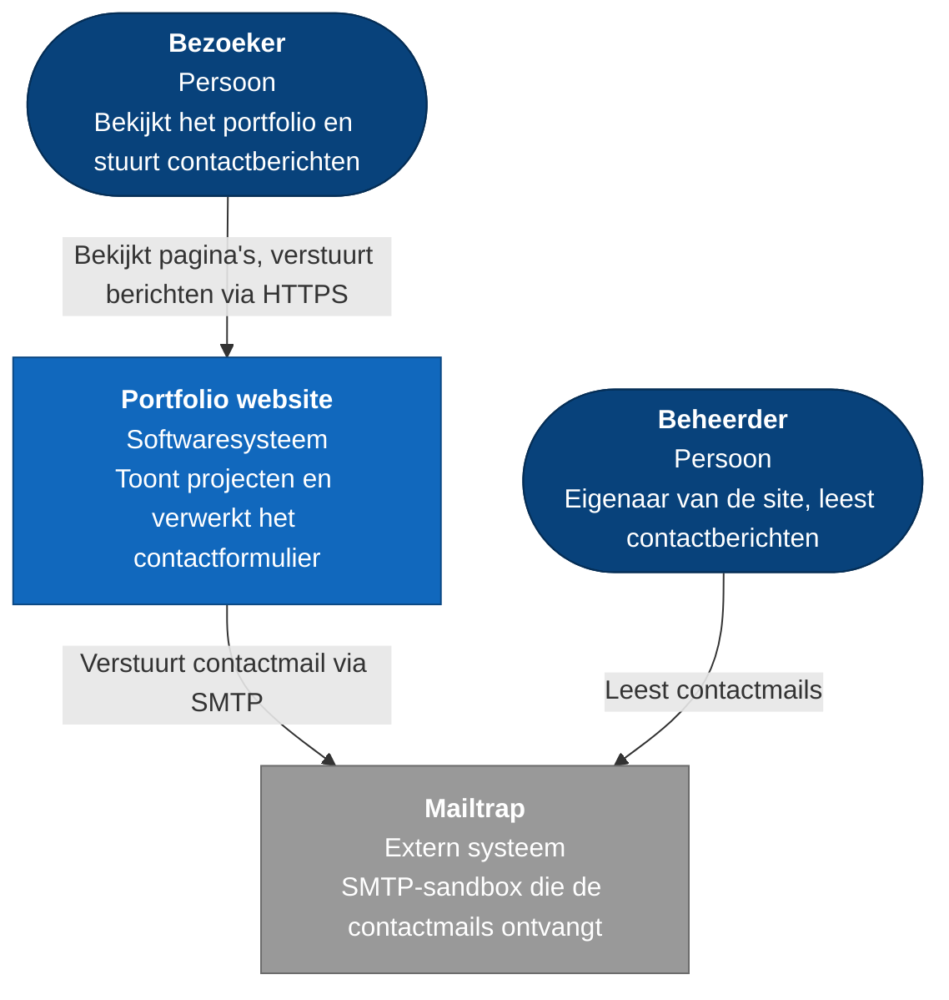
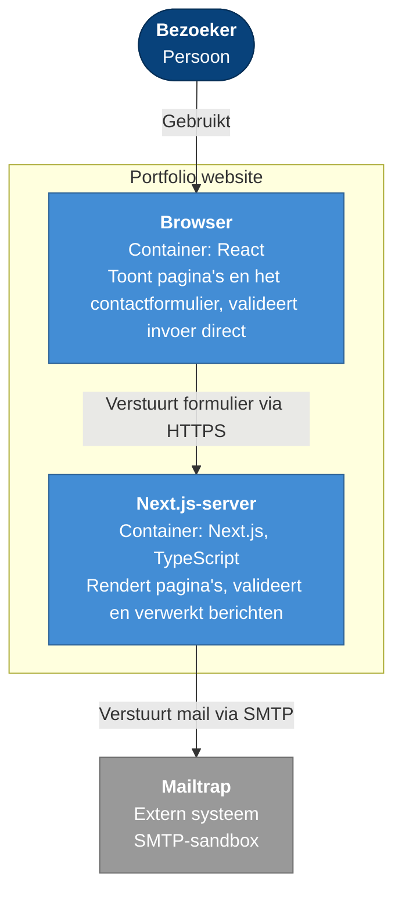
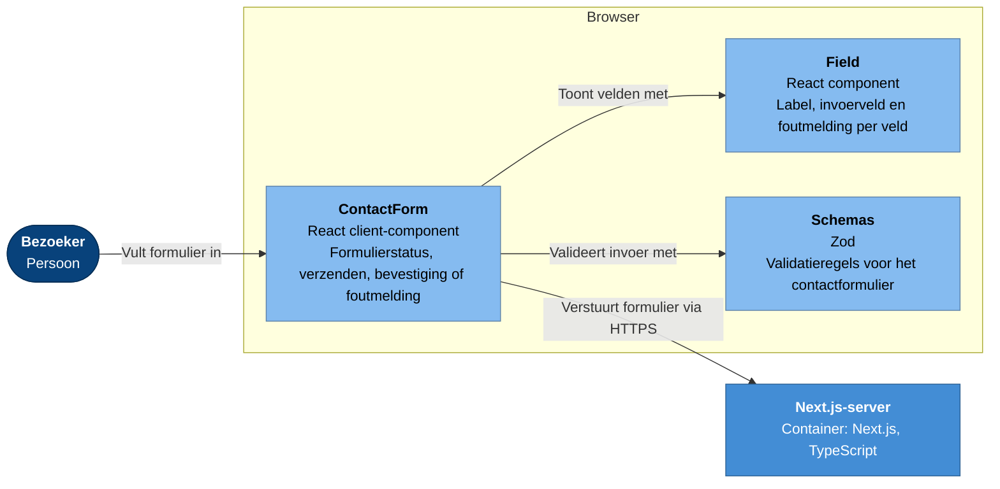
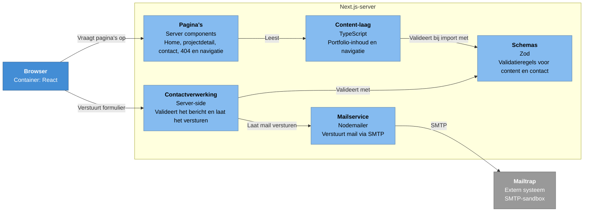

# Technisch ontwerp

**Modules:** Client- en Server Technology, Security for Web Applications
**Auteur:** Sebastiaan Kolmschate

## Inleiding

Dit project is de website van Sebastiaan Kolmschate, gebouwd voor het semester Web Development van de opleiding HBO-ICT aan Hogeschool Windesheim. De website bevat een portfolio en een contactpagina, waarmee bezoekers kunnen zien wie Sebastiaan is en wat hij doet, en met hem in contact kunnen komen.

Dit technisch ontwerp beschrijft de applicatie gelaagd volgens het C4-model, tot en met niveau drie. De codelaag (niveau vier) staat in de codebase zelf en moet voor zichzelf spreken; alleen waar extra uitleg nodig is, wordt die op dat niveau toegevoegd. De diagrammen zijn als flowchart getekend in C4-notatie, zodat ze in elke markdown-viewer renderen.

## 1. Setup

### 1.1 Repositories

Alle code en documentatie staan in één repository: `github.com/sebastiaankolmschateq42/portfolio`.

### 1.2 Project draaien

Hoe het project lokaal draait (vereisten, `make setup` en de overige commando's) staat in de README van de repository. Die staat naast de code en verandert mee, zodat dit document niet verouderd raakt bij elke wijziging in de setup.

## 2. Technieken

### 2.1 Tools

- **Bun**: package manager en scriptrunner.
- **Make**: vaste commando's voor installeren, ontwikkelen, testen en controleren; dezelfde commando's draaien in CI.
- **ESLint en Prettier**: codekwaliteit en consistente opmaak.
- **Vitest**: unit- en integratietests.
- **GitHub Actions**: CI bij elke push en pull request.
- **Mailtrap**: SMTP-sandbox voor het testen van verzonden mail.

### 2.2 Programmeertalen

- **TypeScript** voor alle code, zowel in de browser als op de server.
- **CSS** via Tailwind, met basisstijlen voor formulierelementen in `globals.css`.

### 2.3 Frameworks en libraries

| Keuze                   | Rol                            | Motivatie                                                                 |
| ----------------------- | ------------------------------ | ------------------------------------------------------------------------- |
| Next.js (App Router)    | Rendering, routing, API-routes | Front- en backend in één type-veilige codebase en één deploy              |
| TypeScript              | Taal                           | Fouten bij compileren in plaats van bij de bezoeker                       |
| Bun                     | Package manager en scripts     | Waarom geen npm? Is sneller dan npm.                                      |
| Tailwind CSS            | Styling                        | Snel itereren; basiselementen globaal, afwijkingen per plek               |
| Zod                     | Validatie                      | Eén schema als bron van waarheid, herbruikbaar in browser én op de server |
| React Hook Form         | Formulieren                    | Formulierstatus en veldfouten zonder eigen state-beheer                   |
| Nodemailer              | Mailverzending                 | Standaard SMTP-client; provider wisselen is alleen configuratie           |
| Vitest                  | Tests                          | Snel, TypeScript zonder extra configuratie, mocking van externe diensten  |
| EB Garamond (next/font) | Typografie                     | Bij build selfhosted: geen extern request, geen layout shift              |
| Vercel                  | Deployment                     | Sluit direct aan op Next.js; preview per branch                           |

Content en teksten van de website staan in TypeScript-bestanden en worden bij import met Zod gevalideerd. Daardoor kan een fout in de content (bijvoorbeeld een verkeerd datumformaat) de build laten falen in plaats van een kapotte pagina bij de bezoeker op te leveren. Dit is tijdens het bouwen daadwerkelijk één keer gebeurd.

### 2.4 Standaarden

- **C4-model** voor de architectuurbeschrijving in dit document.
- **OWASP ASVS** als kader voor de beveiligingsmaatregelen (zie het security-rapport).
- **Conventional Commits** voor commitberichten (`feat:`, `fix:`, `docs:` en dergelijke).
- **Toegankelijkheid**: semantische HTML, labels gekoppeld aan invoervelden, foutmeldingen gekoppeld aan het veld waar ze bij horen en een zichtbare focusstijl.

## 3. Definition of Done

Een feature is af wanneer:

- de acceptatiecriteria uit het functioneel ontwerp aantoonbaar gehaald zijn;
- lint, opmaakcontrole en tests slagen, lokaal én in CI;
- de bijbehorende documentatie is bijgewerkt;
- de feature via een pull request naar `main` is gemerged.

## 4. Systeemcontext

De contextlaag beschrijft de applicatie op het hoogste niveau: welke personen en externe systemen zijn erbij betrokken, en hoe verhouden die zich tot elkaar.

- De bezoeker gebruikt de website om het portfolio te bekijken en berichten te sturen.
- De website gebruikt Mailtrap als externe dienst om mails te versturen.
- De beheerder gebruikt Mailtrap om binnengekomen mails te lezen.

Mailtrap is de enige externe afhankelijkheid. Het is een sandbox: mails komen nooit bij een echte ontvanger aan, maar in een testinbox. Zo kan het formulier veilig getest en gedemonstreerd worden zonder eigen maildomein.

## 5. Containers

### 5.1 Applicaties

De website is één deploybare eenheid: een Next.js-applicatie die zowel de pagina's rendert als de server-logica uitvoert. Er is bewust geen losse backend-service; voor deze schaal zou dat alleen een extra netwerkgrens en extra beheer opleveren.

Binnen die eenheid zijn er twee uitvoeringsomgevingen, en die worden hier als containers beschreven:

- **Browser**: de React-kant die bij de bezoeker draait. Statische pagina's worden als HTML uitgeleverd; alleen interactieve onderdelen, zoals het contactformulier, draaien als client-component in de browser.
- **Next.js-server**: rendert pagina's, bouwt bij het bouwen de statische pagina's, verwerkt het contactformulier en praat met Mailtrap.

### 5.2 Configuratie en secrets

De applicatie heeft toegang nodig tot het Mailtrap-account (SMTP-host, poort, gebruikersnaam, wachtwoord) en kent het mailadres van de beheerder. Deze gegevens staan niet in de code:

- Alle configuratie komt uit omgevingsvariabelen (`SMTP_HOST`, `SMTP_PORT`, `SMTP_USER`, `SMTP_PASS`, `CONTACT_INBOX`).
- Lokaal staan ze in `.env.local`, dat buiten git valt. `.env.example` bevat alleen de namen, zodat zichtbaar is welke variabelen nodig zijn.
- Zonder SMTP-configuratie valt de mailservice terug op loggen naar de console. Zo kan er lokaal en in CI gewerkt worden zonder credentials.
- In productie worden dezelfde variabelen in de hostingomgeving gezet; de code verandert niet per omgeving.

### 5.3 Threat modelling op containerniveau

> Nog uit te werken: per container en per verbinding tussen containers de dreigingen benoemen (bijvoorbeeld met STRIDE) en aangeven welke maatregel ze afvangt. Zie de bijlage "Aanpak Technisch Ontwerp" in de schooltemplate.

## 6. Componenten

Per container worden hieronder de componenten beschreven. Code die in beide containers draait (de validatieschema's) wordt bij het bouwen in allebei meegenomen en staat daarom in beide diagrammen.

### 6.1 Browser

- **ContactForm**: het enige client-component. React Hook Form beheert de status, Zod valideert direct bij invoer en toont fouten per veld. De native browservalidatie staat uit (`noValidate`), zodat alle meldingen uit dezelfde bron komen als op de server. Bij succes toont het formulier een bevestiging; bij een fout blijft de invoer staan zodat de bezoeker opnieuw kan proberen.
- **Field**: koppelt label, invoerveld en foutmelding aan elkaar, zodat een screenreader de foutmelding bij het juiste veld voorleest.
- **Schemas**: dezelfde regels als op de server. Ze zorgen in de browser alleen voor directe feedback; de server controleert opnieuw.
- De portfolio-pagina's bevatten geen client-code: ze komen als statische HTML binnen.

### 6.2 Next.js-server

- **Pagina's**: server-components voor home, projectdetail, contact, de 404-pagina en de navigatiebalk. De homepagina en alle projectdetailpagina's worden bij het bouwen statisch gegenereerd.
- **Content-laag**: de portfolio-inhoud en navigatie staan in TypeScript-bestanden en worden bij import met hun schema gecontroleerd. Ongeldige content breekt de build in plaats van de pagina bij de bezoeker.
- **Contactverwerking**: ontvangt het formulier, valideert het opnieuw met het contactschema en laat bij succes een mail versturen. De bestemming is het vaste mailadres van de beheerder; het adres van de bezoeker gaat alleen mee als reply-to. Zo kan het formulier niet gebruikt worden om mail naar willekeurige adressen te sturen.
- **Schemas**: de validatieregels voor content en contact.
- **Mailservice**: dunne laag om Nodemailer heen. Zonder SMTP-configuratie logt hij de mail naar de console; bij een verzendfout geeft hij `false` terug zodat de contactverwerking een nette foutmelding kan geven.

### 6.3 Herleidbaarheid naar het functioneel ontwerp

| Component         | Realiseert                                    |
| ----------------- | --------------------------------------------- |
| Pagina's          | FR-PORT-01, FR-PORT-02, FR-PORT-04, FR-CON-01 |
| Content-laag      | FR-PORT-01, FR-PORT-02, NFR-PERF-01           |
| ContactForm       | FR-CON-01, FR-CON-02, FR-CON-03, FR-CON-04    |
| Field             | FR-CON-03                                     |
| Schemas           | FR-CON-03, NFR-VAL-02                         |
| Contactverwerking | FR-CON-04, FR-CON-05, NFR-VAL-02              |
| Mailservice       | FR-CON-05                                     |

### 6.4 API-endpoints

| Methode | Endpoint       | Beschrijving                                       | Authenticatie | Statuscodes                                                 |
| ------- | -------------- | -------------------------------------------------- | ------------- | ----------------------------------------------------------- |
| POST    | `/api/contact` | Valideert een contactbericht en mailt de beheerder | Nee           | 201 verstuurd · 400 ongeldige JSON of velden · 500 mailfout |

### 6.5 Ontwerpkeuzes

- **API-route in plaats van server action.** Een route is adresseerbaar en zonder client te testen (bijvoorbeeld met curl). Dat maakt de servervalidatie aantoonbaar en houdt één patroon aan voor alle endpoints die nog volgen.
- **Validatie in twee lagen met één schema.** De browser valideert voor directe feedback; de server valideert opnieuw omdat de browser te omzeilen is. Omdat beide hetzelfde schema gebruiken, zijn de regels en meldingen identiek.
- **Geen request-timeout op het formulier.** Bij een hangende SMTP-verbinding kan de bezoeker langer op "Sending…" blijven staan. Voor deze schaal een geaccepteerd risico; benoemd zodat het bewust is.

## 7. Testen

**Unit- en integratietests (Vitest).** Acht tests in twee lagen:

- De mailservice wordt getest met een gemockte Nodemailer-transporter: verzenden met configuratie, terugvallen op de console zonder configuratie, en een verzendfout die `false` oplevert.
- De contact-route wordt getest met een gemockte mailservice: kapotte JSON geeft 400, ongeldige velden geven 400 met veldfouten zonder dat er gemaild wordt, een mailfout geeft 500, en een geldige inzending geeft 201 waarbij de mail naar het vaste beheerdersadres gaat met het bezoekersadres als reply-to.
- De content wordt getest op geldigheid tegen het schema.

Mocking is hier nodig omdat de tests anders een echte SMTP-verbinding zouden opzetten: traag, afhankelijk van netwerk en credentials, en niet te sturen. Met mocks zijn de tests snel en voorspelbaar, draaien ze in CI zonder secrets, en kunnen foutpaden (SMTP onbereikbaar) expres worden afgedwongen.

**Statische controle.** ESLint voor codekwaliteit en Prettier voor consistente opmaak. Beide zijn onderdeel van de CI en moeten slagen voor een merge.

**End-to-end tests.** Gepland: Cypress-tests op de formulieren en navigatie (zie planning).

## 8. Security-maatregelen

De maatregelen staan per ASVS-hoofdstuk uitgewerkt in het security-rapport. Samengevat zijn in de huidige versie genomen:

- invoer wordt in de browser én op de server gevalideerd met hetzelfde schema;
- het contactformulier mailt altijd naar het vaste adres van de beheerder, nooit naar een adres van de bezoeker;
- credentials staan in omgevingsvariabelen en niet in de repository;
- content wordt bij het bouwen gevalideerd, zodat fouten de bezoeker niet bereiken;
- externe links openen met `rel="noopener noreferrer"`.

## 9. Deployment

### 9.1 CI/CD

- GitHub Actions draait bij elke push naar `main`/`develop` en bij elke pull request: installatie met vastgezette lockfile, lint, opmaakcontrole en tests. Dezelfde `make`-targets als lokaal, zodat wat lokaal slaagt ook in CI slaagt.
- Branchstrategie: feature-branch → pull request naar `develop` (mergen alleen bij groene CI) → `develop` naar `main` via pull request bij mijlpalen.

### 9.2 Overzicht deployment

De applicatie draait nu alleen lokaal. Deployment naar Vercel volgt zodra de gastenboek- en beheerfunctionaliteit af is. Omgevingsvariabelen (zie 2.2) worden dan per omgeving in Vercel gezet; de code blijft gelijk. De uitwerking van de omgevingen (lokaal, CI, preview, productie) en de beveiliging van de productieconfiguratie wordt in een latere iteratie toegevoegd.
